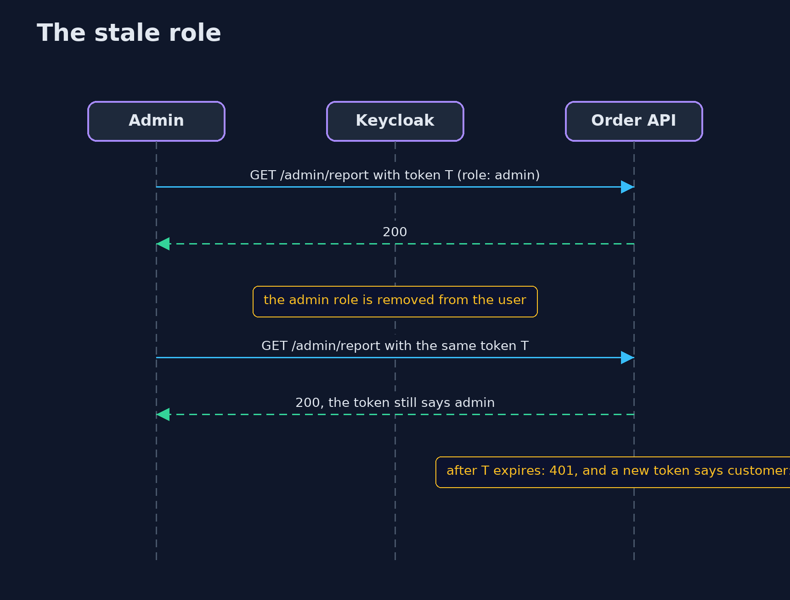
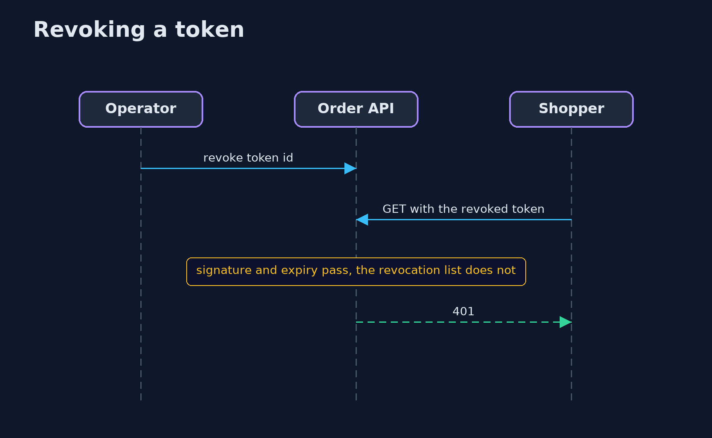

# Authentication vs Authorization with Keycloak — UML Sequence Diagrams

## 1. The stale role

A role removed in the login server does not reach a token that was already issued.

## 2. Revoking a token

A revocation list ends a token at once and costs a lookup per request.

