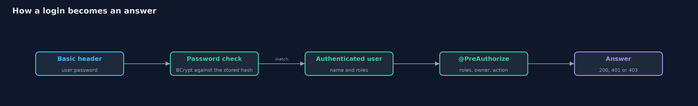
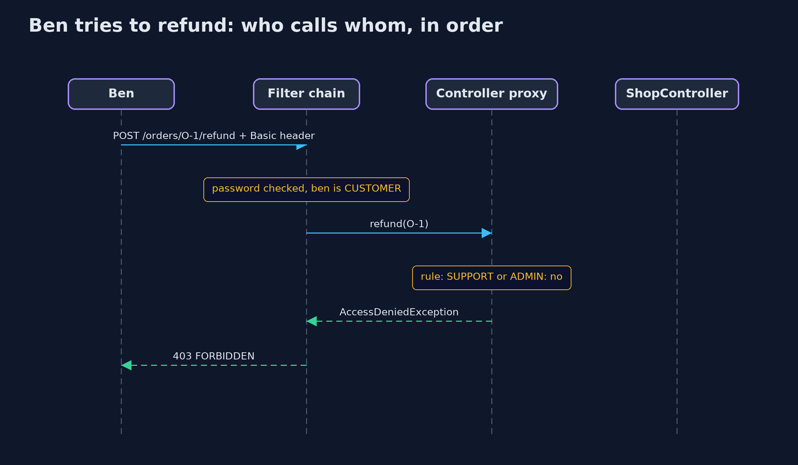

# Authentication vs Authorization with Spring Security

```
src/main/java/com/jk/explore/security/authspring/
├── CommonConfig.java             What every version of the shop shares: the controller, the ownership rules and the four accounts
├── CountingPasswordEncoder.java  BCrypt, which is slow on purpose, with a counter of how many passwords were checked
├── LayeredConfig.java            Version three with a second layer: a rule on the address itself, so an endpoint that forgot its annotation is still guarded
├── LoginOnlyConfig.java          Version two: authentication only
├── OpenConfig.java               Version one: Spring Security is present, but every request is permitted
├── OrderRules.java               Who owns each order
├── PolicyConfig.java             Version three: authentication, then authorization
├── Shop.java                     One running copy of the shop: a Spring application context holding Spring Security's filter chain, driven by MockMvc, so requests go through the real chain without opening a network port
├── ShopController.java           The store's order endpoints
└── SpringAuthDemo.java           Runs the online store story in five numbered acts, with Spring Security, and prints exact, repeatable results
```

**Spring Security answers who is asking with a login filter and a password encoder, and what they may do with rules on the endpoints, and a forgotten rule is still an open door.**

This project teaches the same two questions as the plain version, **authentication**
(who are you?) and **authorization** (what may you do?), but with a framework
doing the work. Spring Security puts a chain of filters in front of the
application. One filter reads the username and password. A password encoder
checks them against a stored BCrypt hash. If nobody is known, the chain answers
401. Rules written on the endpoints, such as `@PreAuthorize`, decide what a known
person may do, and a refusal is a 403.

The demo runs the real filter chain through Spring's `MockMvc`, so there is no web
server and no network port. The online store, its four people and the five acts
are the same as in the plain project, so the two can be compared side by side.

## The idea in everyday terms

Think of a hotel again, now with a security desk at the door. The desk checks
every guest's passport (the authentication filter), and a key-card system holds
the rules for who may open which door (the authorization rules). You still run
the hotel. The framework simply makes sure nobody walks past the desk, and that
every door asks the key-card system.

## The scenario

The online store has customers Ana and Ben, support staff Sam and an admin Alex.
Version one has Spring Security installed but permits everything. Version two
requires a login and nothing else, so a signed-in customer can still refund any
order. Version three adds `@PreAuthorize` rules to the endpoints. A last act shows
two costs: an endpoint whose rule was forgotten is open to every signed-in user,
and HTTP Basic checks the password on every single request.

## Run

```bash
./gradlew run
```

The demo tells the story in 5 acts, each printing exact numbers that the tests check:

| Act | What it shows |
| --- | --- |
| 1. Spring Security present, but every request permitted | With the filter chain set to permit everything, anyone can refund and view any order. |
| 2. Authentication: HTTP Basic, passwords stored as BCrypt | No credentials or a wrong password get a 401; the right password gets 200; stored passwords start with the BCrypt marker. |
| 3. Authenticated is not the same as authorized | With the login rule and nothing else, a customer can refund orders and read other people's orders. |
| 4. Authorization: @PreAuthorize rules on the endpoints | Rules on the methods decide: no credentials get 401, a customer who may not gets 403, support and admins get what their role allows. |
| 5. The bill: a forgotten rule, and a password check on every request | An endpoint without its annotation is open to every signed-in user; a rule on the address closes it; HTTP Basic checks the password on all 3 requests. |

## Test

```bash
./gradlew test
```

13 tests in `BillTest`, `DemoRunsTest`, `FilterChainTest`. Every line the demo prints is checked against `docs/expected-output.txt`, the filter chain runs in the same JVM with no network, and BCrypt hashes are only compared, never printed in full, so every run gives the same result.

## What the simulation got right, and what it left out

The demo does not start a web server. `MockMvc` sends requests straight through the filter chain and the
dispatcher, so the results are the ones a real server would give, and the run is fast and repeatable. HTTP Basic
without a session is used because it keeps each request self-contained; real browsers more often use a login form and a
session cookie. CSRF protection is switched off in the demo's configuration to keep the code short, and must stay on for any
application that uses cookies. The BCrypt cost is 4, the lowest allowed, for speed; real systems use 10 or more.

## Technologies and versions

Every version below is pinned in the project's build files and was the latest stable release when the project was built.

| Technology | Version | Used for |
| --- | --- | --- |
| Java | 25 | the language and runtime; a Gradle toolchain finds or downloads the JDK |
| Gradle | 9.8.1 (wrapper) | build and run; nothing to install, the wrapper downloads it |
| org.springframework:spring-webmvc | 7.0.9, set by spring-framework-bom | Spring MVC: maps web addresses to controller methods |
| org.springframework:spring-test | 7.0.9, set by spring-framework-bom | MockMvc, which sends requests through the real filter chain without a network port |
| org.springframework.security:spring-security-web | 7.1.1, set by spring-security-bom | Spring Security's filter chain |
| org.springframework.security:spring-security-config | 7.1.1, set by spring-security-bom | Spring Security's configuration, `@EnableMethodSecurity` and `HttpSecurity` |
| jakarta.servlet:jakarta.servlet-api | 6.1.0 | the servlet API that Spring MVC and Spring Security are written against |
| org.junit.jupiter:junit-jupiter | 6.1.3, set by junit-bom | JUnit 5: the tests (tests only) |
| org.junit.platform:junit-platform-launcher | 6.1.3, set by junit-bom | JUnit platform launcher, which Gradle needs to run the tests (tests only) |
| videokit | repository tool (`tools/videokit`) | the narrated video and animation: Piper `en_US-amy-medium`, speed 0.8, longer pauses (the amy-slow voice) |

## Learning Material

| Document | What it is for |
| --- | --- |
| [Dependencies](docs/dependencies.md) | what the framework and infrastructure are, and why they are here |
| [Problem statement](docs/problem-statement.md) | the situation and what the project must show |
| [Prerequisites](docs/prerequisites.md) | what you need to know first |
| [Authentication vs Authorization with Spring Security, explained](docs/authentication-vs-authorization-with-spring-security-explained.md) | the acts in prose |
| [Session guide](docs/session.md) | a one-hour lesson with exercises |
| [Animated walkthrough](docs/animation.html) | the acts step by step, narrated |
| [Threat model](docs/threat-model.md) | what is protected, who could harm it, and how, using STRIDE |
| [Spec](docs/spec.md) | what this project must be true of |
| [Expected output](docs/expected-output.txt) | the golden demo output every test and every port checks against |

### The idea in one picture

A request meets the filter chain first (login, then the address rules), then the dispatcher, then the method's own rule, and only then the controller code runs.


### Where each piece sits

Four configurations share one CommonConfig and one controller; only the rules differ.


### How the data moves

The header becomes a user, the user's authorities meet the rule, and the rule gives the answer.



### Who calls whom, in order




### Video

`video/authentication-vs-authorization-with-spring-security-explained.mp4` (with `.m4a` audio and `.srt` subtitles) is built by `video/build_video.sh`. Rendered media is not committed.

## What it costs

- **A forgotten rule is an open endpoint.** `@PreAuthorize` protects only the methods that carry it. A rule on the address as a second layer catches the ones that forget.
- **HTTP Basic checks the password on every request.** BCrypt is slow on purpose, so every call pays for it. Sessions or tokens avoid this, at the cost of managing them.
- **Framework configuration is code to review.** The chain, the matchers and the order of the rules are as important as the rules themselves, and a mistake there is silent.
- **A dependency to keep up to date.** Security fixes arrive through new Spring Security versions, and falling behind is a risk of its own.

## When this is too much

For a tiny internal tool with a single shared password, the framework is more than the problem needs.
For anything with accounts and different rights, a framework's tested filters and password handling
are better than writing your own, which is why the plain project exists to teach the ideas and this one
to show how they are normally applied.

## Where you have already met this

- The `@PreAuthorize`, `@Secured` and `hasRole(...)` annotations in almost every Spring application.
- A `SecurityFilterChain` bean, and the `authorizeHttpRequests` block inside it.
- The `{bcrypt}` prefix in stored passwords of Spring applications.
- The browser's built-in sign-in box, which is HTTP Basic.

## Where this sits

This project is the second one in [identity](..), the framework version of [authentication-vs-authorization](../authentication-vs-authorization).
