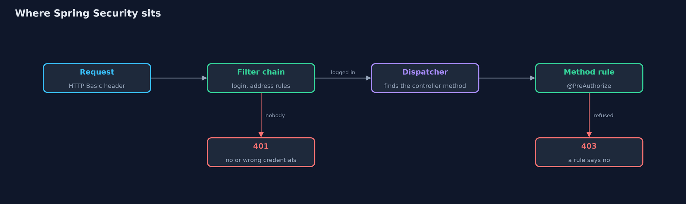

# Authentication vs Authorization with Spring Security — Architecture Diagram

A request meets the filter chain first (login, then the address rules), then the dispatcher, then the method's own rule, and only then the controller code runs.

