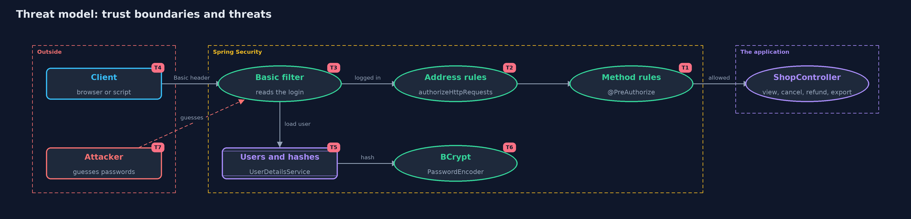

# Threat Model — Authentication vs Authorization with Spring Security

A threat model answers four questions: what are we protecting, who or what could harm it, how, and what do we do about it. This one covers this project's own demo system, not a production deployment. Domain: an online store.

## Scope

The same store as the plain project, built with Spring Security: the filter chain, HTTP Basic login, BCrypt password
storage, `@PreAuthorize` rules and a rule on the address. It covers how a configuration can leave a door open and what
the framework does and does not do for you. It runs through MockMvc, so network and server concerns are out of scope.

## What we protect (assets)

- Customers' orders, and the right to view or cancel only your own.
- The refund and export actions.
- Stored password hashes.
- The security configuration itself, which decides which requests are checked.

## Who and what acts on the system

- Customers Ana and Ben, support Sam, admin Alex.
- An anonymous visitor.
- A developer who adds an endpoint and forgets its rule.
- An attacker guessing passwords against the login.

## Trust boundaries

A trust boundary is a line that data or a request crosses between parts that trust each other differently. Threats cluster where those lines are.

- Request to filter chain: where credentials are checked and 401 is decided.
- Filter chain to controller: where the address rules sit.
- Controller proxy to method: where `@PreAuthorize` is checked and 403 is decided.
- Password to stored hash: BCrypt.

Each dashed box is a trust boundary. A rose tag such as T1 shows where the threat of that number, in the table below, applies.

## Threats, using STRIDE

STRIDE is a checklist of six kinds of threat: **Spoofing** (S), **Tampering** (T), **Repudiation** (R), **Information disclosure** (I), **Denial of service** (D), **Elevation of privilege** (E).

| Id | Kind | Threat | Where it shows up | Control in this project | What is left |
| --- | --- | --- | --- | --- | --- |
| T1 | Elevation of privilege | A logged-in customer reaches refund, cancel or other people's orders | `LoginOnlyConfig` compared with `PolicyConfig` | `@PreAuthorize` rules on roles and ownership, checked before the method runs | Rules are code and can be wrong; the filter test covers each person on each endpoint |
| T2 | Elevation of privilege | A new endpoint ships without its rule | `ShopController.export` | A second rule on the address, `GET /orders/export` for ADMIN, in `LayeredConfig` | The address rule must be kept in step with new endpoints; a deny-by-default rule at the end is stronger |
| T3 | Spoofing | Someone guesses a password or sends no credentials | the Basic filter, `CountingPasswordEncoder` | Passwords are checked against BCrypt hashes; no or wrong credentials give 401 | There is no limit on attempts here; rate limiting is a later project |
| T4 | Information disclosure | The password is read in transit, because Basic sends it on every request | the Authorization header | None in the demo (MockMvc, no network) | A real deployment must use HTTPS, or prefer sessions or tokens |
| T5 | Information disclosure | Password hashes are stolen and attacked offline | `CommonConfig.users` | BCrypt, a slow hash with a built-in salt | The demo's cost is 4 for speed; a real system uses 10 or more and a strong password policy |
| T6 | Denial of service | Slow password checks are used to load the server | BCrypt on every request | None here; the cost is shown by counting checks | Rate limits and sessions reduce the number of checks |
| T7 | Tampering | A forged cross-site request changes an order | `csrf(c -> c.disable())` in the configs | None in the demo, because it uses no cookies | CSRF protection must be switched on for cookie-based sessions |

## Assumptions

- The channel is protected with HTTPS in real use: HTTP Basic sends the password in every request, readable by anyone who can see the traffic. The transport-security module covers this.
- CSRF protection is switched off in the demo's configuration. It must stay on for any application that uses cookie-based sessions.
- The demo accounts and passwords are test values from the project's own code.

## Out of scope

- Brute-force protection on the login: the password-attacks-and-defences project covers rate limits.
- Sessions, remember-me and token formats.
- A real user database and password reset flows.

## How the tests check this

- `FilterChainTest` checks 401, 403 and 200 for each of the four people on each configuration.
- `BillTest` shows the forgotten rule is open, the second layer closes it, and Basic pays one password check per request.
- `DemoRunsTest` compares the whole demo with the golden output.

## Where this model goes next

The passwords-and-mfa module takes the password check apart: how BCrypt and its cost work, how attackers try to beat it, and how a second factor helps.
