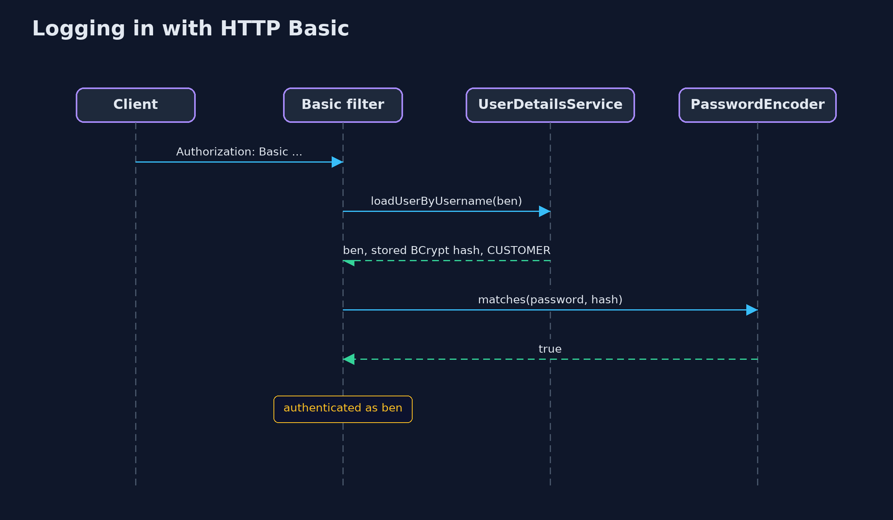
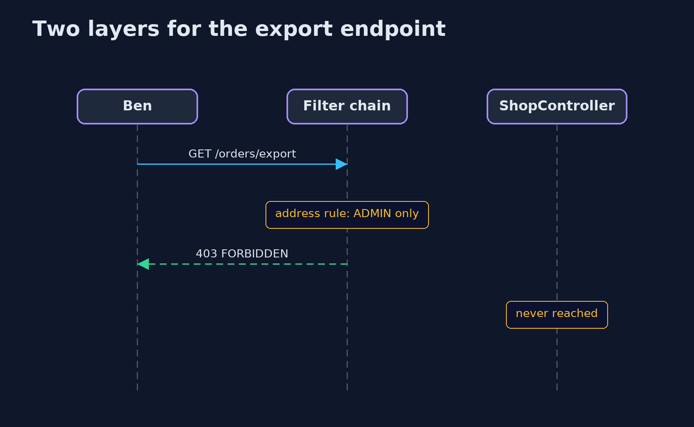

# Authentication vs Authorization with Spring Security — UML Sequence Diagrams

## 1. Logging in with HTTP Basic

The password encoder compares the supplied password with the stored hash on every request.

## 2. Two layers for the export endpoint

The method has no rule, so the rule on the address is the only thing between Ben and every order.

