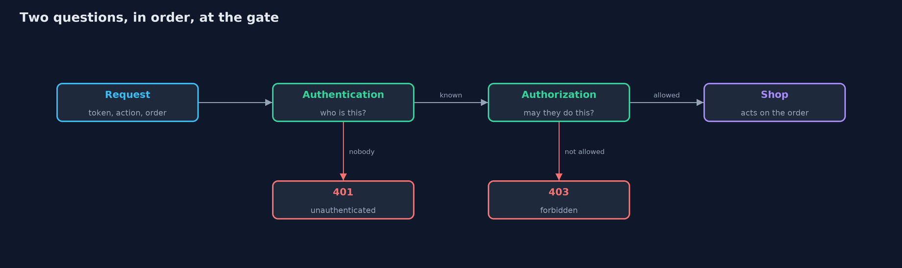
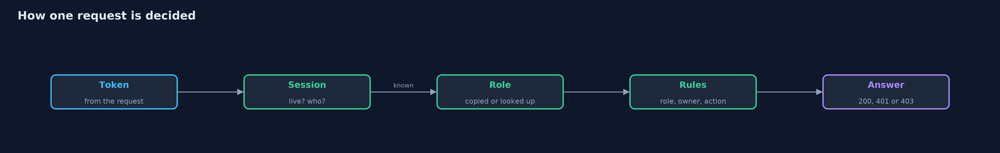
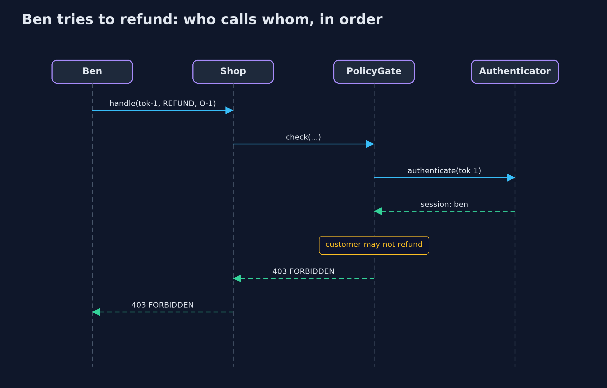

# Authentication vs Authorization

```
src/main/java/com/jk/explore/security/auth/
├── Account.java        A person who can sign in: a username and the role they were given
├── Action.java         The things a request can ask to do to an order
├── AuthDemo.java       Runs the online store story in five numbered acts and prints exact, repeatable results
├── Authenticator.java  Authentication: finding out who is asking
├── Credentials.java    Checks a username and password
├── Gate.java           The check in front of every request: decides whether this token may do this action to this order
├── LoginOnlyGate.java  Authentication only: anyone with a live session is let in, whatever they ask for
├── NoGate.java         No checks at all: nobody is asked who they are, and everything is allowed
├── Order.java          One order in the store: who owns it, what it is, and what was paid
├── PolicyGate.java     Authentication, then authorization
├── Response.java       What the shop sends back: a status and a short note on why
├── Role.java           The job an account does in the store, which decides what it may do
├── Session.java        Proof of a successful sign-in: a token, who it belongs to, the role they had then, and when it was issued
├── Shop.java           The store's order endpoints
├── Status.java         The answer to a request
├── Ticker.java         A clock made of ticks, so sessions can expire without waiting for real time and every run is identical
└── UserDirectory.java  Where the current role of every account is kept, and how many times it has been looked up
```

**Authentication finds out who is asking; authorization decides what that person may do; and a shop that checks only the first lets every customer act as an administrator.**

Two questions sound alike and are different. **Authentication** asks: who are you?
It is proved with something only that person should have, such as a password.
**Authorization** asks: what may you do? It is decided by rules about roles and
ownership. A system that answers only the first question lets every signed-in
user do everything. The two have their own answers too: 401 means "I do not know
who you are", and 403 means "I know who you are, and you may not do this".

This project builds the online store's order endpoints three times. The first has
no checks. The second checks who is asking and nothing else. The third checks who
is asking and what that person may do.

## The idea in everyday terms

Think of a hotel. At the front desk, the clerk checks your passport and gives you
a key card: that is authentication. The key card then opens your room, the gym
and the lift, but not the other guests' rooms and not the staff office: that is
authorization. A hotel that gave every card access to every door would have
checked your passport for nothing.

## The scenario

An online store has three kinds of people. Customers, Ana and Ben, may view and
cancel their own orders. Support staff, Sam, may view any order and issue
refunds. An admin, Alex, may do everything. The store's first version asks
nobody anything. The second adds a login, and the team believes the problem is
solved. It is not, because a logged-in customer can still refund any order and
read anyone's.

## Run

```bash
./gradlew run
```

The demo tells the story in 5 acts, each printing exact numbers that the tests check:

| Act | What it shows |
| --- | --- |
| 1. The first version, with no checks | Nobody is asked who they are, so anyone can refund and view any order. |
| 2. Authentication: finding out who is asking | A wrong password is rejected, the right one gives a session token, and requests without a live token get a 401. |
| 3. Authenticated is not the same as authorized | With a login and nothing else, a customer can refund orders and read other people's orders. |
| 4. Authorization: what may this person do? | Roles and ownership decide: no token gets 401, a customer who may not gets 403, support and admins get what their role allows. |
| 5. The bill: sessions expire, and roles go stale | A session dies after 3 ticks; a role copied at login survives a demotion, and looking it up every time costs one lookup per request. |

## Test

```bash
./gradlew test
```

21 tests in `AuthenticatorTest`, `CredentialsTest`, `DemoRunsTest`, `GateTest`, `PolicyTest`, `StaleRoleTest`. Every line the demo prints is checked against `docs/expected-output.txt`, and sessions use a simulated clock, so every run gives the same result.

## What the simulation got right, and what it left out

Tokens here are numbered (`tok-1`, `tok-2`) so that the demo prints the same text every run;
real session tokens must be long and random, or they can be guessed. Time is simulated in
ticks. Passwords are stored as slow, salted hashes with a salt derived from the username so
the demo is repeatable; a real system uses a random salt for every account. Hashing and tokens
have their own projects later in the track.

## Technologies and versions

Every version below is pinned in the project's build files and was the latest stable release when the project was built.

| Technology | Version | Used for |
| --- | --- | --- |
| Java | 25 | the language and runtime; a Gradle toolchain finds or downloads the JDK |
| Gradle | 9.8.1 (wrapper) | build and run; nothing to install, the wrapper downloads it |
| org.junit.jupiter:junit-jupiter | 6.1.3, set by junit-bom | JUnit 5: the tests (tests only) |
| org.junit.jupiter:junit-jupiter-params | 6.1.3, set by junit-bom | JUnit 5: parameterized tests (tests only) |
| org.junit.platform:junit-platform-launcher | 6.1.3, set by junit-bom | JUnit platform launcher, which Gradle needs to run the tests (tests only) |
| videokit | repository tool (`tools/videokit`) | the narrated video and animation: Piper `en_US-amy-medium`, speed 0.8, longer pauses (the amy-slow voice) |

## Learning Material

| Document | What it is for |
| --- | --- |
| [Problem statement](docs/problem-statement.md) | the situation and what the project must show |
| [Prerequisites](docs/prerequisites.md) | what you need to know first |
| [Authentication vs Authorization, explained](docs/authentication-vs-authorization-explained.md) | the acts in prose |
| [Session guide](docs/session.md) | a one-hour lesson with exercises |
| [Animated walkthrough](docs/animation.html) | the acts step by step, narrated |
| [Threat model](docs/threat-model.md) | what is protected, who could harm it, and how, using STRIDE |
| [Spec](docs/spec.md) | what this project must be true of |
| [Expected output](docs/expected-output.txt) | the golden demo output every test and every port checks against |

### The idea in one picture

A request meets the gate: first authentication (who is this, 401 if nobody), then authorization (may this person do this, 403 if not), and only then the shop acts.



### Where each piece sits

Gate has three implementations. PolicyGate uses the Authenticator for who and the UserDirectory for the current role.


### How the data moves

The token becomes a person, the person becomes a role, and the role and the order give the answer.



### Who calls whom, in order




### Video

`video/authentication-vs-authorization-explained.mp4` (with `.m4a` audio and `.srt` subtitles) is built by `video/build_video.sh`. Rendered media is not committed.

## What it costs

- **Every request pays for the checks.** Looking up the session and applying the rules happens each time, so it must be fast and always available.
- **Sessions expire.** A short lifetime limits the damage from a stolen token, and costs real users a new login.
- **Roles can go stale.** A role copied into the session at login stays after a demotion, until the session ends. Looking it up each time is current, and costs a lookup per request.
- **The gate must be on every endpoint.** One endpoint that forgets to ask is open, however good the rules are.

## When this is too much

A site with one shared, public page needs neither. As soon as there are accounts, authentication
is needed. As soon as different accounts may do different things, or see different data,
authorization is needed too, and it should be written as rules in one place and not as scattered
checks.

## Where you have already met this

- The 401 and 403 pages a browser shows, and the difference between them.
- A login form, a "remember me" box, and a "your session has expired" message.
- A "you do not have permission to view this page" message after you have signed in.
- Role names such as viewer, editor and admin in a cloud or office tool.

## Where this sits

This project is the first one in [identity](..), the second module of the beginner track.
