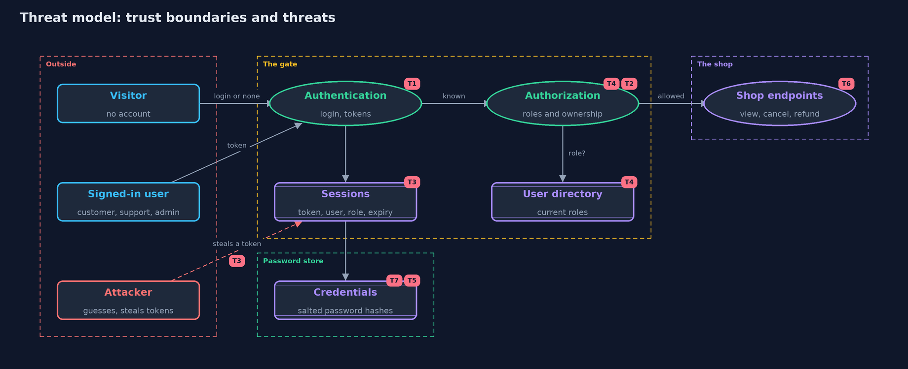

# Threat Model — Authentication vs Authorization

A threat model answers four questions: what are we protecting, who or what could harm it, how, and what do we do about it. This one covers this project's own demo system, not a production deployment. Domain: an online store.

## Scope

The store's order endpoints and the gate in front of them: the login with its session tokens, and the policy of
roles and ownership. It covers who can pretend to be whom, what a signed-in person can reach, and what the gate
costs. It does not cover how the request travels (HTTPS), how passwords are chosen, or multi-factor login.

## What we protect (assets)

- Customers' orders and the right to view or cancel only your own.
- The refund action, which moves money.
- Session tokens, which stand in for a password.
- Accounts and their roles in the user directory.
- Password hashes.

## Who and what acts on the system

- Customers (Ana and Ben): own orders.
- Support (Sam): views any order and issues refunds.
- Admin (Alex): may do everything.
- An anonymous visitor with no account.
- An attacker who steals or guesses a session token, or a customer trying to reach another customer's order.

## Trust boundaries

A trust boundary is a line that data or a request crosses between parts that trust each other differently. Threats cluster where those lines are.

- Anonymous visitor to signed-in user: the login and the 401 answer.
- Signed-in user to action: the policy and the 403 answer.
- Session to directory: where a role is copied or looked up.
- Password to stored hash: where passwords stop being readable.

Each dashed box is a trust boundary. A rose tag such as T1 shows where the threat of that number, in the table below, applies.

## Threats, using STRIDE

STRIDE is a checklist of six kinds of threat: **Spoofing** (S), **Tampering** (T), **Repudiation** (R), **Information disclosure** (I), **Denial of service** (D), **Elevation of privilege** (E).

| Id | Kind | Threat | Where it shows up | Control in this project | What is left |
| --- | --- | --- | --- | --- | --- |
| T1 | Spoofing | Someone guesses a password or uses a made-up token | `Credentials.verify`, `Authenticator.authenticate` | Passwords are checked against a slow salted hash; unknown tokens get 401 | A weak password can still be guessed; password-attacks-and-defences covers this |
| T2 | Elevation of privilege | A logged-in customer refunds orders or reads other people's orders | `LoginOnlyGate` compared with `PolicyGate` | A policy of roles and ownership answers 403 | Rules in code can be wrong; the policy table is tested for every case |
| T3 | Information disclosure | A stolen session token is used by someone else | `Authenticator` | Tokens expire after a fixed number of ticks and can be ended with logout | Within its lifetime a stolen token works; transport protection and short lifetimes limit the harm |
| T4 | Elevation of privilege | A demoted user keeps their old rights until their session ends | `PolicyGate` with `RoleSource.SESSION` | `RoleSource.DIRECTORY` looks the role up on every request | A lookup on every request costs time, and the directory must be always available |
| T5 | Information disclosure | Password hashes are read from the store | `Credentials` | Only salted PBKDF2 hashes are stored, never the passwords | Hashes can still be attacked offline; the demo's salt is derived from the username |
| T6 | Repudiation | A refund is made and nobody can say who did it | `Shop.handle` | Every request is tied to a known session before it acts | The demo does not write an audit log; the audit trail belongs to a later project |
| T7 | Denial of service | Repeated logins use up the server | `Credentials.verify` (slow on purpose) | None here | Slow hashing makes floods expensive for the server too; rate limiting is shown in cia-triad and password-attacks-and-defences |

## Assumptions

- Requests travel over a protected channel; the transport-security module covers this.
- Tokens in the demo are numbered for repeatability. Real tokens must be long and random so they cannot be guessed.
- The directory is itself protected: only an admin can change a role.

## Out of scope

- Phishing, and passwords chosen badly (the passwords-and-mfa module).
- Cookie and browser details such as SameSite, and cross-site request forgery.
- Token formats such as JWT, and single sign-on.

## How the tests check this

- `CredentialsTest` shows wrong passwords and unknown users are rejected.
- `AuthenticatorTest` shows tokens expire and can be ended early.
- `PolicyTest` checks the rules for every role, action and ownership case.
- `GateTest` shows 401 for nobody and 403 for a known person who may not.
- `StaleRoleTest` shows a demotion is missed when the role is copied, and caught when it is looked up.

## Where this model goes next

The with-spring-security project repeats this model with a framework. The passwords-and-mfa module then replaces the
weakest assumption: how passwords are stored, attacked and strengthened.
