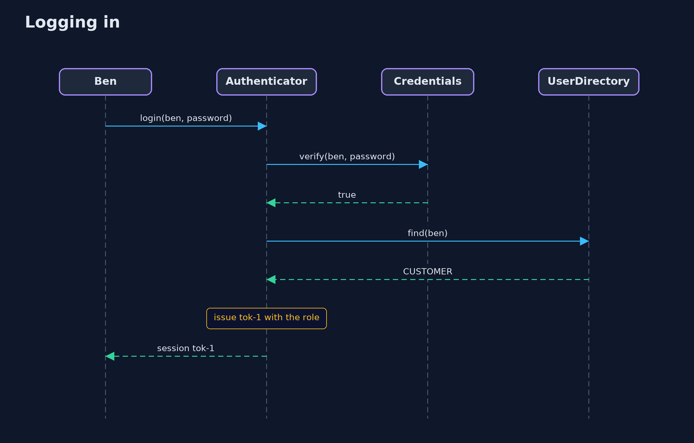
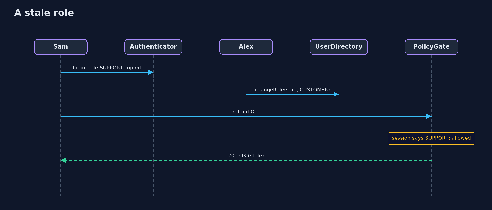

# Authentication vs Authorization — UML Sequence Diagrams

## 1. Logging in

A correct password gives a session; a wrong one gives nothing.

## 2. A stale role

Sam's role is copied into the session at login. Alex demotes Sam, and the session still says SUPPORT.

