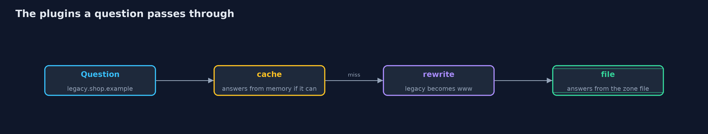

# DNS Basics with CoreDNS

```
src/main/java/com/jk/explore/security/dnscoredns/
├── Address.java              IPv4 addresses as four bytes packed into an int
├── BadMessageException.java  A DNS message that is too short, malformed, or built from a name that cannot be encoded
├── Client.java               Asks a DNS server a question over UDP (one datagram each way) or over TCP (each message starts with its length in two bytes)
├── CoreDns.java              One CoreDNS container with a given zone, started for a demo and stopped afterwards
├── CoreDnsDemo.java          Runs the online store story in five numbered acts against a real CoreDNS container and prints repeatable results
├── DnsMessage.java           A DNS message as in RFC 1035: a 12-byte header, questions, and answers
└── ShopZone.java             The text of the files CoreDNS is started with: a Corefile (its configuration) and a zone file for shop.example
```

**A real DNS server answers exactly what its zone file says, over UDP or TCP, with no signature, so whoever controls the file controls the answer, and every cache repeats it.**

The plain version of this lesson built DNS messages and a resolver in Java. Here the other side is real: **CoreDNS**, a widely used open-source DNS server, runs in a container. It is configured by a small **Corefile** and serves a **zone file**, a text file of records for
shop.example. Three of its **plugins** are used: **file** serves the zone, **rewrite** answers one name as another, and **cache** keeps answers for a while and counts their time to live down.

The Java code asks it questions over **UDP**, one datagram each way, and over **TCP**, where each message starts with its length in two bytes. It sees a name that does not exist (NXDOMAIN), a name the server will not answer (REFUSED),
and then a zone with a wrong record, which the server serves as faithfully as the right one.

## The idea in everyday terms

Think of a phone book printed from a master list. The printer prints whatever the list says, in the same ink, with no way to tell a typo from a fact. A copy shop keeps a stack of old pages for a while to save a trip,
and anyone who picks up a page believes it. What protects the shop is who may edit the master list, and a seal on each page that a reader can check.

## The scenario

An online store runs its own DNS server for shop.example. The demo starts it, asks for www, the same question over TCP, a missing name, a name outside the zone and an old name that is rewritten, watches the cache count down, and then starts a server whose zone has a wrong record.

## Run

```bash
./gradlew run
```

The demo tells the story in 5 acts, each printing exact numbers that the tests check:

| Act | What it shows |
| --- | --- |
| 1. A real DNS server, in a container | CoreDNS serves the zone file's record for www.shop.example over UDP, repeats the question's id, and is believed because the id and question match. |
| 2. The same question over UDP and over TCP | Both give the same address; over TCP each message starts with a two-byte length, so the answer is 2 bytes longer; neither signs or encrypts. |
| 3. Names that do not exist, names it will not answer, and a rewrite | A missing name gives NXDOMAIN with no answers, a name outside the zone is REFUSED, and legacy.shop.example is rewritten to www and answered under the name asked. |
| 4. The cache and the countdown of the time to live | The cache plugin cuts the zone's 300 seconds to 60, and each answer from the cache has a smaller time to live than the one before. |
| 5. A zone with a wrong record | A record changed to 192.0.2.66 with a day-long time to live is served exactly like the right one, and the cache setting cuts what it hands out to 60 seconds. |

## Test

```bash
./gradlew test
```

24 tests in `ConfigAndClientTest`, `CoreDnsContainerTest`, `DemoRunsTest`, `DnsMessageTest`. The ordinary tests need only a JDK: they check the Corefile and zone text, the pinned image, the DNS message encoding and the client against small servers written in the tests. The container tests (tagged docker) start CoreDNS and check real answers, and run with integrationTest. The demo's comparison with its golden output runs with the integration tests, because the demo needs Docker: run `./gradlew integrationTest` after changing the demo or its narration.

## What the simulation got right, and what it left out

A real CoreDNS container serves the zone on free local ports bound to loopback. The demo prints only facts that do not depend on ports, ids or the exact countdown, so it is the same on every run. Containers are always stopped and removed.

## Technologies and versions

Every version below is pinned in the project's build files and was the latest stable release when the project was built.

| Technology | Version | Used for |
| --- | --- | --- |
| Java | 25 | the language and runtime; a Gradle toolchain finds or downloads the JDK |
| Gradle | 9.8.1 (wrapper) | build and run; nothing to install, the wrapper downloads it |
| org.junit.jupiter:junit-jupiter | 6.1.3, set by junit-bom | JUnit 5: the tests (tests only) |
| org.junit.platform:junit-platform-launcher | 6.1.3, set by junit-bom | JUnit platform launcher, which Gradle needs to run the tests (tests only) |
| CoreDNS (container image) | coredns/coredns:1.14.7 | the real DNS server the Java code asks, pinned to an exact version |
| Docker | any recent Docker Engine or Docker Desktop | runs the CoreDNS containers for the demo and the container tests |
| videokit | repository tool (`tools/videokit`) | the narrated video and animation: Piper `en_US-amy-medium`, speed 0.8, longer pauses (the amy-slow voice) |

## Learning Material

| Document | What it is for |
| --- | --- |
| [Dependencies](docs/dependencies.md) | what the framework and infrastructure are, and why they are here |
| [Problem statement](docs/problem-statement.md) | the situation and what the project must show |
| [Prerequisites](docs/prerequisites.md) | what you need to know first |
| [DNS Basics with CoreDNS, explained](docs/dns-basics-with-coredns-explained.md) | the acts in prose |
| [Session guide](docs/session.md) | a one-hour lesson with exercises |
| [Animated walkthrough](docs/animation.html) | the acts step by step, narrated |
| [Threat model](docs/threat-model.md) | what is protected, who could harm it, and how, using STRIDE |
| [Spec](docs/spec.md) | what this project must be true of |
| [Expected output](docs/expected-output.txt) | the golden demo output every test and every port checks against |

### The idea in one picture

The Java client sends questions over UDP and TCP to CoreDNS, which reads a Corefile and a zone file.


### Where each piece sits

CoreDns starts the container, Client asks, ShopZone writes the files, DnsMessage is the wire format.


### How the data moves

The cache sees the question first, then rewrite, then the file.



### Who calls whom, in order


### Video

`video/dns-basics-with-coredns-explained.mp4` (with `.m4a` audio and `.srt` subtitles) is built by `video/build_video.sh`. Rendered media is not committed.

## What it costs

- **The server believes its files.** CoreDNS serves what the zone file says, so control of the file and of the process that writes it is control of the name.
- **Caches repeat a wrong answer.** Fixing the file does not recall answers that resolvers and browsers already hold, which is why important names often have short times to live.
- **Plain DNS is readable and unsigned.** UDP and TCP carry the question and answer in the clear, and neither proves who made the answer; DNSSEC and encrypted transports address that and are not run here.
- **It needs Docker.** The demo and the container tests start real containers, so a running Docker is required, though the default tests are not.

## When this is too much

Running your own authoritative DNS server is a real job, and most online stores use a provider's. Understanding what such a server does, and trusting it only as far as its zone's access controls, is the part worth learning.

## Where you have already met this

- `dig www.shop.example` and `nslookup`, which send exactly these questions.
- Kubernetes clusters, where CoreDNS is the default name service.
- Corefile and zone-file syntax, shared with many DNS servers.
- Short times to live on names that must be able to change quickly.

## Where this sits

This project follows [dns-basics](../dns-basics) and is the fourth in [networking](..). It puts a real server on the other end of the questions that project simulated.
