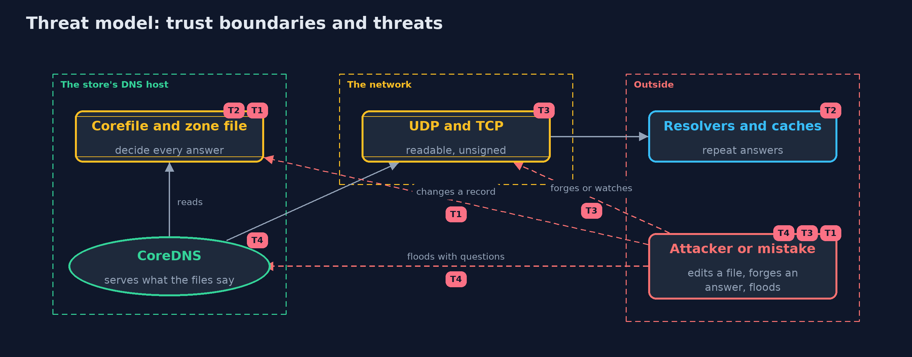

# Threat Model — DNS Basics with CoreDNS

A threat model answers four questions: what are we protecting, who or what could harm it, how, and what do we do about it. This one covers this project's own demo system, not a production deployment. Domain: an online store.

## Scope

An online store's authoritative DNS server for shop.example, run as CoreDNS: its configuration and zone files, the queries it answers over UDP and TCP, and the caches that repeat its answers. It does not cover the registrar, the recursive resolvers customers use, or DNSSEC, which is described and not run.

## What we protect (assets)

- The zone file: it decides where customers' browsers go.
- The Corefile and the server process.
- The server's availability.
- The caches that hold its answers.

## Who and what acts on the system

- The store's operators, who edit zone files.
- Resolvers and customers asking questions.
- An attacker who can send questions, watch the wire, or edit a file by mistake or by access.

## Trust boundaries

A trust boundary is a line that data or a request crosses between parts that trust each other differently. Threats cluster where those lines are.

- The zone file to the server: whoever can write the file decides every answer.
- The server to the network: questions arrive from anyone, and answers are unsigned.
- The server to resolver caches: an answer given once is repeated until its time runs out.

Each dashed box is a trust boundary. A rose tag such as T1 shows where the threat of that number, in the table below, applies.

## Threats, using STRIDE

STRIDE is a checklist of six kinds of threat: **Spoofing** (S), **Tampering** (T), **Repudiation** (R), **Information disclosure** (I), **Denial of service** (D), **Elevation of privilege** (E).

| Id | Kind | Threat | Where it shows up | Control in this project | What is left |
| --- | --- | --- | --- | --- | --- |
| T1 | Tampering | A record in the zone file is changed by mistake or by someone who should not | `ShopZone.zoneFile` | Restrict who can write the file, review changes, and keep the file in version control | The server cannot tell a right record from a wrong one, so detection depends on monitoring from outside |
| T2 | Tampering | A wrong answer lives on in resolvers' caches after the file is fixed | the `cache` plugin and customers' resolvers | A cap on cached times to live, and short times to live on important names | Resolvers that do not cap keep an answer for its whole time to live |
| T3 | Spoofing | A forged answer is accepted, or questions are watched, because plain DNS is unsigned and readable | `Client`, UDP and TCP | DNSSEC to sign the records, and encrypted transports to hide the questions (described here, not run) | Both depend on the resolver and the client supporting them |
| T4 | Denial of service | The server is flooded with questions, or used to amplify an attack on someone else | `CoreDns` | Bind to the interfaces needed, rate-limit, and answer only for the store's own zone (a name outside it is REFUSED) | A flood larger than the link still takes the service down |

## Assumptions

- In the demo the server is bound to loopback only and run for seconds.
- A production server would run with limits on who can send queries and on how fast.
- The image is pinned to an exact version and updated when the project updates.

## Out of scope

- Registrar and delegation security.
- Recursive resolvers and how they are poisoned: the plain dns-basics project.
- DNSSEC and encrypted DNS transports, which are described only.

## How the tests check this

- `ConfigAndClientTest` checks the Corefile and zone text, the pinned image, and the UDP and TCP client against small servers written in the test.
- `DnsMessageTest` checks the DNS wire format.
- `CoreDnsContainerTest` (integration) starts CoreDNS and checks answers over UDP and TCP, NXDOMAIN, REFUSED, the rewrite, the counting cache, the wrong record, and that containers are removed.
- `DemoRunsTest` (integration) compares the whole demo with the golden output.

## Where this model goes next

The next project, http-basics-and-headers, moves up a layer: what a web request and a response carry, and the headers that protect browsers.
