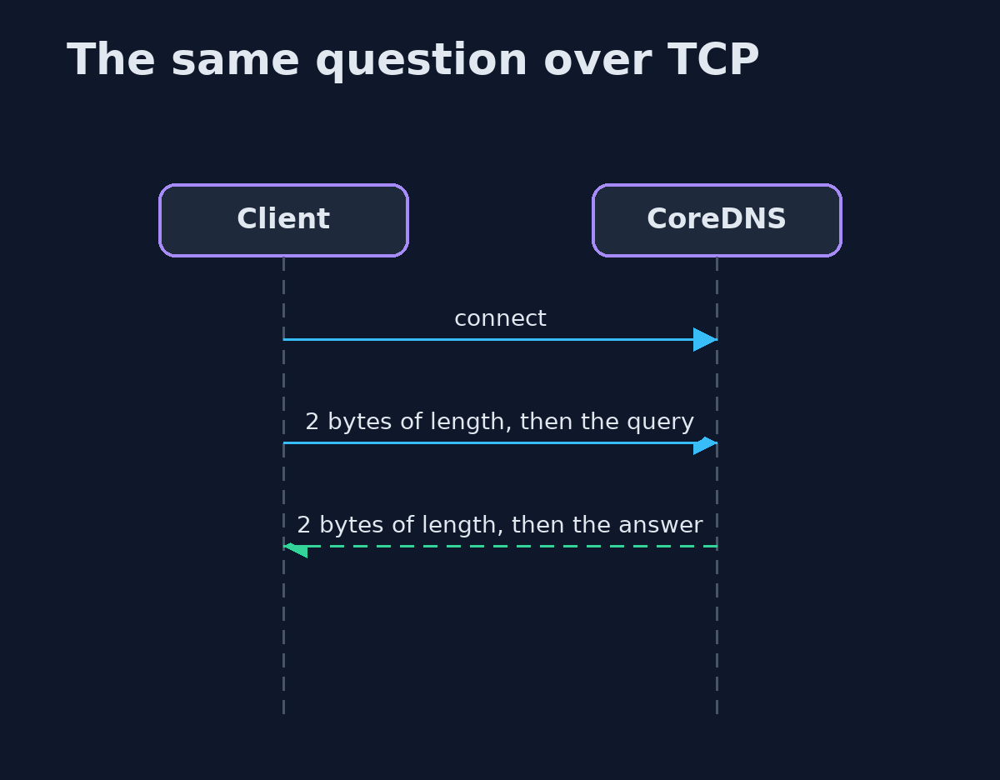
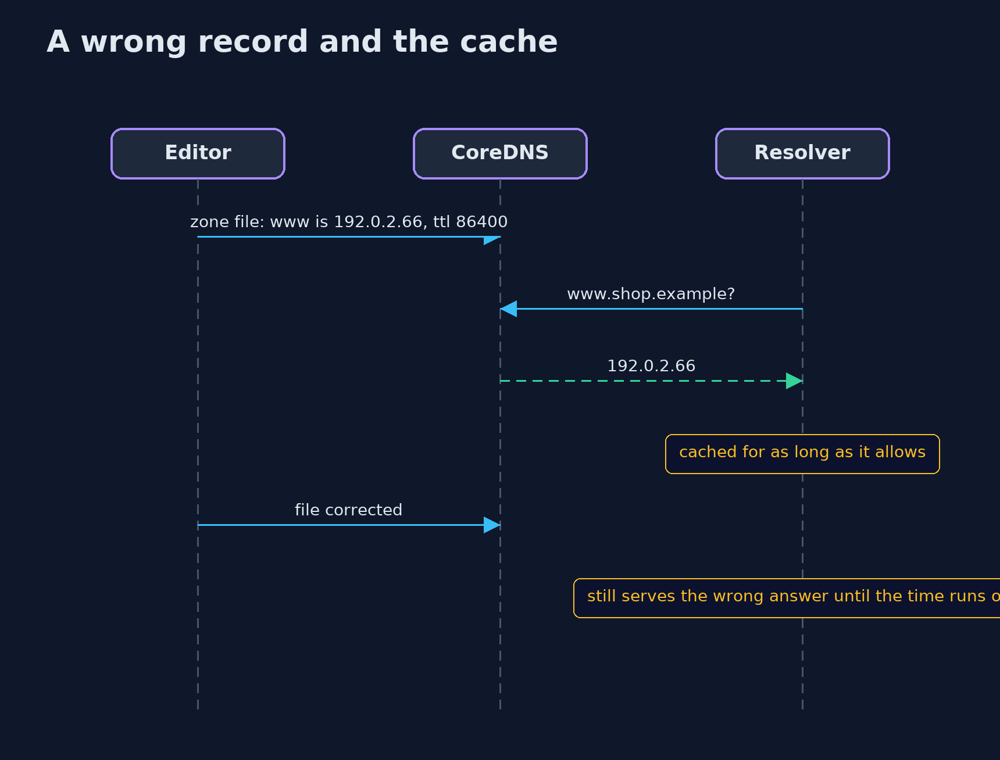

# DNS Basics with CoreDNS — UML Sequence Diagrams

## 1. The same question over TCP

Each message starts with its length in two bytes.

## 2. A wrong record and the cache

The server and the caches repeat the record until someone changes it and the time runs out.

