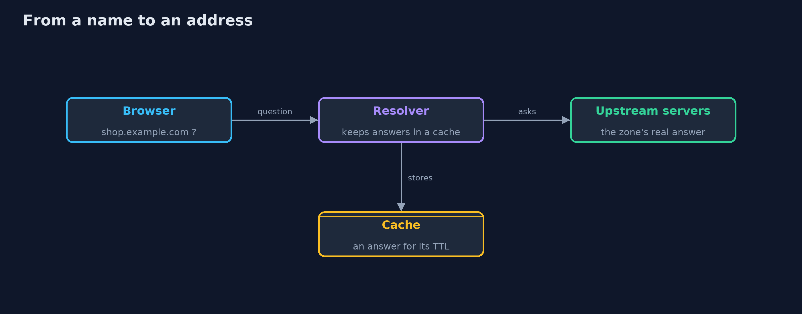
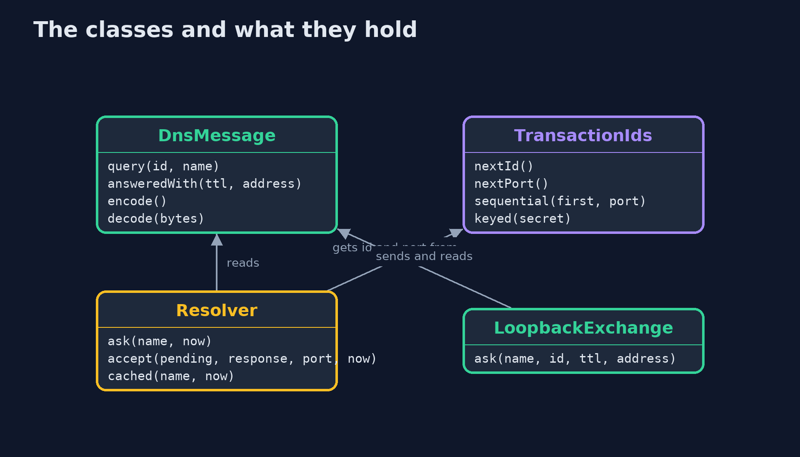
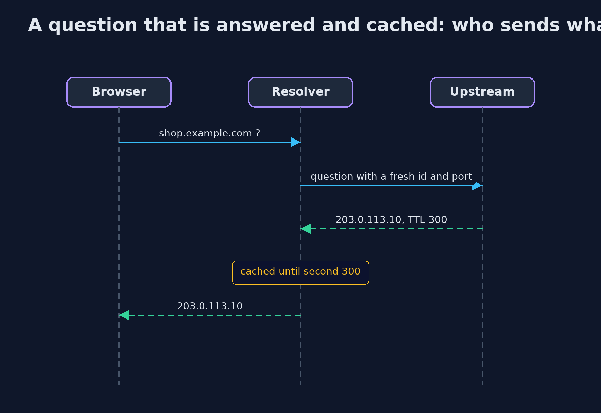

# DNS Basics for Security

```
src/main/java/com/jk/explore/security/dns/
├── Address.java              IPv4 addresses as four bytes packed into an int
├── BadMessageException.java  A DNS message that is too short, malformed, or built from a name that cannot be encoded
├── DnsDemo.java              Runs the online store story in five numbered acts and prints exact, repeatable results
├── DnsMessage.java           A DNS message as in RFC 1035: a 12-byte header, questions, and answers
├── LoopbackExchange.java     A real DNS exchange over UDP on this machine: a tiny server answers one question, and a client reads the answer
├── Resolver.java             A caching resolver in a simulation with a clock in seconds
└── TransactionIds.java       Where a resolver gets the 16-bit id and the source port of each query; a response is believed only if it repeats both
```

**DNS turns names into addresses with no signature on the answer: a resolver believes any reply that repeats the right id, so ids must be unguessable, lifetimes capped, and the final check left to TLS.**

Before a browser can connect to the store, it must turn **shop.example.com** into an address. That is the job of **DNS**, the internet's phone book. A small **question** goes out in a single **UDP** datagram, and a small **answer** comes back, to be kept in a **cache**
for its **time to live** (TTL). There is no connection and no signature. A resolver believes a reply if it repeats the question and the 16-bit **transaction id**, and, on modern resolvers, arrives at the right source port.
Anyone who can guess those numbers and answer first can put a false address in the cache, which is **cache poisoning**.

The demo builds a message byte by byte, with the name compression of RFC 1035, caches answers with a TTL, runs a real exchange over UDP, poisons a resolver with predictable ids, and shows what stops it.

## The idea in everyday terms

Think of calling directory enquiries and writing down the number you are told. The operator never signs anything, and the line is open, so a person who shouts a number first, using the right reference code, is believed.
The operator's notebook, the cache, then repeats the false number to every caller until the page is replaced.

## The scenario

An online store is reached by name. The demo shows what a DNS question and answer contain, how a resolver caches, a real exchange over UDP on this machine, how a resolver with counting ids is poisoned with one forged answer, and what limits the damage.

## Run

```bash
./gradlew run
```

The demo tells the story in 5 acts, each printing exact numbers that the tests check:

| Act | What it shows |
| --- | --- |
| 1. A DNS message, byte by byte | The question for shop.example.com is 34 bytes; the answer repeats the name as a two-byte pointer and is 50 bytes, not 66; nothing in it says who made it. |
| 2. The cache and the time to live | An answer is kept for 300 seconds: a hit at second 100, a new question at second 300; caching repeats one false answer to every customer. |
| 3. A real exchange over UDP | One datagram of 34 bytes goes out and 50 come back; the name is readable in the query; there is no connection and no signature. |
| 4. Cache poisoning by guessing | Counting ids from port 53 are guessed at once and the cache says the attacker's address; a keyed id and port stop 1000 guesses out of about four billion pairs. |
| 5. How long a false answer lives, and what stops it | A false answer with a 86400-second lifetime is still believed after two hours unless the resolver caps lifetimes at 3600; DNSSEC, encrypted DNS and TLS cover the rest. |

## Test

```bash
./gradlew test
```

21 tests in `DemoRunsTest`, `DnsMessageTest`, `ResolverTest`. The query bytes are checked against the RFC 1035 layout and the answer's name pointer against its compression rule. The resolver uses a simulated clock and fixed secrets, and the one real exchange prints only facts that do not depend on port numbers, so the golden output is the same on every run.

## What the simulation got right, and what it left out

Messages and the resolver are built in memory with a simulated clock, so the demo is exact. The one real exchange is over UDP on the loopback interface of the machine running it, and the demo prints only facts that do not depend on port numbers.
The query layout is checked against RFC 1035.

## Technologies and versions

Every version below is pinned in the project's build files and was the latest stable release when the project was built.

| Technology | Version | Used for |
| --- | --- | --- |
| Java | 25 | the language and runtime; a Gradle toolchain finds or downloads the JDK |
| Gradle | 9.8.1 (wrapper) | build and run; nothing to install, the wrapper downloads it |
| org.junit.jupiter:junit-jupiter | 6.1.3, set by junit-bom | JUnit 5: the tests (tests only) |
| org.junit.platform:junit-platform-launcher | 6.1.3, set by junit-bom | JUnit platform launcher, which Gradle needs to run the tests (tests only) |
| videokit | repository tool (`tools/videokit`) | the narrated video and animation: Piper `en_US-amy-medium`, speed 0.8, longer pauses (the amy-slow voice) |

## Learning Material

| Document | What it is for |
| --- | --- |
| [Problem statement](docs/problem-statement.md) | the situation and what the project must show |
| [Prerequisites](docs/prerequisites.md) | what you need to know first |
| [DNS Basics for Security, explained](docs/dns-basics-explained.md) | the acts in prose |
| [Session guide](docs/session.md) | a one-hour lesson with exercises |
| [Animated walkthrough](docs/animation.html) | the acts step by step, narrated |
| [Threat model](docs/threat-model.md) | what is protected, who could harm it, and how, using STRIDE |
| [Spec](docs/spec.md) | what this project must be true of |
| [Expected output](docs/expected-output.txt) | the golden demo output every test and every port checks against |

### The idea in one picture

The browser asks a resolver, which asks upstream and keeps the answer; every hop is unsigned unless DNSSEC is used.



### Where each piece sits

DnsMessage is the codec, TransactionIds decides what a query looks like, Resolver believes or refuses a response.



### How the data moves

The resolver believes a response only if all of these match; an attacker has to guess the ones it cannot see.


### Who calls whom, in order




### Video

`video/dns-basics-explained.mp4` (with `.m4a` audio and `.srt` subtitles) is built by `video/build_video.sh`. Rendered media is not committed.

## What it costs

- **Random ports and ids are a speed bump, not a lock.** About four billion combinations make blind guessing impractical, but not impossible against a patient attacker, and they do not protect against an attacker on the path.
- **Capping lifetimes costs speed.** A shorter cap means more questions to the upstream servers, and it limits a false answer's life, not its first use.
- **DNSSEC needs the zone to be signed and the resolver to check.** Both sides must deploy it, and keys must be managed and rolled over.
- **Encrypted DNS moves trust.** DNS over TLS or HTTPS hides questions from the path, but the resolver still sees them.
- **The demo is a model.** It supports only the A record, one question, and a simulated clock, so it teaches the ideas and not the full protocol.

## When this is too much

Most applications never speak DNS themselves; the operating system does. The knowledge matters when choosing resolvers, setting TTLs, and deciding which defences to trust: DNSSEC where available, encrypted DNS for privacy, and always TLS with a certificate check as the last line.

## Where you have already met this

- `dig` and `nslookup`, which show questions, answers and TTLs.
- "DNS_PROBE_FINISHED" and "server not found" errors in a browser.
- TTL settings in a domain's control panel, and "wait for DNS to propagate".
- News stories about hijacked domains and poisoned caches.

## Where this sits

This project is the second in [networking](..), after [tcp-ip-basics](../tcp-ip-basics): a name is turned into an address before any connection starts, and the transport-security module explains the check that catches a wrong address.
