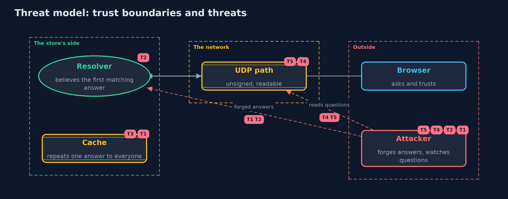

# Threat Model — DNS Basics for Security

A threat model answers four questions: what are we protecting, who or what could harm it, how, and what do we do about it. This one covers this project's own demo system, not a production deployment. Domain: an online store.

## Scope

An online store's customers resolving its name through a caching resolver: the questions, the unsigned answers, the cache that repeats them, and the ids and ports that protect a query.
It covers an attacker who can send forged datagrams to the resolver and one who can watch the path. It does not cover the store's own DNS servers, registrar accounts, or the certificate check.

## What we protect (assets)

- The address that customers are sent to for the store's name.
- The resolver's cache.
- The privacy of which sites customers ask for.

## Who and what acts on the system

- Customers and their browsers.
- The resolver and the upstream servers.
- An attacker who can forge datagrams, and one who can watch the path.

## Trust boundaries

A trust boundary is a line that data or a request crosses between parts that trust each other differently. Threats cluster where those lines are.

- Resolver to upstream servers: unsigned datagrams that cross the internet.
- Resolver to its cache: one false entry reaches every customer.

Each dashed box is a trust boundary. A rose tag such as T1 shows where the threat of that number, in the table below, applies.

## Threats, using STRIDE

STRIDE is a checklist of six kinds of threat: **Spoofing** (S), **Tampering** (T), **Repudiation** (R), **Information disclosure** (I), **Denial of service** (D), **Elevation of privilege** (E).

| Id | Kind | Threat | Where it shows up | Control in this project | What is left |
| --- | --- | --- | --- | --- | --- |
| T1 | Spoofing | A forged answer with a guessed id is cached and sent to every customer | `Resolver.accept` | Random ids and source ports from a keyed hash | An attacker on the path sees the query and can answer first, so signatures are needed |
| T2 | Spoofing | A resolver with predictable ids is poisoned by a single guess | `TransactionIds.sequential` | Keyed ids and ports | Old or unpatched resolvers still count up |
| T3 | Tampering | A false answer with a long lifetime stays in the cache | `Resolver` | A cap on lifetimes | The false answer is used until it expires, so the cap limits it but does not stop it |
| T4 | Information disclosure | An observer reads which names customers ask for | `LoopbackExchange` | None in plain DNS; encrypted DNS hides it from the path | The resolver itself still sees every question |
| T5 | Tampering | A message is changed on the path | `DnsMessage` | DNSSEC signatures, checked by the resolver | Only signed zones are protected, and TLS is still the last check |

## Assumptions

- The attacker cannot see the resolver's queries, and cannot guess a keyed id and port.
- The resolver's secret for ids and ports is unpredictable.
- In the demo, addresses are documentation addresses and the secret is a fixed demo value.

## Out of scope

- Registrar and zone account security.
- DNSSEC validation: described, not run.
- The certificate check in the browser: the transport-security module.

## How the tests check this

- `DnsMessageTest` checks the RFC 1035 query layout, name compression, round trips, and that pointer loops, cut messages and bad names are refused.
- `ResolverTest` checks the cache and TTL, that wrong ids, ports and questions are refused, the lifetime cap, guessable and keyed ids, and a real UDP exchange.
- `DemoRunsTest` compares the whole demo with the golden output.

## Where this model goes next

The next project, http-basics-and-headers, looks at the web request that follows the lookup, and the headers that defend it.
