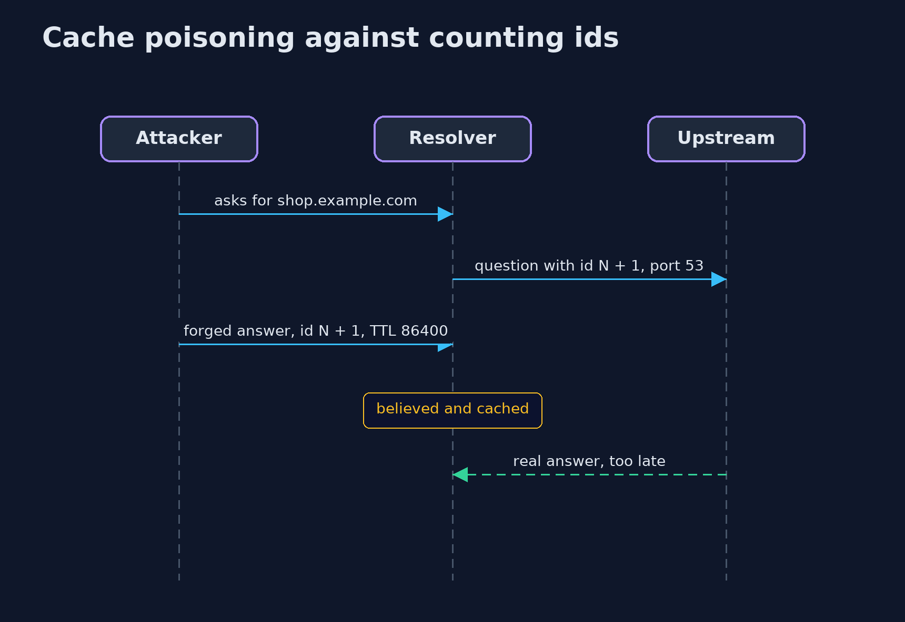
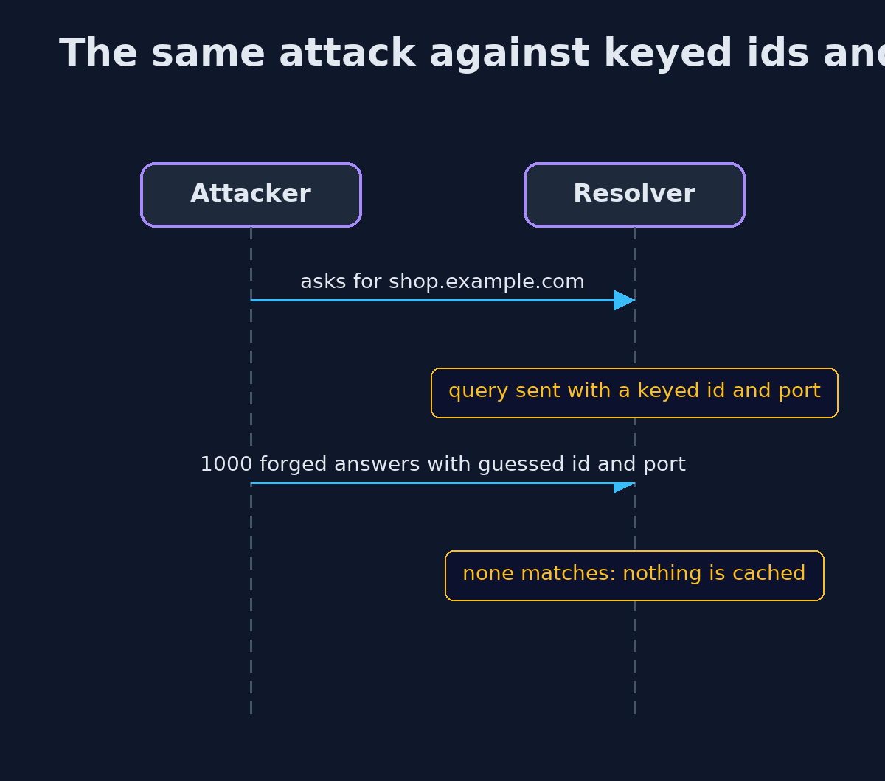

# DNS Basics for Security — UML Sequence Diagrams

## 1. Cache poisoning against counting ids

The attacker triggers a question, guesses the next id, and answers before the real server.

## 2. The same attack against keyed ids and ports

The attacker must match both numbers without seeing the query.

