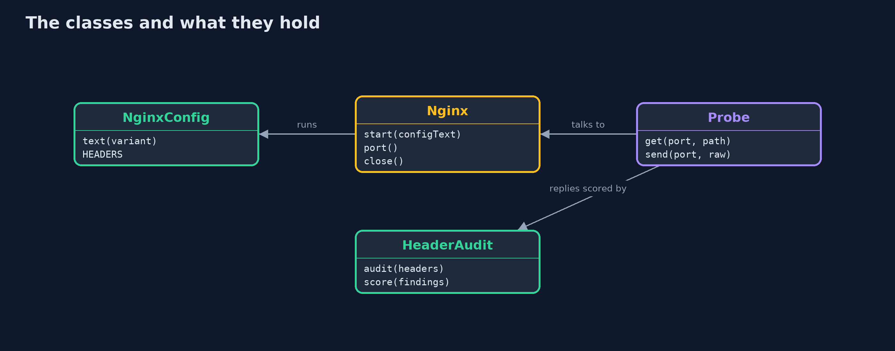
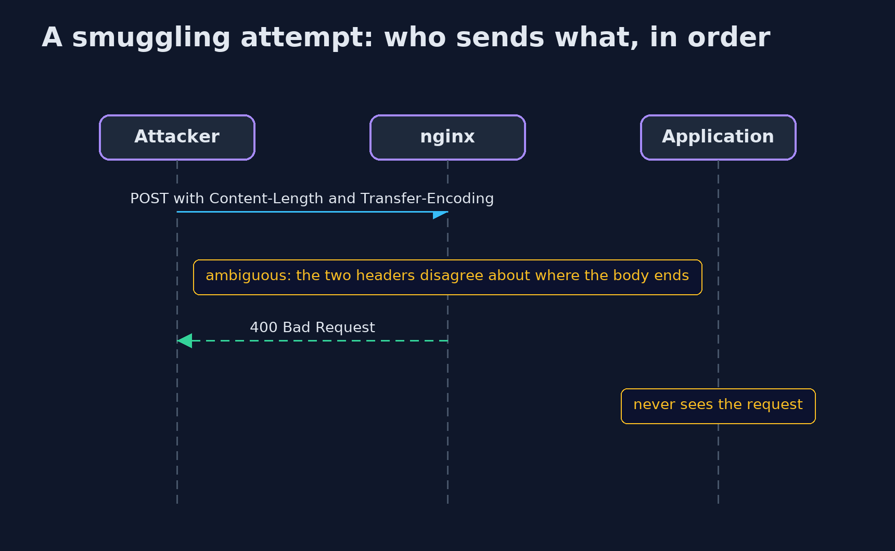

# HTTP Basics and Security Headers with nginx

```
src/main/java/com/jk/explore/security/httpnginx/
├── HeaderAudit.java    Scores a response against five security headers, one point each
├── HttpNginxDemo.java  Runs the online store story in five numbered acts against real nginx containers and prints repeatable results
├── Nginx.java          One nginx container with a given configuration, started for a demo and stopped afterwards
├── NginxConfig.java    Writes the nginx configuration for each version of the online store's front door
└── Probe.java          Sends raw bytes to a port and reads the whole answer, so malformed requests can be sent that an HTTP client library would never send
```

**nginx can add the security headers and refuse ambiguous requests before the application sees them, but a header added without always vanishes from error pages, a nested add_header silently drops the rest, and hiding a version is a speed bump and not a lock.**

The plain version of this lesson built an HTTP parser and a header auditor in Java. In production the **security headers** are usually added by the web server in front of the application, and **nginx**
is very often that server. The directive is `add_header`. It looks simple and has three traps. Without the word **`always`**, nginx adds the header only to successful answers, so error pages go out bare.
**Inheritance** is all or nothing: a `location` that has even one `add_header` of its own drops every `add_header` from the level above. And what the application behind the proxy says about itself, such as
`X-Powered-By`, is passed along unless `proxy_hide_header` removes it. nginx also refuses requests that are ambiguous, such as one with both `Content-Length` and `Transfer-Encoding`, which is the shape of a **request smuggling** attack.

The demo starts a real nginx in a Docker container for each act, sends requests with a raw socket so that malformed ones can be sent too, and scores each answer with the same five-header auditor as the plain project.

## The idea in everyday terms

Think of a doorman who hands every visitor the house rules on the way in. If he hands them out only to guests who arrive properly, a visitor who is turned away at the side gate never gets the rules. If each side room has its own
notice board, the main rules are not copied there unless someone writes them again. And a parcel that says it is four kilos and also says it is five is sent back, not argued over.

## The scenario

An online store has nginx at its front door. The demo sets the five security headers, checks error pages and a side location, applies limits to bodies and header lines, sends the ambiguous requests of a smuggling attack, and puts nginx in front of
an application that reveals its technology.

## Run

```bash
./gradlew run
```

The demo tells the story in 5 acts, each printing exact numbers that the tests check:

| Act | What it shows |
| --- | --- |
| 1. nginx in front of the shop, as it comes | Out of the box a request scores 0 of 5 on the security headers and the Server header shows the exact nginx version. |
| 2. add_header, and the word always | Without always the home page scores 5 of 5 but the 404 page scores 0; with always both score 5, and server_tokens off hides the version. |
| 3. The inheritance trap | A location that adds its own Cache-Control drops all five server-level headers and scores 0 of 5; repeating them there scores 5 of 5. |
| 4. Limits, and requests that are ambiguous | A body over 1k gets 413, a header line of 4000 characters gets 400, and both Content-Length with Transfer-Encoding and two different Content-Lengths get 400. |
| 5. Hiding what the application gives away, and the bill | A proxy passes X-Powered-By and X-AspNet-Version along unless proxy_hide_header removes them; hiding is a speed bump, and the configuration needs tests. |

## Test

```bash
./gradlew test
```

29 tests in `ConfigAndAuditTest`, `CspCheckTest`, `NginxContainerTest`, `ReferenceConfigTest`. The default tests need no Docker: they check the generated configurations, the auditor and the reply parser. The tests tagged docker start real nginx containers, check every claim in the demo and that no container is left running, and compare the demo with the golden output. The demo's comparison with its golden output runs with the integration tests, because the demo needs Docker: run `./gradlew integrationTest` after changing the demo or its narration.

## What the simulation got right, and what it left out

nginx runs in a container on a random local port, and the demo prints only facts that do not depend on the port or on timing: scores, status codes and which headers are present. The version number is pinned in the image name.
Raw sockets are used so the demo can send requests that no HTTP client library would send.

## Technologies and versions

Every version below is pinned in the project's build files and was the latest stable release when the project was built.

| Technology | Version | Used for |
| --- | --- | --- |
| Java | 25 | the language and runtime; a Gradle toolchain finds or downloads the JDK |
| Gradle | 9.8.1 (wrapper) | build and run; nothing to install, the wrapper downloads it |
| org.junit.jupiter:junit-jupiter | 6.1.3, set by junit-bom | JUnit 5: the tests (tests only) |
| org.junit.platform:junit-platform-launcher | 6.1.3, set by junit-bom | JUnit platform launcher, which Gradle needs to run the tests (tests only) |
| nginx (container image) | nginx:1.31.7-alpine | the web server and reverse proxy in front of the store, pinned to an exact version |
| Docker | any recent Docker Engine or Docker Desktop | runs the nginx container for the demo and the container tests |
| videokit | repository tool (`tools/videokit`) | the narrated video and animation: Piper `en_US-amy-medium`, speed 0.8, longer pauses (the amy-slow voice) |

## Learning Material

| Document | What it is for |
| --- | --- |
| [Dependencies](docs/dependencies.md) | what the framework and infrastructure are, and why they are here |
| [Problem statement](docs/problem-statement.md) | the situation and what the project must show |
| [Prerequisites](docs/prerequisites.md) | what you need to know first |
| [HTTP Basics and Security Headers with nginx, explained](docs/http-basics-and-headers-with-nginx-explained.md) | the acts in prose |
| [Session guide](docs/session.md) | a one-hour lesson with exercises |
| [Animated walkthrough](docs/animation.html) | the acts step by step, narrated |
| [Threat model](docs/threat-model.md) | what is protected, who could harm it, and how, using STRIDE |
| [Spec](docs/spec.md) | what this project must be true of |
| [Expected output](docs/expected-output.txt) | the golden demo output every test and every port checks against |

### The idea in one picture

Headers and limits are decided by nginx; the application behind it is only trusted to answer.


### Where each piece sits

NginxConfig writes the configuration; Nginx runs it; Probe talks to it; HeaderAudit judges it.



### How the data moves

A level that has any add_header replaces all the add_header lines of the level above.


### Who calls whom, in order




### Video

`video/http-basics-and-headers-with-nginx-explained.mp4` (with `.m4a` audio and `.srt` subtitles) is built by `video/build_video.sh`. Rendered media is not committed.

## What it costs

- **Headers describe the page.** A Content-Security-Policy that is wrong for the real site breaks the site, so the policy has to be tested with the real pages.
- **Configuration is easy to get subtly wrong.** The `always` and inheritance rules are not obvious, so the configuration needs tests like the ones in this project.
- **Hiding is a speed bump.** Removing a version number does not remove the hole, and attackers probe anyway. The fix is to keep software up to date.
- **Limits need tuning.** A body limit that is too small refuses real uploads, and one that is too large invites abuse.
- **Docker is needed.** The demo and the container tests need a running Docker; the default tests do not.

## When this is too much

Setting the five headers and `server_tokens off` is cheap and always worth doing. The refusals of ambiguous requests are on by default in current nginx, and the value of this project is knowing that and checking it.

## Where you have already met this

- `add_header` lines in almost every nginx configuration, and `always` copied from a snippet nobody explained.
- Scanners such as securityheaders.com that give a site a letter grade.
- Include files such as `security-headers.conf` repeated in each `location`.
- Advisories about request smuggling between a proxy and an application server.

## Where this sits

This project follows [http-basics-and-headers](../http-basics-and-headers) and is a tools counterpart in [networking](..), next to [the Spring Boot version](../http-basics-and-headers-with-spring-boot). It uses Docker in the same way as [password-attacks-and-defences-with-nginx](../../passwords-and-mfa/password-attacks-and-defences-with-nginx).
