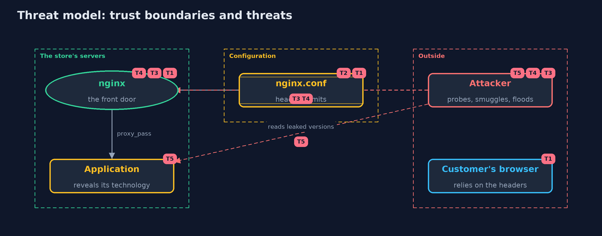

# Threat Model — HTTP Basics and Security Headers with nginx

A threat model answers four questions: what are we protecting, who or what could harm it, how, and what do we do about it. This one covers this project's own demo system, not a production deployment. Domain: an online store.

## Scope

The configuration of an nginx reverse proxy in front of an online store's application: the security headers it sets, the limits on request sizes, the treatment of ambiguous requests, and the headers it passes along from the application. It does not cover TLS, the application's own code, or nginx itself being compromised.

## What we protect (assets)

- The browser protections that the headers switch on, such as HSTS and the content security policy.
- The agreement between nginx and the application about where each request ends.
- The application's technology and version, which help an attacker choose an attack.
- The server's resources, which oversize requests would use.

## Who and what acts on the system

- Customers' browsers, which obey the headers.
- An attacker who sends malformed, ambiguous or oversize requests and reads replies.
- The administrator who writes and changes the configuration.

## Trust boundaries

A trust boundary is a line that data or a request crosses between parts that trust each other differently. Threats cluster where those lines are.

- Internet to nginx: every request crosses it.
- nginx to the application: only requests that nginx accepts cross it.
- Configuration file to the running server: a mistake in the file is a mistake in production.

Each dashed box is a trust boundary. A rose tag such as T1 shows where the threat of that number, in the table below, applies.

## Threats, using STRIDE

STRIDE is a checklist of six kinds of threat: **Spoofing** (S), **Tampering** (T), **Repudiation** (R), **Information disclosure** (I), **Denial of service** (D), **Elevation of privilege** (E).

| Id | Kind | Threat | Where it shows up | Control in this project | What is left |
| --- | --- | --- | --- | --- | --- |
| T1 | Tampering | A header is missing from error pages or from a location, so a browser protection is off where it matters | `NginxConfig`, `HeaderAudit` | always on every add_header, headers repeated in each location that adds its own, and an audit of every location and an error page | A new location added later can lose the headers again, so the audit must run in the build |
| T2 | Tampering | The configuration is changed by mistake and nobody notices because the page still works | `nginx.conf` | Configuration in version control, with tests that fetch pages and check the headers | Tests cover only the locations they request |
| T3 | Tampering | Request smuggling: nginx and the application disagree about where a request ends | nginx request parsing | nginx refuses Content-Length together with Transfer-Encoding, and conflicting Content-Length headers (400) | Keep nginx and the application server up to date, because their parsers must keep agreeing |
| T4 | Denial of service | Oversize bodies or header lines use up server resources | `client_max_body_size`, `large_client_header_buffers` | Limits on body size and header buffers answer 413 and 400 | The limits must be tuned to real uploads, and a flood of small requests needs rate limits as well |
| T5 | Information disclosure | The application's technology and version are revealed in headers, helping an attacker pick an attack | `proxy_hide_header`, `server_tokens` | Hide X-Powered-By, X-AspNet-Version and the nginx version | Hiding is a speed bump: fingerprinting still works, so keep the software up to date |

## Assumptions

- nginx and Docker are up to date.
- The configuration is under version control and reviewed.
- In the demo, the application is a stub inside the same nginx, and its leaked versions are fake.

## Out of scope

- TLS settings and certificates: the transport-security module.
- A web application firewall.
- The application's own vulnerabilities.

## How the tests check this

- `ConfigAndAuditTest` checks each configuration's directives, the auditor and the reply parser, without Docker.
- `NginxContainerTest` (integration) starts real nginx containers and checks the headers on pages and error pages, the inheritance trap, the limits, the ambiguous requests, the hidden headers and that no container is left behind.
- `ReferenceConfigTest` checks the written-out configuration is what the code generates.

## Where this model goes next

The next module, transport-security, looks at how connections are protected with TLS, certificates and HTTPS.
