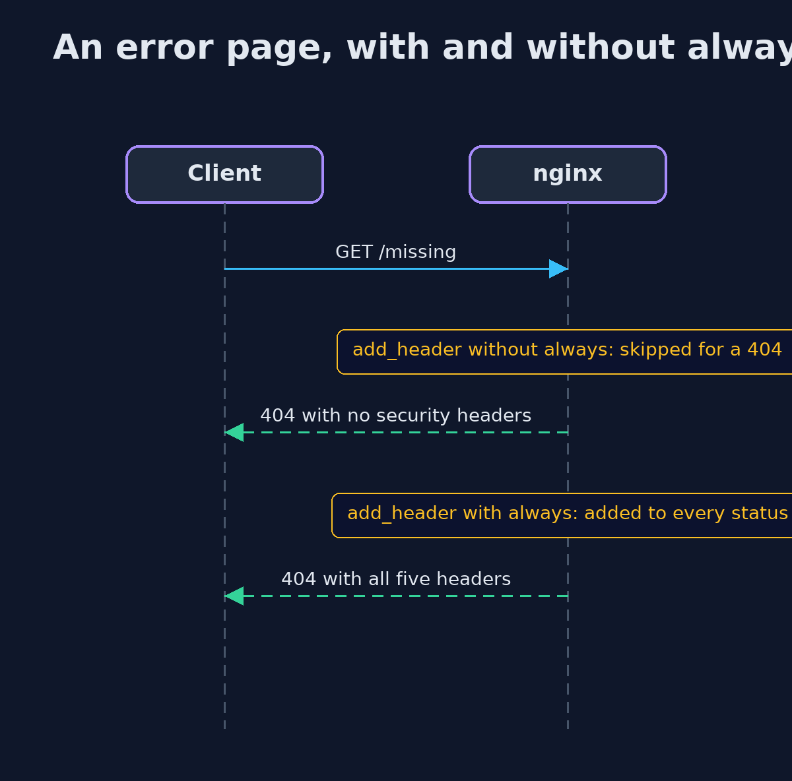
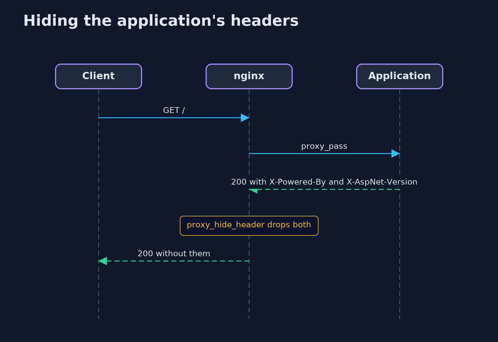

# HTTP Basics and Security Headers with nginx — UML Sequence Diagrams

## 1. An error page, with and without always

Without always the header is added to successful answers only.

## 2. Hiding the application's headers

proxy_hide_header removes a header from the application's reply before it reaches the client.

