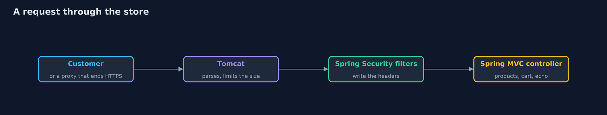
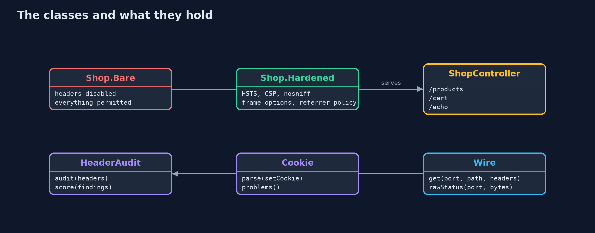
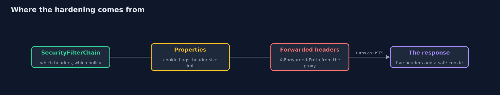
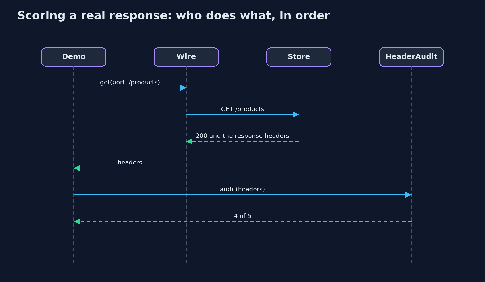

# HTTP Basics and Security Headers with Spring Boot

```
src/main/java/com/jk/explore/security/httpspring/
├── Cookie.java          A Set-Cookie header, parsed, and a judgement of whether it is safe for a login session
├── HeaderAudit.java     Scores a response against five security headers, one point each
├── HttpSpringDemo.java  Runs the online store story in five numbered acts against a real Spring Boot server on the loopback interface
├── Shop.java            Two versions of the same store: one with the headers switched off, and one hardened
├── ShopController.java  The store's three endpoints: a page, a cart that starts a session, and a search that puts the customer's text in a header
└── Wire.java            Talks to a running store over the loopback interface: with the JDK's HTTP client, and with raw bytes for requests a client would never send
```

**Spring Boot and Spring Security write the security headers, harden the session cookie and bound the request size with a few lines of configuration, and the container refuses a line break in a header, but the defaults still need a decision from you.**

The plain version of this lesson wrote an HTTP parser, a cookie judge and a header auditor by hand. Real stores use a framework. **Spring Boot** starts a real web server (**Tomcat**) inside the program, and **Spring Security** puts a chain of filters
in front of every request, one of which writes the **security headers**. A few lines of configuration choose which headers, a few **properties** harden the session cookie and bound the size of a request, and the container itself refuses a line
break in a header, which is how **header injection** is attacked.

The demo starts two real servers on the loopback interface, one with the headers switched off and one hardened, and scores their real responses with the same five-header audit as before. It then shows why one header appears only over HTTPS, hardens a cookie, tries to inject a header and sends an oversized one.

## The idea in everyday terms

The earlier project was forging your own door locks, to learn how locks work. This one fits standard locks that a locksmith has tested. You still choose which doors get locks and which key to use, and you still have to
check that the locks are fitted, which is why the demo scores the real doors and does not trust the plan.

## The scenario

An online store runs a small Spring Boot application with a products page, a cart that starts a session, and a search that puts the customer's text in a header. The demo runs it twice, bare and hardened, and attacks both.

## Run

```bash
./gradlew run
```

The demo tells the story in 5 acts, each printing exact numbers that the tests check:

| Act | What it shows |
| --- | --- |
| 1. The same page, with and without header writers | With headers switched off the store scores 0 of 5; the hardened store scores 4 of 5, because Strict-Transport-Security is left out on plain HTTP on purpose. |
| 2. The same page behind a proxy that ends HTTPS | With X-Forwarded-Proto: https the hardened store scores 5 of 5 and sends Strict-Transport-Security; trusting that header is safe only if nobody but the proxy can reach the store. |
| 3. The cookie that carries the cart's session | The default session cookie has 2 problems, no Secure and no SameSite; three properties give the hardened store a cookie with none. |
| 4. A line break inside a header | The search text with a line break and a second header is refused by the container with status 500, no X-Echo and no second header; a header name with a space gets 400. |
| 5. Limits on the size of a request | A 4000-character header is accepted by the default store with 200 and refused by the hardened store, whose limit is 1KB, with 400. |

## Test

```bash
./gradlew test
```

18 tests in `CookieAndAuditTest`, `DemoRunsTest`, `MockMvcHeadersTest`, `RealServerTest`. Real servers are started on free ports and closed after every test, and the demo prints only facts that do not depend on ports, dates or session ids, so the golden output is the same on every run.

## What the simulation got right, and what it left out

Both servers are real Spring Boot applications started on free ports on the loopback interface, so nothing needs installing except a JDK. The demo prints only facts that do not depend on the port, the date or the session id. Tests also use MockMvc, which
sends a request through the whole filter chain in memory. HTTPS itself is not used; the transport-security module covers it, and the demo shows the effect of a proxy that ends HTTPS by sending the X-Forwarded-Proto header.

## Technologies and versions

Every version below is pinned in the project's build files and was the latest stable release when the project was built.

| Technology | Version | Used for |
| --- | --- | --- |
| Java | 25 | the language and runtime; a Gradle toolchain finds or downloads the JDK |
| Gradle | 9.8.1 (wrapper) | build and run; nothing to install, the wrapper downloads it |
| org.springframework.boot:spring-boot-starter-webmvc | 4.1.1, set by spring-boot-dependencies | library the code uses |
| org.springframework.boot:spring-boot-starter-security | 4.1.1, set by spring-boot-dependencies | library the code uses |
| org.springframework.boot:spring-boot-starter-webmvc-test | 4.1.1, set by spring-boot-dependencies | library the code uses (tests only) |
| org.springframework.boot:spring-boot-starter-security-test | 4.1.1, set by spring-boot-dependencies | library the code uses (tests only) |
| org.junit.jupiter:junit-jupiter | 6.1.3, set by junit-bom | JUnit 5: the tests (tests only) |
| org.junit.platform:junit-platform-launcher | 6.1.3, set by junit-bom | JUnit platform launcher, which Gradle needs to run the tests (tests only) |
| Spring Boot | 4.1.1 | the latest stable release; its dependency list pins the Spring and Tomcat versions below, and it starts the real web server |
| Spring Framework (Spring MVC) | 7.0.9 | maps web addresses to Java methods; pinned by Spring Boot 4.1.1 |
| Spring Security | 7.1.1 | writes the security headers and sits in front of every request; pinned by Spring Boot 4.1.1 |
| Apache Tomcat (embedded) | 11.0.24 | the web server inside the application; it parses requests and enforces size limits; pinned by Spring Boot 4.1.1 |
| videokit | repository tool (`tools/videokit`) | the narrated video and animation: Piper `en_US-amy-medium`, speed 0.8, longer pauses (the amy-slow voice) |

## Learning Material

| Document | What it is for |
| --- | --- |
| [Dependencies](docs/dependencies.md) | what the framework and infrastructure are, and why they are here |
| [Problem statement](docs/problem-statement.md) | the situation and what the project must show |
| [Prerequisites](docs/prerequisites.md) | what you need to know first |
| [HTTP Basics and Security Headers with Spring Boot, explained](docs/http-basics-and-headers-with-spring-boot-explained.md) | the acts in prose |
| [Session guide](docs/session.md) | a one-hour lesson with exercises |
| [Animated walkthrough](docs/animation.html) | the acts step by step, narrated |
| [Threat model](docs/threat-model.md) | what is protected, who could harm it, and how, using STRIDE |
| [Spec](docs/spec.md) | what this project must be true of |
| [Expected output](docs/expected-output.txt) | the golden demo output every test and every port checks against |

### The idea in one picture

Tomcat reads the request, Spring Security's filters run, and the headers are written on the way out.



### Where each piece sits

Two configurations of the same store, and the helpers that judge their responses.



### How the data moves

Three kinds of setting: filter configuration, container properties, and the proxy.



### Who calls whom, in order




### Video

`video/http-basics-and-headers-with-spring-boot-explained.mp4` (with `.m4a` audio and `.srt` subtitles) is built by `video/build_video.sh`. Rendered media is not committed.

## What it costs

- **A framework is a large dependency.** Boot, Spring Security and Tomcat bring many jars, and their versions have to be updated together as new releases fix vulnerabilities.
- **The defaults are a start.** Spring Security writes some headers by default, and the policy that matters, such as the Content-Security-Policy, is yours to write and test against your pages.
- **Trusting a forwarded header is a decision.** `server.forward-headers-strategy=native` believes X-Forwarded-Proto from trusted proxies. If the application is reachable without the proxy, a customer can send the header and change what the application believes.
- **A small request limit can break real customers.** Cookies and long addresses need room, so the limit has to be set from real traffic.
- **A header check on the demo is not a check on production.** The demo scores one page over plain HTTP on this machine: the real check is on the real site, over HTTPS.

## When this is too much

For any real web application, use the framework's header support and test the result. Writing headers by hand is for learning, and for cases the framework does not cover.

## Where you have already met this

- `http.headers(...)` in a Spring Security configuration class.
- `server.servlet.session.cookie.*` properties in `application.properties`.
- Security scanners that give a site a grade for its headers.
- `server.max-http-request-header-size` and its relatives in hardening guides.

## Where this sits

This project follows [http-basics-and-headers](../http-basics-and-headers) and is the sixth in [networking](..). The same five-header audit and cookie judge are used here, on a real framework's responses.
