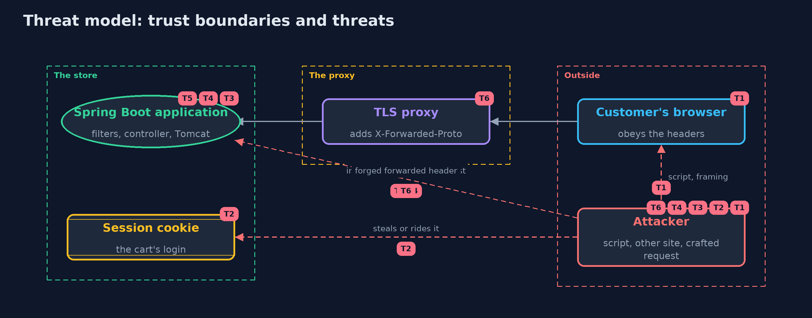

# Threat Model — HTTP Basics and Security Headers with Spring Boot

A threat model answers four questions: what are we protecting, who or what could harm it, how, and what do we do about it. This one covers this project's own demo system, not a production deployment. Domain: an online store.

## Scope

An online store's Spring Boot web application: the headers it sends to the browser, its session cookie, the requests it accepts, and the proxy in front of it. It covers a script injected into a page, a request from another site, a crafted or oversized request,
and a forged forwarded header. It does not cover HTTPS itself, authentication, or the application's own logic.

## What we protect (assets)

- The customer's session, held in a cookie.
- The page's content and the customer's browser.
- The server's memory and time.
- The store's belief about whether a request was secure.

## Who and what acts on the system

- A customer with a browser that obeys the headers.
- An attacker who can inject a script, build a page on another site, or send crafted requests.
- The proxy that ends HTTPS.

## Trust boundaries

A trust boundary is a line that data or a request crosses between parts that trust each other differently. Threats cluster where those lines are.

- Browser to server: the headers are the server's only way to tell the browser how to behave.
- Proxy to application: forwarded headers cross it and must only be believed from the proxy.

Each dashed box is a trust boundary. A rose tag such as T1 shows where the threat of that number, in the table below, applies.

## Threats, using STRIDE

STRIDE is a checklist of six kinds of threat: **Spoofing** (S), **Tampering** (T), **Repudiation** (R), **Information disclosure** (I), **Denial of service** (D), **Elevation of privilege** (E).

| Id | Kind | Threat | Where it shows up | Control in this project | What is left |
| --- | --- | --- | --- | --- | --- |
| T1 | Tampering | A script injected into a page runs, or the page is shown inside another site's frame | `Shop.Hardened` headers | Content-Security-Policy with default-src 'self' and frame-ancestors, X-Frame-Options, nosniff | The policy must fit the real pages, and only helps browsers that enforce it |
| T2 | Spoofing | The session cookie is read by a script, sent over plain HTTP, or sent with another site's request | the JSESSIONID cookie | HttpOnly, Secure and SameSite=Strict through three properties | SameSite is not a replacement for CSRF tokens, and Strict can break links from other sites |
| T3 | Tampering | Customer text with a line break splits the response or sets a second header | `ShopController.echo` | Tomcat refuses a line break in a header value | The code should validate or encode customer text before it reaches a header |
| T4 | Denial of service | An oversized request makes the server read and hold too much | Tomcat's header limit | server.max-http-request-header-size set from real traffic | A limit too small breaks real customers, and body, upload and rate limits are separate |
| T5 | Information disclosure | A malformed request is read differently by two programs | Tomcat's parser | Tomcat refuses a header name with a space with status 400 | A proxy in front must be strict in the same way |
| T6 | Spoofing | A forged X-Forwarded-Proto makes the application believe the request was secure | `server.forward-headers-strategy=native` | Believe forwarded headers only from trusted proxies, and keep the application unreachable except through the proxy | If the application is reachable directly, the belief can be forged |

## Assumptions

- The application is reachable only through the proxy.
- TLS is handled by the proxy and tested elsewhere.
- In the demo, the stores listen on the loopback interface on free ports.

## Out of scope

- HTTPS and certificates: the transport-security module.
- CSRF tokens, authentication and CORS.
- A complete Content-Security-Policy for a real site.

## How the tests check this

- `MockMvcHeadersTest` checks the five headers over HTTPS and plain HTTP, and the refusal of a line break, through the whole filter chain.
- `RealServerTest` starts real servers on free ports and checks scores, the cookie, the injection, the malformed request, the size limit, and an untrusted forwarded header.
- `CookieAndAuditTest` checks the cookie judge and the header audit.
- `DemoRunsTest` compares the whole demo with the golden output.

## Where this model goes next

The next module, transport-security, looks at what makes a connection private: the TLS handshake, certificates and HTTPS.
