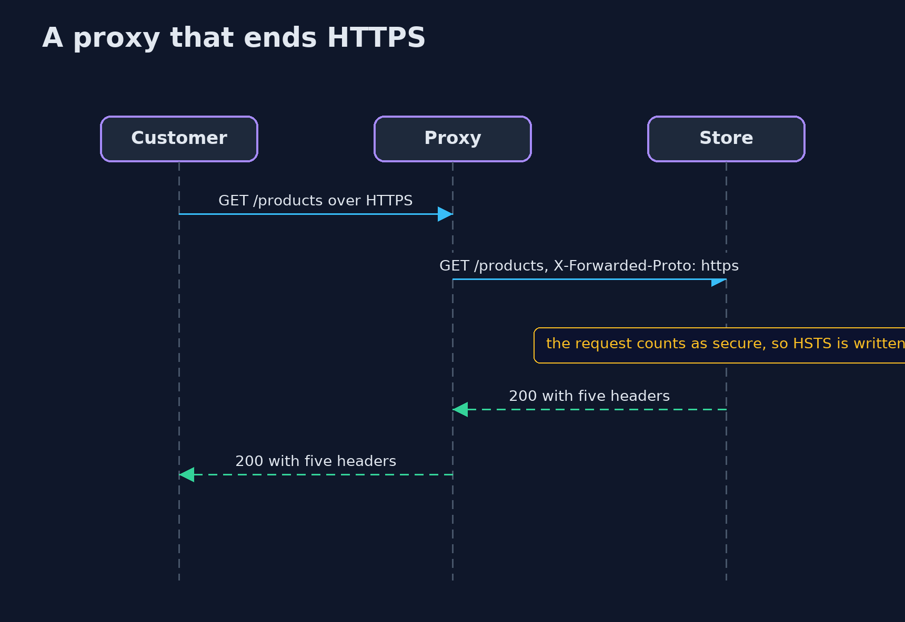
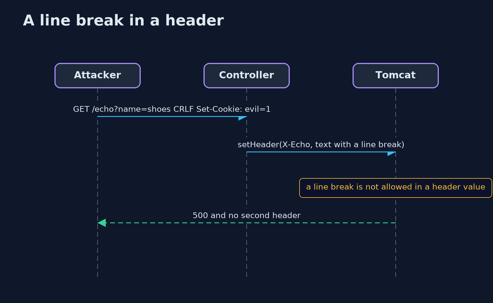

# HTTP Basics and Security Headers with Spring Boot — UML Sequence Diagrams

## 1. A proxy that ends HTTPS

The hardened store believes the forwarded header only from a trusted proxy.

## 2. A line break in a header

The container refuses to write it.

