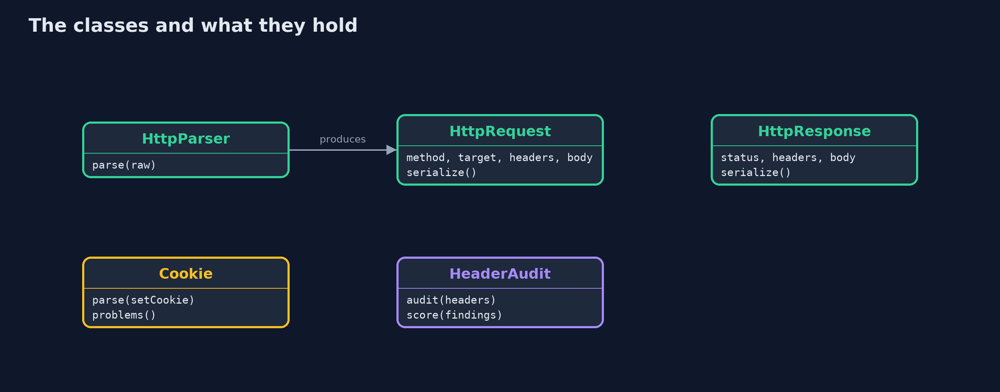
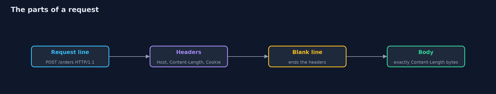

# HTTP Basics and Security Headers

```
src/main/java/com/jk/explore/security/http/
├── BadMessageException.java  A request, response, header or cookie that is malformed or ambiguous, and so is refused
├── Cookie.java               A Set-Cookie header, parsed, and a judgement of whether it is safe for a login session
├── HeaderAudit.java          Scores a response against five security headers, one point each
├── HttpDemo.java             Runs the online store story in five numbered acts and prints exact, repeatable results
├── HttpParser.java           A small, strict HTTP/1.1 request parser
├── HttpRequest.java          A parsed HTTP/1.1 request
├── HttpResponse.java         An HTTP response
└── LoopbackExchange.java     A real HTTP server and client on the loopback interface, so the audit runs on headers that really crossed a socket
```

**HTTP messages are plain text that the sender controls, so a server must read them strictly, never put raw text in a header, set cookies with care, and tell the browser what to refuse with security headers.**

**HTTP** is how browsers talk to web servers, and an HTTP/1.1 message is plain text: a **request line**, some **headers**, a blank line and an optional **body**. Every line is chosen by the sender, and the server and any proxy
in front of it must read it the same way. When they do not, an attacker can hide a second request inside the first, which is the idea behind **request smuggling**. When a server puts a customer's text into a header without checking for line breaks,
the customer can add headers of their own: **header injection**. **Cookies** carry the login, so their attributes (**HttpOnly**, **Secure**, **SameSite**) decide who can read or send them. And **security headers** tell the browser what to refuse:
use HTTPS only, load scripts only from the site, do not guess content types, do not be put in a frame, do not leak the address.

The demo parses and writes messages, refuses ambiguous ones, refuses injection, judges four cookies, and scores two real responses from a real server on this machine.

## The idea in everyday terms

Think of an order form that anyone can fill in by hand. The shop's clerk and the warehouse worker must read it the same way: if the clerk thinks the form ends at the first signature and the worker keeps reading, a second order written below
gets filled for the wrong person. A customer's name written on the form must not be able to add a new line that says "deliver to me". Cookies are the membership card, and the headers are the notices on the shop door: "enter only by this door",
"no photographs", "do not follow strangers' directions".

## The scenario

An online store receives a purchase request, redirects a search, sets a session cookie and serves pages. The demo shows each of those messages as text, shows which malformed versions are refused, judges cookies, and audits the headers of a real response.

## Run

```bash
./gradlew run
```

The demo tells the story in 5 acts, each printing exact numbers that the tests check:

| Act | What it shows |
| --- | --- |
| 1. An HTTP message is just text | A request of 82 characters is parsed into method, target, Host and a 17-byte body, and written out again as the same text. |
| 2. Messages that two programs could read differently | Both Content-Length and Transfer-Encoding, two different lengths, a space before a colon and a body with a hidden second request are all refused; the exact request is accepted. |
| 3. Header injection | A normal search redirect is written; search text with a line break and a second header is refused, because otherwise the attacker would set a cookie. |
| 4. Cookies that carry a login | A bare cookie has three problems; Secure, HttpOnly, SameSite=Lax and Path=/ has none; SameSite=None without Secure has two; a __Host- cookie with a Domain has one. |
| 5. Security headers on a real response | A real local server with no security headers scores 0 of 5, the same server with the five headers scores 5 of 5, and headers set badly score 1 of 5. |

## Test

```bash
./gradlew test
```

23 tests in `CookieAndHeaderTest`, `DemoRunsTest`, `ParserTest`. Messages are parsed and written in memory, cookies and headers are judged by fixed rules, and the one real exchange prints only facts that do not depend on the port number, so the golden output is the same on every run.

## What the simulation got right, and what it left out

Messages are built and parsed in memory, so the demo is exact. The real exchange uses the JDK's own HTTP server and HTTP client on the loopback interface, and the demo prints only facts that do not depend on the port number.

## Technologies and versions

Every version below is pinned in the project's build files and was the latest stable release when the project was built.

| Technology | Version | Used for |
| --- | --- | --- |
| Java | 25 | the language and runtime; a Gradle toolchain finds or downloads the JDK |
| Gradle | 9.8.1 (wrapper) | build and run; nothing to install, the wrapper downloads it |
| org.junit.jupiter:junit-jupiter | 6.1.3, set by junit-bom | JUnit 5: the tests (tests only) |
| org.junit.platform:junit-platform-launcher | 6.1.3, set by junit-bom | JUnit platform launcher, which Gradle needs to run the tests (tests only) |
| videokit | repository tool (`tools/videokit`) | the narrated video and animation: Piper `en_US-amy-medium`, speed 0.8, longer pauses (the amy-slow voice) |

## Learning Material

| Document | What it is for |
| --- | --- |
| [Problem statement](docs/problem-statement.md) | the situation and what the project must show |
| [Prerequisites](docs/prerequisites.md) | what you need to know first |
| [HTTP Basics and Security Headers, explained](docs/http-basics-and-headers-explained.md) | the acts in prose |
| [Session guide](docs/session.md) | a one-hour lesson with exercises |
| [Animated walkthrough](docs/animation.html) | the acts step by step, narrated |
| [Threat model](docs/threat-model.md) | what is protected, who could harm it, and how, using STRIDE |
| [Spec](docs/spec.md) | what this project must be true of |
| [Expected output](docs/expected-output.txt) | the golden demo output every test and every port checks against |

### The idea in one picture

Two programs read the same bytes, and the attacker lives in the gap between how they read them.


### Where each piece sits

HttpParser reads, HttpResponse writes, Cookie and HeaderAudit judge.



### How the data moves

Each part is a line or block of text the sender wrote.



### Who calls whom, in order


### Video

`video/http-basics-and-headers-explained.mp4` (with `.m4a` audio and `.srt` subtitles) is built by `video/build_video.sh`. Rendered media is not committed.

## What it costs

- **Strict parsing refuses some real traffic.** Old clients and odd proxies sometimes send folded headers or bare line feeds. Refusing them is safer, and it should be logged so a real client with a bug is found.
- **SameSite=Strict can break links.** A customer who follows a link from another site arrives without the cookie and looks logged out, so Lax is the usual choice for a session.
- **A strict Content-Security-Policy takes work.** Inline scripts and styles must be moved out or given nonces, and every third-party script must be listed.
- **HSTS is hard to undo.** Once a browser has seen a long max-age, it will refuse plain HTTP for that long, so it should be rolled out with a short age first.
- **The demo is a model.** The parser handles a request with a Content-Length body only: no chunked bodies, no HTTP/2, no folding, no obsolete forms. Real servers do more, and their own defences should be switched on.

## When this is too much

Every public site should send the five headers and set its session cookie with HttpOnly, Secure and SameSite. Writing a parser is rarely needed: the point is to know what the server and the proxy in front of it do with an odd message,
and to configure both to refuse it.

## Where you have already met this

- The browser developer tools' Network tab, which shows request and response headers.
- `curl -v`, which prints the lines of both messages.
- Scanners such as securityheaders.com and Mozilla Observatory that grade a site's headers.
- Advisories titled "HTTP request smuggling" for proxies and servers.

## Where this sits

This project is the third in [networking](..), after [tcp-ip-basics](../tcp-ip-basics), and prepares the transport-security module: HTTPS is HTTP carried inside TLS.
