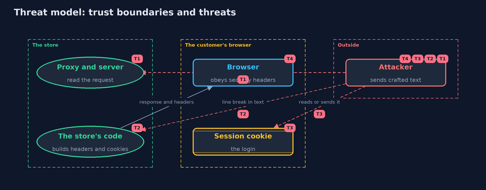

# Threat Model — HTTP Basics and Security Headers

A threat model answers four questions: what are we protecting, who or what could harm it, how, and what do we do about it. This one covers this project's own demo system, not a production deployment. Domain: an online store.

## Scope

An online store's HTTP handling: how a proxy and server read requests, how the store builds response headers and cookies from customer text, and which security headers it sends to the browser. It covers an attacker who can send crafted requests and text.
It does not cover TLS, the contents of pages, or the web application's own logic.

## What we protect (assets)

- The customer's session cookie.
- The integrity of each request: that it means the same to every program that reads it.
- The response headers that set the browser's rules.
- Other customers' requests in the same connection.

## Who and what acts on the system

- Customers and their browsers.
- An attacker who can craft requests and customer text.
- The proxy and the server in front of the store.

## Trust boundaries

A trust boundary is a line that data or a request crosses between parts that trust each other differently. Threats cluster where those lines are.

- Internet to proxy: every byte is chosen by the sender.
- Proxy to server: the two must read the bytes alike.
- Customer text to response headers: line breaks must not cross it.
- Server to browser: security headers are the store's only way to set the browser's rules.

Each dashed box is a trust boundary. A rose tag such as T1 shows where the threat of that number, in the table below, applies.

## Threats, using STRIDE

STRIDE is a checklist of six kinds of threat: **Spoofing** (S), **Tampering** (T), **Repudiation** (R), **Information disclosure** (I), **Denial of service** (D), **Elevation of privilege** (E).

| Id | Kind | Threat | Where it shows up | Control in this project | What is left |
| --- | --- | --- | --- | --- | --- |
| T1 | Tampering | A request is read differently by the proxy and the server, hiding a second request | `HttpParser` | Refuse both Content-Length and Transfer-Encoding, differing lengths, odd header names, folding and bare line feeds | Real proxies and servers must be configured and updated to be as strict, and HTTP/2 end to end removes the ambiguity |
| T2 | Tampering | Customer text with a line break adds a header or splits the response | `HttpResponse.serialize` | Refuse line breaks in header names and values | Encoding the text is better than refusing it, so the customer still gets an answer |
| T3 | Information disclosure | A session cookie is read by a script, sent over plain HTTP or sent by another site | `Cookie.problems` | HttpOnly, Secure, SameSite and the __Host- prefix | A cookie that is still stolen from the device or by a network observer on HTTP is valid until it expires |
| T4 | Elevation of privilege | The browser allows a page to be framed, sniffed, downgraded or to run any script | `HeaderAudit` | Strict-Transport-Security, Content-Security-Policy, X-Content-Type-Options, X-Frame-Options, Referrer-Policy | Headers reduce what an injected script can do, and do not remove the injection |

## Assumptions

- The browser enforces the headers it is sent.
- Transport is protected by TLS, which is the next module.
- In the demo, the proxy is not run: its disagreement with the server is shown by the strict parser's refusals.

## Out of scope

- TLS and certificates.
- Cross-site scripting in the page itself, which Content-Security-Policy limits but does not remove.
- HTTP/2 and HTTP/3 framing.

## How the tests check this

- `ParserTest` checks round trips and the refusal of both lengths, differing lengths, spaces before colons, folded headers, bare line feeds, wrong body lengths and header injection.
- `CookieAndHeaderTest` checks cookie judgement, header scores for empty, hardened and badly set headers, and a real loopback exchange.
- `DemoRunsTest` compares the whole demo with the golden output.

## Where this model goes next

The next module, transport security, starts with the TLS handshake: how a connection like these becomes private and authenticated.
