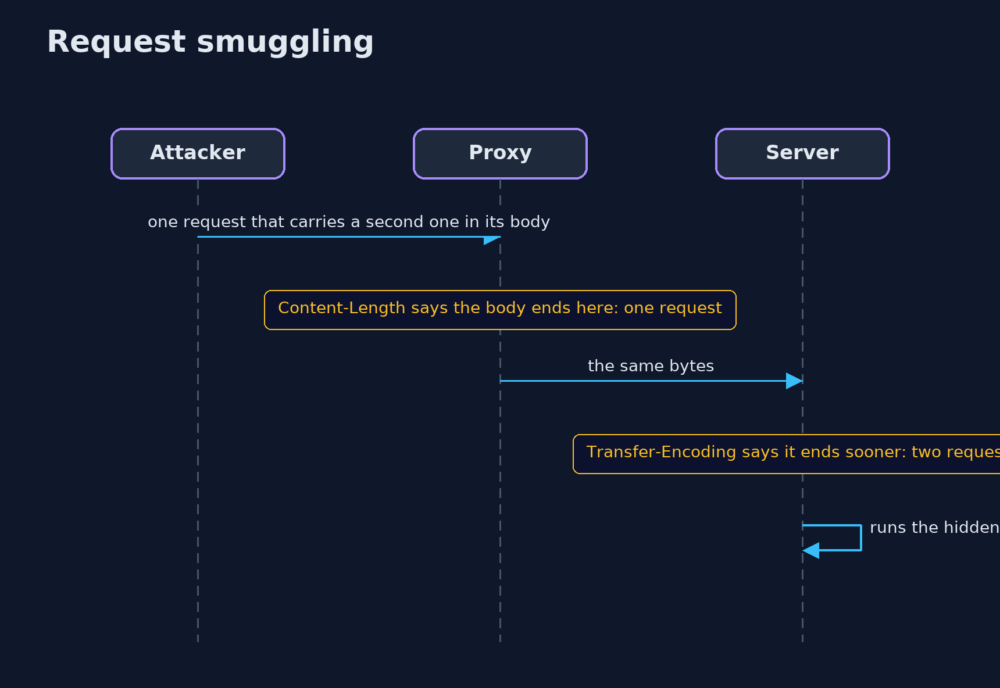
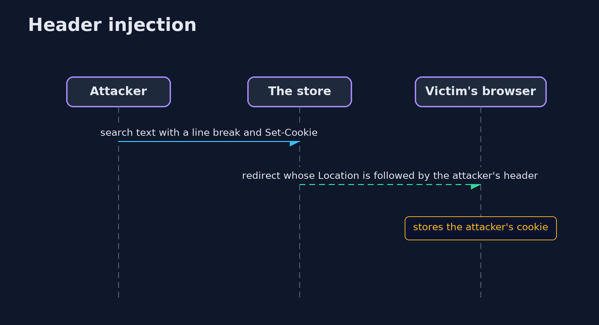

# HTTP Basics and Security Headers — UML Sequence Diagrams

## 1. Request smuggling

The proxy thinks one request, the server thinks two.

## 2. Header injection

A line break in customer text starts a new header.

