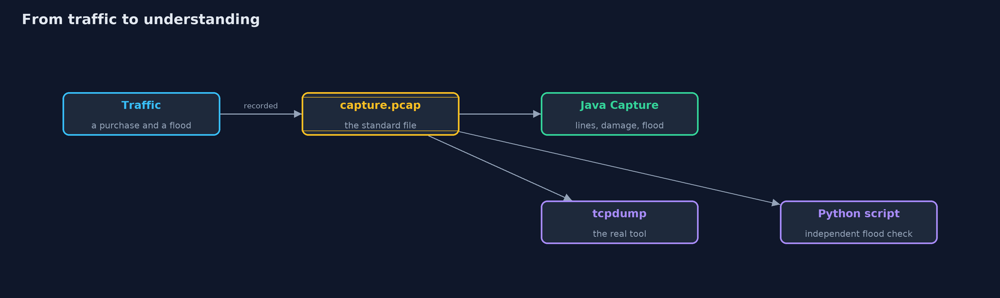
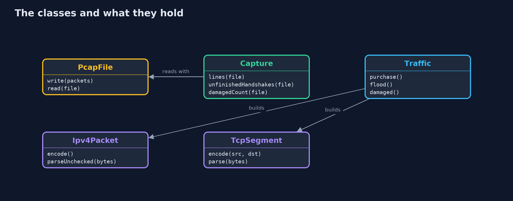
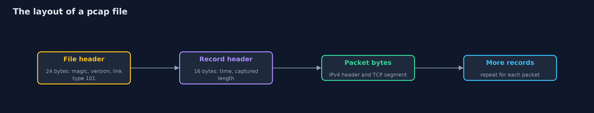
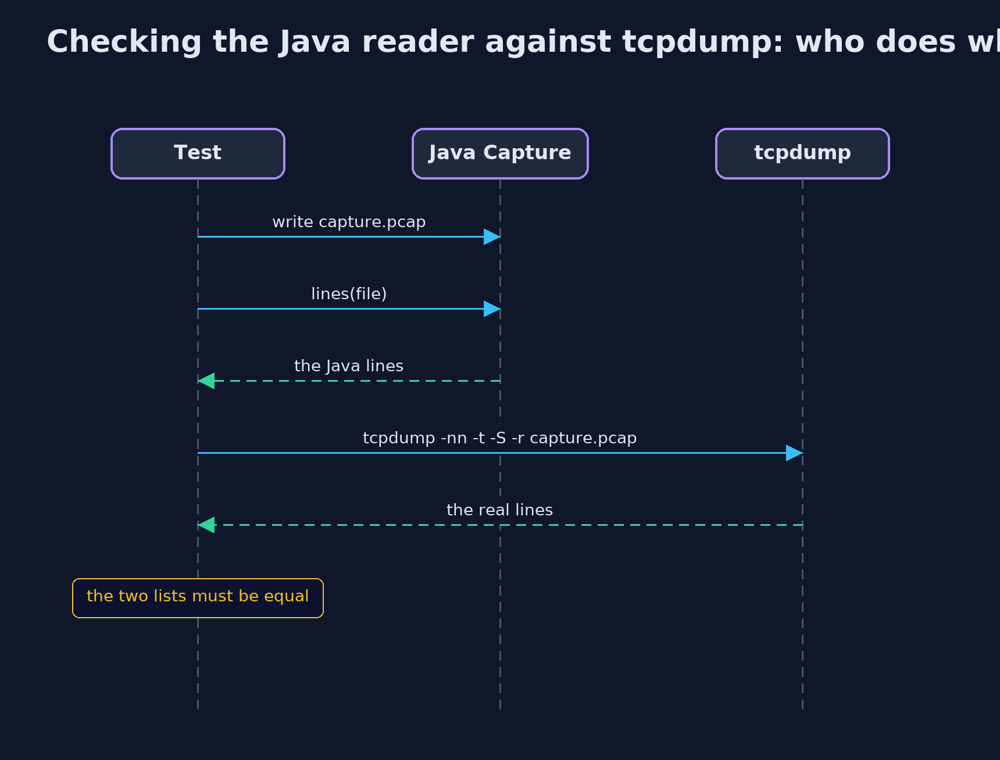

# TCP/IP Basics with tcpdump and Python

```
src/main/java/com/jk/explore/security/tcpipdump/
├── Address.java             IPv4 addresses as four bytes packed into an int
├── BadPacketException.java  A packet or segment that is too short, malformed or fails its checksum
├── Capture.java             Reads a capture: prints each packet in the style of `tcpdump -nn -t -S`, counts damaged packets, and finds sources that started a connection and never finished it
├── Checksum.java            The Internet checksum of RFC 1071: the ones' complement of the ones' complement sum of 16-bit words
├── Ipv4Packet.java          An IPv4 packet with a 20-byte header (no options) carrying a TCP segment
├── PcapFile.java            The classic libpcap capture file format, which tcpdump and Wireshark read: a 24-byte file header, then for each packet a 16-byte record header and the packet's bytes
├── TcpSegment.java          A TCP segment with a 20-byte header (no options)
├── TcpdumpDemo.java         Runs the online store story in five numbered acts: record traffic to a capture file, read it back, find a flood, find a damaged packet, and see what a capture reveals
└── Traffic.java             The traffic the demo records: one real customer's purchase, then a SYN flood, then one damaged packet
```

**A capture file shows what really arrived, damaged, forged or readable, and tcpdump and a short Python script can read the same file the Java code writes, but a capture is as sensitive as the traffic it holds.**

The plain version of this lesson built packets in memory. Real investigations start from a **capture**: a file of the packets that crossed a network interface. The standard format is **pcap**, a 24-byte file header and then, for each packet, a
16-byte record header and the packet's bytes. **tcpdump** is the classic command-line tool that records and prints captures, and Wireshark is its graphical cousin. Because pcap is a standard, this project writes a capture from Java
and lets tcpdump read it, and a short independent **Python** script finds the half-open handshakes of a SYN flood in the same file.

The demo records a customer's purchase, reads it back in tcpdump's format, finds a flood and a damaged packet, and ends with the cost: the capture holds the card number in the clear.

## The idea in everyday terms

Think of a security camera at the shop door. What the guards remember is one thing, what the tape shows is another. Reading the tape afterwards tells you who came in, in what order, and whether anyone was loitering, and the tape is
exactly as valuable to a thief as the shop's own secrets, so it is kept in a locked room.

## The scenario

An online store records the traffic of one customer's purchase, then of a SYN flood. The demo writes the capture, prints it as tcpdump would, finds the sources that never finished a handshake, and finds a packet whose checksum is wrong.

## Run

```bash
./gradlew run
```

The demo tells the story in 5 acts, each printing exact numbers that the tests check:

| Act | What it shows |
| --- | --- |
| 1. Recording traffic to a capture file | A purchase of 5 packets, 234 bytes, becomes a 338-byte pcap file: a 24-byte file header and 16 bytes of header for each packet. |
| 2. Reading it back, in the style of tcpdump | Each packet is printed with its addresses, ports, flags, sequence numbers and length, and the lines are the same as the real tcpdump prints. |
| 3. Finding a SYN flood in a capture | Of 14 packets, 9 sources sent a SYN and never finished the handshake; the real customer is not among them. |
| 4. Finding a damaged packet | One packet has a wrong checksum; plain tcpdump shows it like any other, and tcpdump -v marks the checksum incorrect. |
| 5. What a capture reveals | The capture contains the card number in the clear, so a capture file is as sensitive as the traffic; only TLS makes it useless to a thief. |

## Test

```bash
./gradlew test
```

13 tests in `CaptureTest`, `DemoRunsTest`, `ToolsInteropTest`. The capture file is written with fixed timestamps and packets, so it is identical every time. The ordinary tests need only a JDK; the integration tests (tagged tools) compare tcpdump's real output and a Python script's answer with the Java code's.

## What the simulation got right, and what it left out

The capture is written by Java with fixed timestamps, addresses and sequence numbers, so the file is identical every time. tcpdump and Python are used only by the integration tests, which compare their output with the Java code's. The demo itself
needs no tool, so it is the same on every machine. Live capture is not used.

## Technologies and versions

Every version below is pinned in the project's build files and was the latest stable release when the project was built.

| Technology | Version | Used for |
| --- | --- | --- |
| Java | 25 | the language and runtime; a Gradle toolchain finds or downloads the JDK |
| Gradle | 9.8.1 (wrapper) | build and run; nothing to install, the wrapper downloads it |
| org.junit.jupiter:junit-jupiter | 6.1.3, set by junit-bom | JUnit 5: the tests (tests only) |
| org.junit.platform:junit-platform-launcher | 6.1.3, set by junit-bom | JUnit platform launcher, which Gradle needs to run the tests (tests only) |
| tcpdump | 4.99.1 (libpcap 1.10.1) | the independent check that prints the capture the Java code writes; needed for the integration tests |
| Python | 3.14 | runs the independent flood detector in python/; standard library only |
| videokit | repository tool (`tools/videokit`) | the narrated video and animation: Piper `en_US-amy-medium`, speed 0.8, longer pauses (the amy-slow voice) |

## Learning Material

| Document | What it is for |
| --- | --- |
| [Dependencies](docs/dependencies.md) | what the framework and infrastructure are, and why they are here |
| [Problem statement](docs/problem-statement.md) | the situation and what the project must show |
| [Prerequisites](docs/prerequisites.md) | what you need to know first |
| [TCP/IP Basics with tcpdump and Python, explained](docs/tcp-ip-basics-with-tcpdump-explained.md) | the acts in prose |
| [Session guide](docs/session.md) | a one-hour lesson with exercises |
| [Animated walkthrough](docs/animation.html) | the acts step by step, narrated |
| [Threat model](docs/threat-model.md) | what is protected, who could harm it, and how, using STRIDE |
| [Spec](docs/spec.md) | what this project must be true of |
| [Expected output](docs/expected-output.txt) | the golden demo output every test and every port checks against |

### The idea in one picture

One capture file, three readers: the Java code, the real tcpdump and the Python script.



### Where each piece sits

PcapFile reads and writes the format; Capture analyses it; Traffic makes the packets.



### How the data moves

A file header, then a record header and the packet bytes for each packet.



### Who calls whom, in order




### Video

`video/tcp-ip-basics-with-tcpdump-explained.mp4` (with `.m4a` audio and `.srt` subtitles) is built by `video/build_video.sh`. Rendered media is not committed.

## What it costs

- **A capture is sensitive data.** It holds whatever crossed the wire, such as card numbers and cookies when TLS is not used, so it needs the same protection as the traffic.
- **Live capture needs privileges.** Reading from a network interface needs root, so work from recorded files, on a copy.
- **Captures grow fast.** A busy server can fill a disk in minutes, so capture filters and short captures are the habit.
- **A capture shows the wire, not the application.** With TLS you see sizes and timing, not content, which is the point of TLS.

## When this is too much

For understanding, a small capture and tcpdump are always worth it. For a production incident, use captures sparingly, with filters, for a short time, and store them securely, because the capture itself is a copy of every secret that crossed the wire.

## Where you have already met this

- `tcpdump` and Wireshark in every network troubleshooting guide.
- `.pcap` and `.pcapng` files attached to incident reports.
- Intrusion detection systems, which analyse traffic in the same way.
- Cloud "traffic mirroring" and "flow logs", which are captures with less detail.

## Where this sits

This project follows [tcp-ip-basics](../tcp-ip-basics) and is the second in [networking](..). It adds a tool for looking at what that project modelled.
