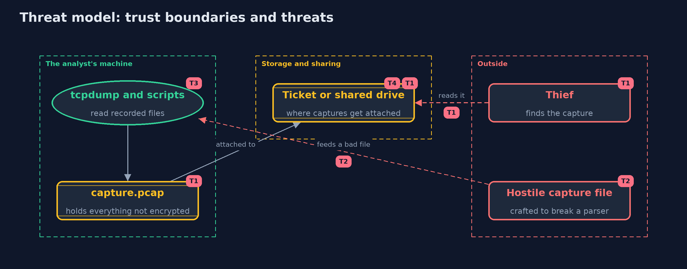

# Threat Model — TCP/IP Basics with tcpdump and Python

A threat model answers four questions: what are we protecting, who or what could harm it, how, and what do we do about it. This one covers this project's own demo system, not a production deployment. Domain: an online store.

## Scope

The handling of packet capture files by an analyst at an online store: recording, reading with tcpdump and scripts, storing and sharing. It does not cover live capture, the network that is being captured, or the content of any protocol above TCP.

## What we protect (assets)

- The capture file, which holds every byte that crossed the wire unencrypted.
- The analyst's machine, which parses the file.
- The places where captures are stored or attached.

## Who and what acts on the system

- An analyst who records and reads captures.
- A thief or colleague who finds a capture.
- An attacker who can influence a capture file's contents.

## Trust boundaries

A trust boundary is a line that data or a request crosses between parts that trust each other differently. Threats cluster where those lines are.

- Capture file to the people who can read it: a file moves from a restricted machine to tickets and shared drives.
- Capture file to the parser: a file from outside is untrusted input.

Each dashed box is a trust boundary. A rose tag such as T1 shows where the threat of that number, in the table below, applies.

## Threats, using STRIDE

STRIDE is a checklist of six kinds of threat: **Spoofing** (S), **Tampering** (T), **Repudiation** (R), **Information disclosure** (I), **Denial of service** (D), **Elevation of privilege** (E).

| Id | Kind | Threat | Where it shows up | Control in this project | What is left |
| --- | --- | --- | --- | --- | --- |
| T1 | Information disclosure | A capture file with card numbers or cookies is found, attached to a ticket or left on a shared drive | `Traffic`, `Capture.containsText` | Capture briefly and with filters, store securely, delete when done, and use TLS so the content is encrypted | Metadata such as addresses, sizes and timing remains visible even with TLS |
| T2 | Elevation of privilege | A crafted capture file exploits a flaw in the tool that reads it | `PcapFile.read` | The reader checks every length and rejects truncated or unexpected files | Keep tcpdump and Wireshark up to date, and open files from outside in a disposable environment |
| T3 | Tampering | A damaged or forged packet is trusted because only the application logs were read | `Capture.damagedCount` | Recompute checksums when reading a capture | A forged packet with a correct checksum is still accepted, so a checksum is not authentication |
| T4 | Repudiation | Nobody can show who recorded a capture, or whether it was changed afterwards | the capture file | None in pcap: record who captured it and when, and store a hash or signature with it | Without signatures a capture is weak evidence |

## Assumptions

- Captures are made with permission and a clear purpose.
- The analyst works on a copy, on a machine that is kept up to date.
- In the demo, all addresses are documentation addresses and the card number is a test value.

## Out of scope

- Live capture and the privileges it needs.
- Decrypting TLS captures.
- Intrusion detection.

## How the tests check this

- `CaptureTest` checks the pcap layout, round trips, truncated files, line format, the flood sources, the damaged packet, and the card number in the capture.
- `ToolsInteropTest` (integration) checks that the real tcpdump prints the same lines, that tcpdump -v marks the bad checksum, and that the Python script finds the same sources.
- `DemoRunsTest` compares the whole demo with the golden output.

## Where this model goes next

The next project, dns-basics, looks at how names become addresses, and how that answer too can be forged.
