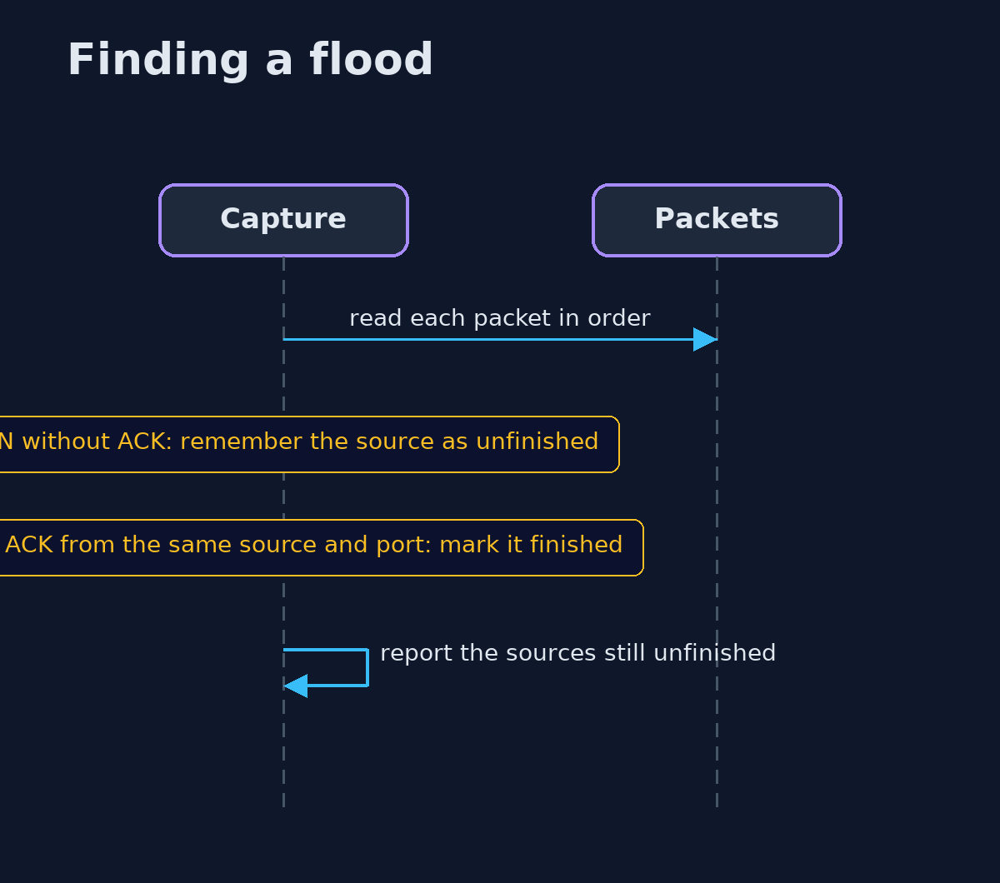
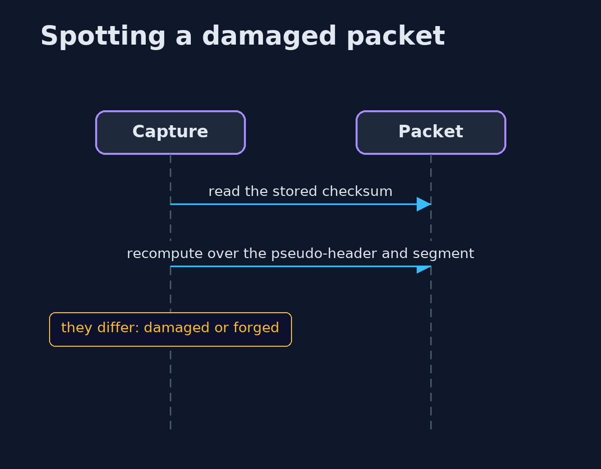

# TCP/IP Basics with tcpdump and Python — UML Sequence Diagrams

## 1. Finding a flood

A source that sent a SYN and never an ACK is unfinished.

## 2. Spotting a damaged packet

Recompute the checksum and compare.

