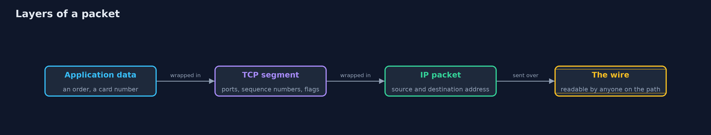
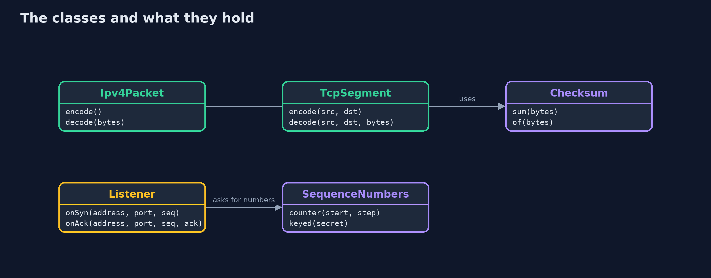
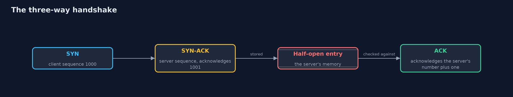
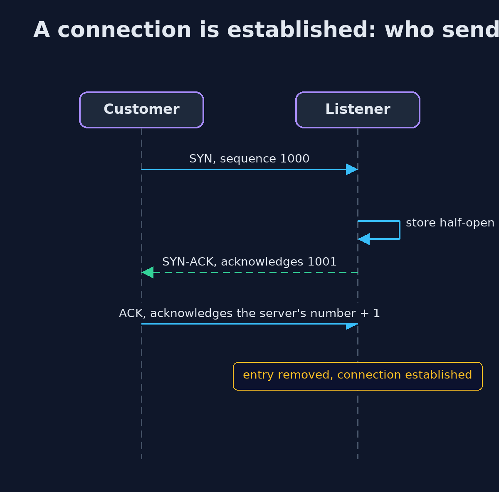

# TCP/IP Basics for Security

```
src/main/java/com/jk/explore/security/tcpip/
├── Address.java             IPv4 addresses as four bytes packed into an int
├── BadPacketException.java  A packet or segment that is too short, malformed or fails its checksum
├── Checksum.java            The Internet checksum of RFC 1071: the ones' complement of the ones' complement sum of 16-bit words
├── Ipv4Packet.java          An IPv4 packet with a 20-byte header (no options) carrying a TCP segment
├── Listener.java            The server side of the three-way handshake, as a state machine
├── PlaintextTap.java        A real TCP connection on the loopback interface, with a tap that records what crosses it, as a sniffer on the wire would
├── SequenceNumbers.java     Where a connection's first sequence number comes from
├── TcpIpDemo.java           Runs the online store story in five numbered acts and prints exact, repeatable results
└── TcpSegment.java          A TCP segment with a 20-byte header (no options)
```

**TCP/IP delivers bytes reliably, but it does not say who sent them, it does not hide them, and its handshake can be filled up: security has to be added on top.**

Almost everything on the internet rides on **IP**, which moves packets from one address to another, and **TCP**, which turns those packets into a reliable, ordered stream of bytes.
Both were designed for cooperation, not defence. A packet's **source address** is only a field the sender fills in. A **checksum** catches accidents and has no key. A **connection** begins with a
three-way **handshake**, and the server must remember each half-finished handshake, which is what a **SYN flood** abuses. And the stream TCP delivers is not hidden from anyone on the path.

The demo builds an IPv4 packet and a TCP segment byte by byte, runs the handshake as a state machine, floods it, defends it with SYN cookies, forges a connection by guessing numbers, and sends a card number over a real connection.

## The idea in everyday terms

Think of the postal system. Each envelope carries a return address that anyone can write, whatever is true. A smudge check on the envelope catches rain damage, not a forger. Starting a conversation by post means three letters:
"are you there?", "yes, are you?", "yes". A shop that must reserve a chair for everyone who sends the first letter can be emptied of chairs by someone sending thousands of first letters from fake addresses.

## The scenario

An online store's web server receives connections from customers. The demo shows what a packet contains, what its checksum does not protect, how a connection begins, how the store's connection table is filled by an attacker,
how a connection is forged by guessing numbers, and what an observer sees of a real connection.

## Run

```bash
./gradlew run
```

The demo tells the story in 5 acts, each printing exact numbers that the tests check:

| Act | What it shows |
| --- | --- |
| 1. Layers: a packet inside a packet | A TCP segment is 20 bytes and inside an IP packet it is 40 bytes; the packet decodes again, but nothing in it says who the sender really is. |
| 2. A checksum catches accidents, not attackers | A changed byte is refused, but the same change made by someone who recomputes the checksum is accepted, because the checksum has no key. |
| 3. The three-way handshake | SYN with sequence 1000, SYN-ACK acknowledging 1001 and one half-open entry, ACK establishes the connection; an ACK with no SYN before it is refused. |
| 4. A SYN flood | Eight SYNs that never answer fill a table of eight, so a real customer is refused; SYN cookies keep no entry and the customer still connects. |
| 5. Guessable numbers, and a stream anyone can read | A counter that adds 64000 lets an attacker forge a connection as the admin machine; a keyed hash does not; and a real connection shows the card number to anyone watching. |

## Test

```bash
./gradlew test
```

19 tests in `DemoRunsTest`, `ListenerTest`, `PacketsTest`. The checksum is checked against the RFC 1071 example. Packets are built and read in memory, the handshake is a state machine with fixed addresses, and the one real connection prints only facts that do not depend on port numbers, so the golden output is the same on every run.

## What the simulation got right, and what it left out

All packets are built and read in memory, so the demo is exact. The one real connection is on the loopback interface of the machine running it, and the demo prints only facts that do not depend on port numbers.
The checksum is checked against the example in RFC 1071.

## Technologies and versions

Every version below is pinned in the project's build files and was the latest stable release when the project was built.

| Technology | Version | Used for |
| --- | --- | --- |
| Java | 25 | the language and runtime; a Gradle toolchain finds or downloads the JDK |
| Gradle | 9.8.1 (wrapper) | build and run; nothing to install, the wrapper downloads it |
| org.junit.jupiter:junit-jupiter | 6.1.3, set by junit-bom | JUnit 5: the tests (tests only) |
| org.junit.platform:junit-platform-launcher | 6.1.3, set by junit-bom | JUnit platform launcher, which Gradle needs to run the tests (tests only) |
| videokit | repository tool (`tools/videokit`) | the narrated video and animation: Piper `en_US-amy-medium`, speed 0.8, longer pauses (the amy-slow voice) |

## Learning Material

| Document | What it is for |
| --- | --- |
| [Problem statement](docs/problem-statement.md) | the situation and what the project must show |
| [Prerequisites](docs/prerequisites.md) | what you need to know first |
| [TCP/IP Basics for Security, explained](docs/tcp-ip-basics-explained.md) | the acts in prose |
| [Session guide](docs/session.md) | a one-hour lesson with exercises |
| [Animated walkthrough](docs/animation.html) | the acts step by step, narrated |
| [Threat model](docs/threat-model.md) | what is protected, who could harm it, and how, using STRIDE |
| [Spec](docs/spec.md) | what this project must be true of |
| [Expected output](docs/expected-output.txt) | the golden demo output every test and every port checks against |

### The idea in one picture

Each layer wraps the one above; none of them proves who sent it.



### Where each piece sits

Packets and segments are values; Listener is the state machine; SequenceNumbers decides what the server's first number is.



### How the data moves

The server must remember the middle step, and that memory is what a SYN flood fills.



### Who calls whom, in order




### Video

`video/tcp-ip-basics-explained.mp4` (with `.m4a` audio and `.srt` subtitles) is built by `video/build_video.sh`. Rendered media is not committed.

## What it costs

- **SYN cookies are for emergencies.** They drop TCP options and cost a hash for every SYN, so servers switch them on only when the table is full.
- **Keyed sequence numbers need a good secret.** The secret must be unpredictable, and replaced from time to time.
- **Filtering by address helps only near the source.** Spoofed packets are stopped by ingress filtering at the networks they come from, which the store does not control.
- **The demo is a model.** It builds packets and a state machine in memory, with no options, no retransmission and no real IP stack, so it teaches the ideas and not the full protocol.

## When this is too much

For most applications, TCP/IP is something to understand and leave alone: the operating system implements it. The knowledge matters when something goes wrong or something is attacked,
and when choosing where to put defences: rate limits, firewalls, SYN cookies, and above all TLS.

## Where you have already met this

- `netstat` and `ss`, which list connections and their states, such as SYN_RECV and ESTABLISHED.
- `tcpdump` and Wireshark, which show packets with their flags.
- Firewall rules that say "drop packets from this source".
- News stories about SYN floods and denial-of-service attacks.

## Where this sits

This project is the first in [networking](..) and builds on [authentication-vs-authorization](../../identity/authentication-vs-authorization): knowing who is on the other end of a connection is the problem that the later projects solve.
