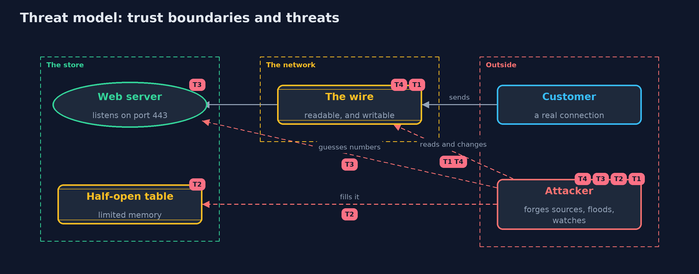

# Threat Model — TCP/IP Basics for Security

A threat model answers four questions: what are we protecting, who or what could harm it, how, and what do we do about it. This one covers this project's own demo system, not a production deployment. Domain: an online store.

## Scope

An online store's web server accepting TCP connections: the packets it receives, the handshake that starts a connection, the table that remembers half-finished handshakes, the sequence numbers it chooses and the stream that follows.
It covers an attacker who can send packets with any source address and can watch the path. It does not cover the web application on top, names, or encryption.

## What we protect (assets)

- The server's ability to accept connections (availability).
- The identity attached to a connection, such as a trusted admin address.
- The content of the stream.
- The server's table of half-open connections.

## Who and what acts on the system

- Customers making real connections.
- An attacker who can send packets from any claimed address.
- An observer on the network path.

## Trust boundaries

A trust boundary is a line that data or a request crosses between parts that trust each other differently. Threats cluster where those lines are.

- Internet to the store's server: every packet crosses it and none proves its sender.
- Server to its half-open table: the memory a flood fills.

Each dashed box is a trust boundary. A rose tag such as T1 shows where the threat of that number, in the table below, applies.

## Threats, using STRIDE

STRIDE is a checklist of six kinds of threat: **Spoofing** (S), **Tampering** (T), **Repudiation** (R), **Information disclosure** (I), **Denial of service** (D), **Elevation of privilege** (E).

| Id | Kind | Threat | Where it shows up | Control in this project | What is left |
| --- | --- | --- | --- | --- | --- |
| T1 | Spoofing | A packet claims a source address that is not the sender's | `Ipv4Packet` | None in the protocol; never use a source address as identity, and filter at the edge | Identity needs keys: TLS and authentication |
| T2 | Denial of service | A SYN flood fills the table of half-open connections | `Listener.onSyn` | SYN cookies keep no state for a SYN | Cookies drop options and cost work, and a flood can still use up bandwidth |
| T3 | Spoofing | A connection is forged by guessing the server's sequence number | `SequenceNumbers` | A keyed hash of the connection and a counter, as in RFC 6528 | The secret must be unpredictable and replaced from time to time |
| T4 | Tampering | A packet is changed on the path and its checksum recomputed | `Checksum` | None: the checksum has no key | Integrity needs a keyed code or a signature, as in TLS |
| T5 | Information disclosure | An observer reads the stream | `PlaintextTap` | None in TCP | Encrypt the stream with TLS |

## Assumptions

- The attacker cannot see replies sent to a spoofed address.
- The server's secret for sequence numbers and cookies is unpredictable.
- In the demo, addresses are documentation addresses and the secret is a fixed demo value.

## Out of scope

- Names and the web: the next projects.
- Encryption and certificates: the transport-security module.
- Network-level defences such as ingress filtering and load balancers.

## How the tests check this

- `PacketsTest` checks the RFC 1071 checksum, packet round trips, and that any changed header byte is caught.
- `ListenerTest` checks the handshake, full tables, SYN cookies, guessable and keyed numbers, and a real connection.
- `DemoRunsTest` compares the whole demo with the golden output.

## Where this model goes next

The next project, dns-basics, looks at how names become addresses, and how that answer too can be forged.
