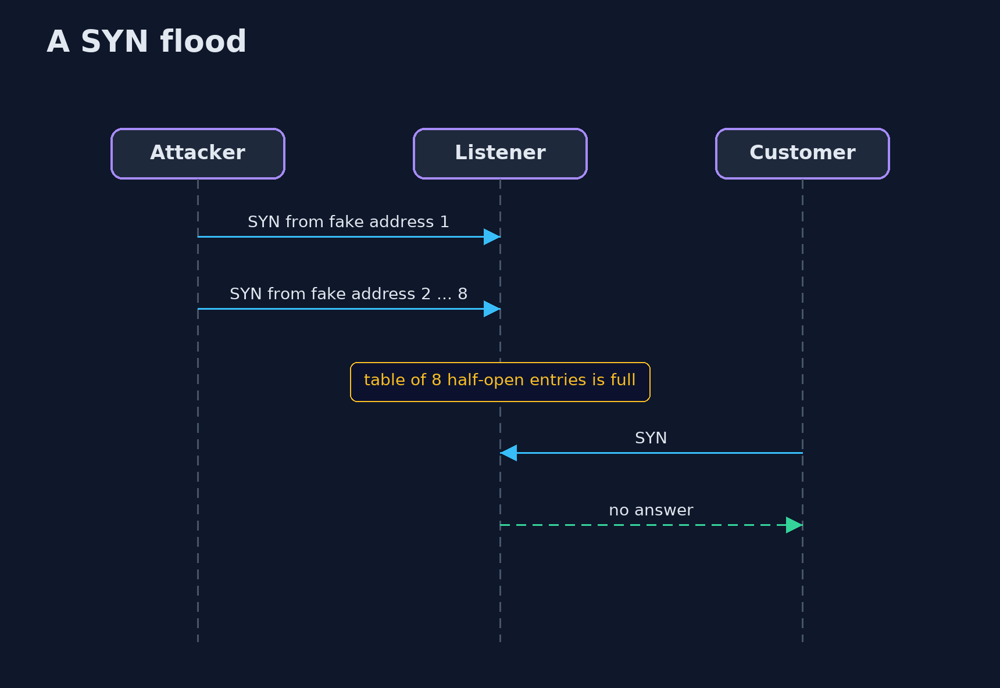
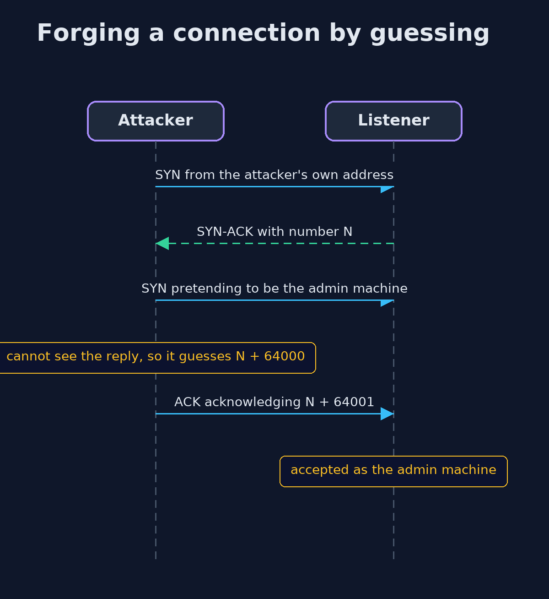

# TCP/IP Basics for Security — UML Sequence Diagrams

## 1. A SYN flood

Spoofed addresses never answer, so the entries stay until the table is full.

## 2. Forging a connection by guessing

With a counter the next number is the last one plus 64000.

