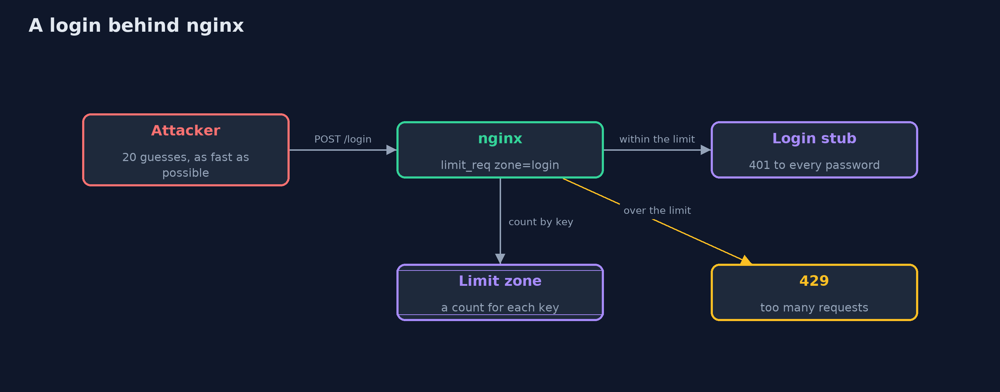
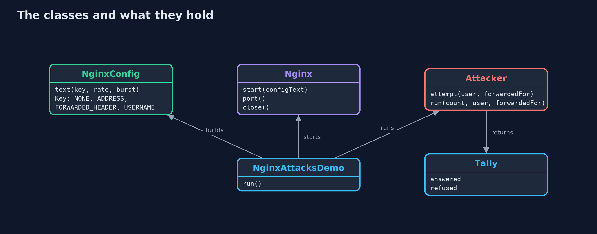
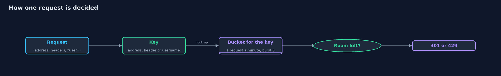
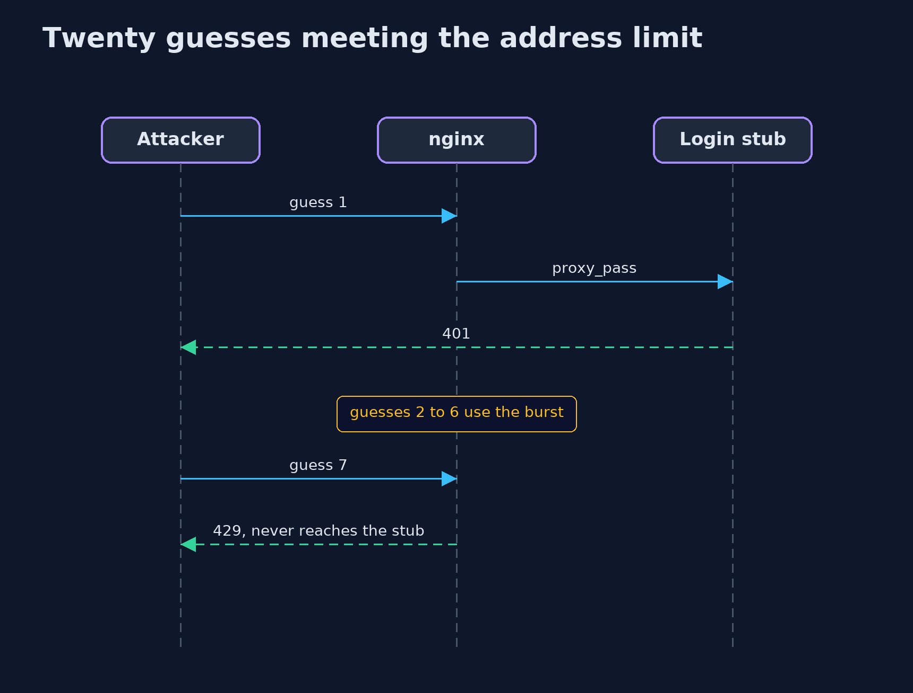

# Password Attacks and Defences with nginx

```
src/main/java/com/jk/explore/security/attacksnginx/
├── Attacker.java          Sends login attempts to the nginx login, one after another as fast as it can, and counts the answers
├── Nginx.java             One nginx container with a given configuration, started for a demo and stopped afterwards
├── NginxAttacksDemo.java  Runs the online bank story in five numbered acts against real nginx containers and prints repeatable results
├── NginxConfig.java       Writes the nginx configuration for one version of the login
└── Tally.java             How many attempts were answered by the login (401) and how many were turned away by the limit (429)
```

**nginx can rate-limit a login before it reaches the application, but the limit is only as good as the key it counts, and a key the attacker can choose is no limit at all.**

The plain version of this lesson modelled a bank's login with a clock made of ticks. This project puts a real piece of software in
front of the login: **nginx**, a web server that is very often the first thing a request meets. Its `limit_req` directive keeps a count
of requests for each **key** and turns away those that arrive too fast, answering 429 (Too Many Requests). The key is a choice, and
the choice matters more than the numbers. Count by the connection's real address and an attacker with one address is held to
the limit. Count by a header the client writes itself, such as `X-Forwarded-For`, and the attacker simply writes a new value
for every attempt.

The demo starts a real nginx in a Docker container for each act, sends twenty guesses at a login with a plain Java client, and
counts what came back. The login itself is a stub that answers 401 to every password, so only the limit decides what the attacker sees.

## The idea in everyday terms

Think of a door guard at a bank who allows each visitor six entries an hour. If the guard recognises visitors by their
face, a thief is held to six. If the guard asks visitors for their name and trusts what they say, the thief says a
new name each time and walks in twenty times. The rule was fine. What the guard counted was wrong.

## The scenario

An online bank's login sits behind nginx. Twenty guesses at Dana's account arrive from one machine, as fast as it can send
them. The bank tries five arrangements: no limit, a limit on the client address, a limit on a header, the same limit on the
real address, and a limit per username. In each, the attacker's twenty guesses and what happens to them are counted. The rate is one request
a minute with a burst of five, so the limit's effect shows within a moment and does not depend on timing.

## Run

```bash
./gradlew run
```

The demo tells the story in 5 acts, each printing exact numbers that the tests check:

| Act | What it shows |
| --- | --- |
| 1. nginx in front of the login, with no limit | With no limit, all 20 guesses at Dana's login are answered with 401. |
| 2. limit_req on the client's address: 1r/m, burst 5 | Keyed on the connection address, the limit lets 6 guesses through, 1 plus the burst of 5, and refuses the other 14 with a 429. |
| 3. The same limit, but counted on the X-Forwarded-For header | Keyed on a header the client writes, the attacker sends a different value each time and all 20 guesses are answered. |
| 4. The same limit, counted on the real connection address | Keyed on the real address, changing the header buys nothing: 6 answered and 14 refused again. |
| 5. The bill: a limit per username | Keyed on the username, the limit holds an attack on Dana to 6 but also turns Dana away, and a spray of 20 usernames is never limited. |

## Test

```bash
./gradlew test
```

13 tests in `NginxConfigTest`, `NginxContainerTest`, `ReferenceConfigTest`. The unit tests (`./gradlew test`) check the generated nginx configurations and need no Docker. The tests that start real containers, including the golden-output comparison, are tagged `docker` and run with `./gradlew integrationTest`. The demo's comparison with its golden output runs with the integration tests, because the demo needs Docker: run `./gradlew integrationTest` after changing the demo or its narration.

## What the simulation got right, and what it left out

The login is a stub inside the same nginx, answering 401 to every password, because the lesson is about the limit and not
about checking passwords. The rate is one request a minute with a burst of five: nginx's limit counts in real time, so
the demo chooses a rate so slow that the whole run takes a few seconds and the counts are the same every time. Real limits use rates such as
five a second, and need more care. The demo cannot send requests from different real addresses, so the difference between the
connection address and a client-written header is shown by changing the header only.

## Technologies and versions

Every version below is pinned in the project's build files and was the latest stable release when the project was built.

| Technology | Version | Used for |
| --- | --- | --- |
| Java | 25 | the language and runtime; a Gradle toolchain finds or downloads the JDK |
| Gradle | 9.8.1 (wrapper) | build and run; nothing to install, the wrapper downloads it |
| org.junit.jupiter:junit-jupiter | 6.1.3, set by junit-bom | JUnit 5: the tests (tests only) |
| org.junit.platform:junit-platform-launcher | 6.1.3, set by junit-bom | JUnit platform launcher, which Gradle needs to run the tests (tests only) |
| nginx (container image) | nginx:1.31.7-alpine | the web server and rate limiter in front of the login, pinned to an exact version |
| Docker | any recent Docker Engine or Docker Desktop | runs the nginx container for the demo and the container tests |
| videokit | repository tool (`tools/videokit`) | the narrated video and animation: Piper `en_US-amy-medium`, speed 0.8, longer pauses (the amy-slow voice) |

## Learning Material

| Document | What it is for |
| --- | --- |
| [Dependencies](docs/dependencies.md) | what the framework and infrastructure are, and why they are here |
| [Problem statement](docs/problem-statement.md) | the situation and what the project must show |
| [Prerequisites](docs/prerequisites.md) | what you need to know first |
| [Password Attacks and Defences with nginx, explained](docs/password-attacks-and-defences-with-nginx-explained.md) | the acts in prose |
| [Session guide](docs/session.md) | a one-hour lesson with exercises |
| [Animated walkthrough](docs/animation.html) | the acts step by step, narrated |
| [Threat model](docs/threat-model.md) | what is protected, who could harm it, and how, using STRIDE |
| [Spec](docs/spec.md) | what this project must be true of |
| [Expected output](docs/expected-output.txt) | the golden demo output every test and every port checks against |

### The idea in one picture

The attacker's guesses meet nginx first. The limit zone counts them by a key, and only those within the limit reach the login stub.



### Where each piece sits

The configuration is generated from a Key; the container runs it; the attacker counts the answers.



### How the data moves

nginx takes the key from the request, looks up its bucket, and lets the request through or answers 429.



### Who calls whom, in order




### Video

`video/password-attacks-and-defences-with-nginx-explained.mp4` (with `.m4a` audio and `.srt` subtitles) is built by `video/build_video.sh`. Rendered media is not committed.

## What it costs

- **Counting the wrong thing makes the limit useless.** A limit keyed on `X-Forwarded-For` or any other client-written header is bypassed by changing it. Behind a proxy or load balancer, the real address must be taken from a header only the trusted proxy sets.
- **A limit per username locks the owner out too.** While the bucket for Dana is full, Dana's own login is turned away, from any address.
- **A limit per username misses a spray.** One guess at each of many usernames never fills any bucket.
- **Shared addresses are punished together.** Many customers behind one office or mobile network address share one bucket.
- **Docker is a dependency of the demo.** The container has to start, and the image has to be present.

## When this is too much

A site with no accounts does not need a login limit. For one that does, a limit at the front door is cheap and worth having. nginx is
only one place to put it, and the same ideas apply to any reverse proxy, load balancer or cloud gateway: choose the key carefully, return 429,
and combine the limit with the lockout, second factor and breach check from the plain project.

## Where you have already met this

- A "429 Too Many Requests" page, sometimes with a "try again later" message.
- `limit_req_zone` and `limit_req` lines in an nginx configuration.
- An API that documents its rate limits in a response header.
- Advice to "never trust X-Forwarded-For" in a security review.

## Where this sits

This project is the fourth in [passwords-and-mfa](..), the nginx version of [password-attacks-and-defences](../password-attacks-and-defences).
