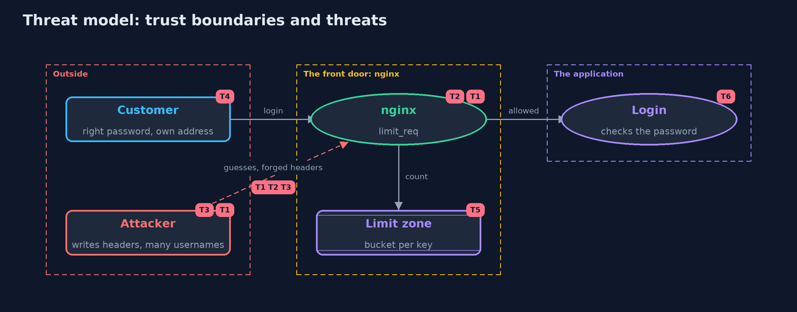

# Threat Model — Password Attacks and Defences with nginx

A threat model answers four questions: what are we protecting, who or what could harm it, how, and what do we do about it. This one covers this project's own demo system, not a production deployment. Domain: an online bank.

## Scope

The front door of an online bank's login: an nginx container with a request limit, and the login stub behind it. It covers
which key the limit counts, how an attacker can avoid the limit, and what the limit does to a real customer. It does not cover the password check itself, TLS
or the rest of the bank.

## What we protect (assets)

- Customers' accounts, which guessing targets.
- The availability of login to the real customer.
- The login service, which should not be asked more often than needed.
- The limit's own state: the count for each key.

## Who and what acts on the system

- An attacker with one machine, sending guesses as fast as possible.
- An attacker who writes request headers and chooses usernames.
- A real customer, logging in from their own address.
- The operator, who writes the nginx configuration.

## Trust boundaries

A trust boundary is a line that data or a request crosses between parts that trust each other differently. Threats cluster where those lines are.

- Internet to nginx: the line where the limit decides.
- nginx to the login: only requests within the limit cross it.
- Client-written headers to the key: a header must not become a key unless a trusted proxy set it.

Each dashed box is a trust boundary. A rose tag such as T1 shows where the threat of that number, in the table below, applies.

## Threats, using STRIDE

STRIDE is a checklist of six kinds of threat: **Spoofing** (S), **Tampering** (T), **Repudiation** (R), **Information disclosure** (I), **Denial of service** (D), **Elevation of privilege** (E).

| Id | Kind | Threat | Where it shows up | Control in this project | What is left |
| --- | --- | --- | --- | --- | --- |
| T1 | Spoofing | Guessing at the login with no limit | nginx in act one | limit_req keyed on the real connection address: one plus the burst gets through | An attacker with many real addresses has many buckets |
| T2 | Spoofing | The limit is bypassed by changing a header the limit counts | `NginxConfig.Key.FORWARDED_HEADER` | Key on the connection address; behind a proxy, take it from a header only that proxy sets | A misconfigured proxy can bring the problem back |
| T3 | Spoofing | A spray of many usernames never fills a per-username bucket | `NginxConfig.Key.USERNAME` | Add a limit per address beside it | A spray from many addresses still gets through |
| T4 | Denial of service | A per-username limit turns away the real owner while an attacker fills the bucket | `NginxConfig.Key.USERNAME` | Prefer the address key, or accept the cost knowingly | Any key that an outsider can fill can be used to deny service |
| T5 | Denial of service | Many customers behind one shared address share one bucket | the limit zone | None here | Tune the rate to the traffic, or key on a combination of signals |
| T6 | Elevation of privilege | The login is reachable without passing the limit | the port of the login stub | The stub listens inside the container only; the demo publishes only port 80 | In a real system the application must not be directly reachable from outside nginx |

## Assumptions

- nginx sees the real client address. In the demo it sees the Docker network's address, which stands for one attacker.
- In a real deployment behind a trusted proxy, only that proxy can set the forwarded header, and it overwrites what clients send.
- The rate is deliberately slow here, so counts are repeatable.

## Out of scope

- TLS, timeouts, logging and the rest of a production nginx configuration.
- Distributed attackers with many real addresses.
- Checking the password: the plain password-attacks-and-defences project does that.

## How the tests check this

- `NginxConfigTest` checks the generated configurations, including the key, the burst and that `limit_req` sits beside `proxy_pass`.
- `ReferenceConfigTest` checks that `infra/nginx-limit-by-address.conf` is what the code generates.
- `NginxContainerTest` (tagged `docker`) starts real containers and checks the counts for all five keys and the golden output.

## Where this model goes next

The next project, totp-multi-factor, builds the second factor that makes a guessed password not enough.
