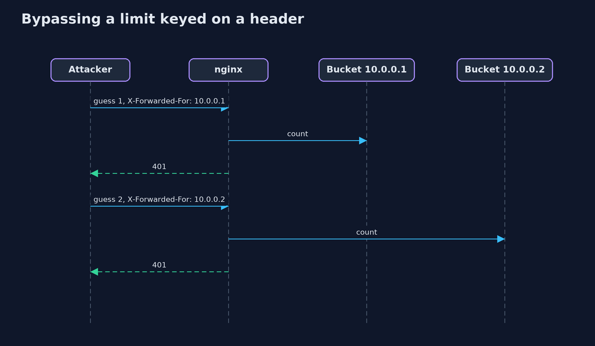
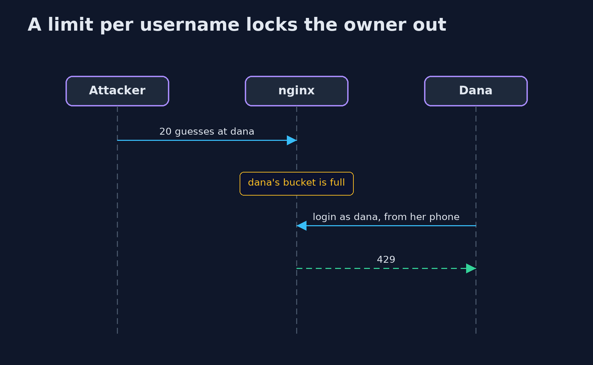

# Password Attacks and Defences with nginx — UML Sequence Diagrams

## 1. Bypassing a limit keyed on a header

Every guess carries a new X-Forwarded-For value, so every guess finds an empty bucket.

## 2. A limit per username locks the owner out

Dana's bucket was filled by the attacker, and Dana's own login uses the same bucket.

