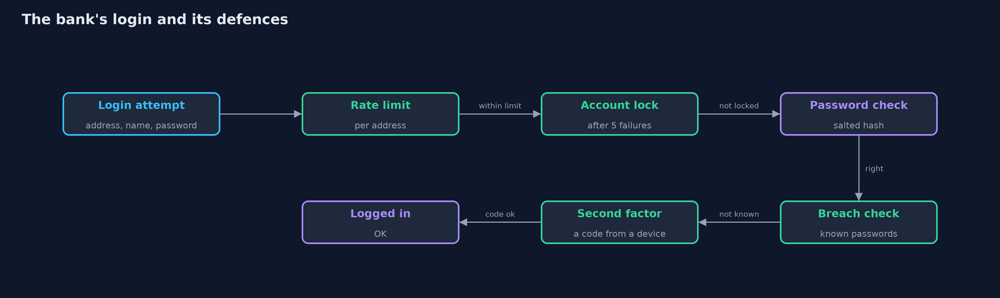
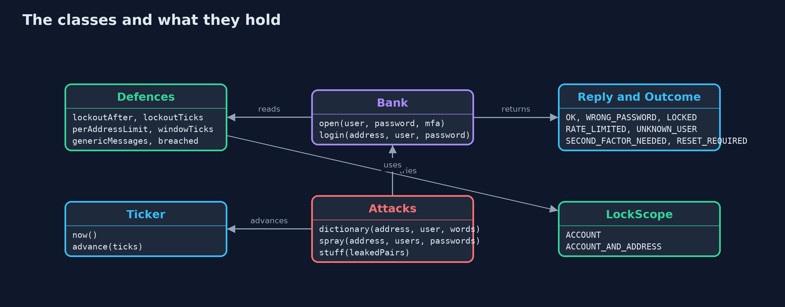
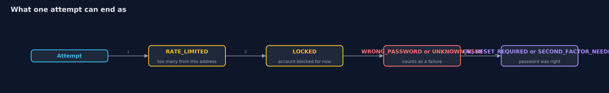
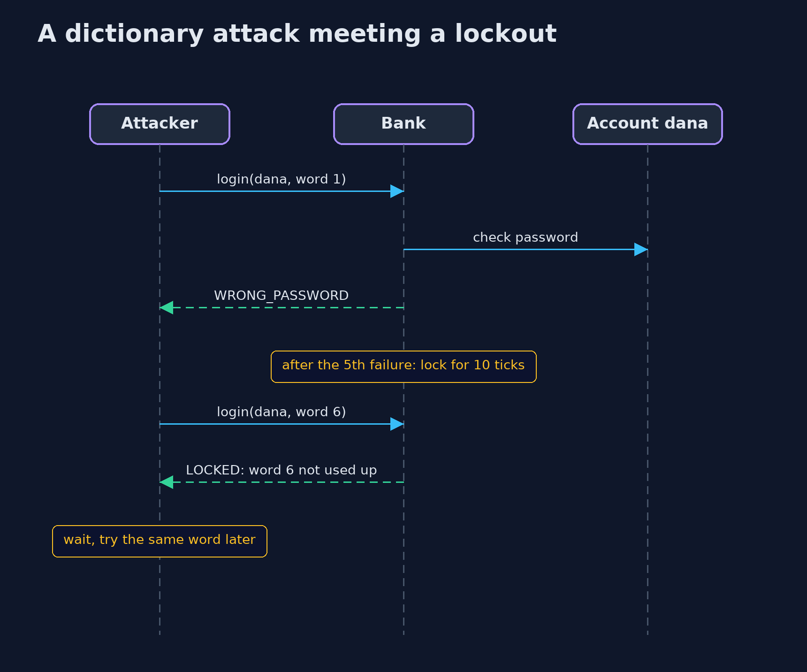

# Password Attacks and Defences

```
src/main/java/com/jk/explore/security/attacks/
├── Attacks.java      The three ways of guessing online, each as a short script run against a bank's login
├── AttacksDemo.java  Runs the online bank story in five numbered acts and prints exact, repeatable results
├── Bank.java         The login of an online bank, with the defences against guessing that {@link Defences} switches on
├── Defences.java     Which defences the bank's login has switched on
├── Found.java        What an attack achieved
├── LockScope.java    What a lockout counts failures against: the account as a whole, or each account-and-address pair on its own
├── Outcome.java      What the bank's login answered to one attempt
├── Reply.java        The bank's answer to one login attempt: the outcome, and the message the person sees
└── Ticker.java       A clock made of ticks (think of each tick as a second), so lockouts and limits need no waiting and every run is identical
```

**A bank's login can be guessed at through three kinds of attack, dictionary, spraying and stuffing, and each defence, lockout, rate limit, second factor and breach check, stops one and misses another.**

Hashing protects passwords after a theft. But an attacker does not have to steal anything: the login page
itself will answer every guess. There are three common ways to use it. A **dictionary attack** tries many passwords
against one account. **Password spraying** tries a few very common passwords against every account, so no single account
sees many failures. **Credential stuffing** takes pairs of usernames and passwords leaked from another site and tries each pair once,
hoping people reused them.

Four defences answer them. A **lockout** blocks an account after too many failures. A **rate limit** caps the
attempts one address may make. A **second factor** stops a right password from being enough. A **check against known breaches** refuses
passwords that are already public. This project runs each attack against a bank's login with each defence in turn, on a clock made of ticks, and counts
what the attack managed to do.

## The idea in everyday terms

Think of a night guard at a bank vault. A patient thief tries one key after another. The guard can ring an alarm
after five wrong keys, which stops the thief, and also stops a customer whose key sticks. He can allow each visitor only
five tries an hour. But a thief with a ring of stolen keys, one for each of a hundred doors, tries each key only once, and
never trips any of it. Only a second lock that needs something else, or a list of keys known to be stolen, catches that thief.

## The scenario

An online bank has ten customers. Dana's password, midnight7, is on the attacker's list of twenty common passwords. Emil,
Farah and Hana chose welcome1, and Ivan chose hunter2. Gus, Kate and Mona chose long random passwords. Joel and Liam chose
passwords that were also leaked from another site, as did Dana and Farah. The attacker has no stolen database, only the bank's
login page and a clock that ticks once for every attempt.

## Run

```bash
./gradlew run
```

The demo tells the story in 5 acts, each printing exact numbers that the tests check:

| Act | What it shows |
| --- | --- |
| 1. No defences | A dictionary attack finds Dana's password in 14 guesses at tick 13, and spraying three common passwords takes 4 of 10 accounts in 23 guesses. |
| 2. Lock an account after 5 wrong passwords, for 10 ticks | The dictionary attack on Dana now wins at tick 33 instead of 13, but the spray still takes 4 accounts, because no account fails 5 times. |
| 3. Allow each address 5 attempts in every 10 ticks | A rate limit per address delays Dana's password to tick 23 and stretches the spray to 43 ticks, but both still succeed. |
| 4. Credential stuffing: passwords leaked from another site | With lockout and rate limit, 4 of 10 accounts still fall; a second factor on 2 of them cuts that to 2; a breach check cuts it to 0 and forces 4 resets. |
| 5. The bill: a lock can be used against the customer, and messages can leak | An attacker can lock Dana out, locking per address avoids that but gives 10 addresses 50 guesses, and different error messages reveal which names exist. |

## Test

```bash
./gradlew test
```

21 tests in `AttacksTest`, `BankTest`, `DemoRunsTest`. Every line the demo prints is checked against `docs/expected-output.txt`. Time is a tick counter and nothing is random, so every run gives the same result.

## What the simulation got right, and what it left out

Time is a counter of ticks, one per attempt, so every run is the same. The wordlists are tiny: 20 words for the dictionary and 3 for the spray,
where a real attacker has billions. Real systems also see attackers spread over thousands of addresses, who defeat a limit per address,
and defenders use further signals, such as device recognition and unusual locations, which this project does not model.

## Technologies and versions

| Technology | Version | Used for |
| --- | --- | --- |
| Java | 25 | the code (toolchain set in `build.gradle`; Gradle finds or downloads the JDK) |
| Gradle | 9.2.1 (wrapper) | build and run, nothing to install |
| JUnit | 5.10.2 | the tests |
| videokit | repository tool (`tools/videokit`) | the narrated video and animation: Piper `en_US-amy-medium`, speed 0.8, longer pauses (the amy-slow voice) |

## Learning Material

| Document | What it is for |
| --- | --- |
| [Problem statement](docs/problem-statement.md) | the situation and what the project must show |
| [Prerequisites](docs/prerequisites.md) | what you need to know first |
| [Password Attacks and Defences, explained](docs/password-attacks-and-defences-explained.md) | the acts in prose |
| [Session guide](docs/session.md) | a one-hour lesson with exercises |
| [Animated walkthrough](docs/animation.html) | the acts step by step, narrated |
| [Threat model](docs/threat-model.md) | what is protected, who could harm it, and how, using STRIDE |
| [Spec](docs/spec.md) | what this project must be true of |
| [Expected output](docs/expected-output.txt) | the golden demo output every test and every port checks against |

### The idea in one picture

An attempt passes the rate limit, then the account lock, then the password check, then the breach check and the second factor, and each can turn it away.



### Where each piece sits

Bank is the login; Defences says which protections are on; Attacks holds the three scripts.



### How the data moves

An attempt can be turned away at four places before it reaches a verdict.



### Who calls whom, in order




### Video

`video/password-attacks-and-defences-explained.mp4` (with `.m4a` audio and `.srt` subtitles) is built by `video/build_video.sh`. Rendered media is not committed.

## What it costs

- **A lockout can be used against the customer.** An attacker who fails five times on Dana's account locks Dana out. Locking each account-and-address pair on its own helps, but an attacker with many addresses gets more guesses.
- **Rate limits slow, they do not stop.** Five attempts every ten ticks still lets a patient attacker through, and shared addresses, such as an office, can hit the limit by accident.
- **A second factor adds friction** for every login, and for the customers who lose the device.
- **Messages can leak.** A different message for an unknown name and a wrong password tells an attacker which usernames exist. One message for both is safer, and makes real mistakes harder to explain.

## When this is too much

A site with no accounts has nothing to defend. As soon as there are accounts, a rate limit is the minimum, and for anything that
holds money or private data, a second factor and a breach check are worth the friction. The strength of each defence should match
what the account can lose.

## Where you have already met this

- "Your account has been locked after too many failed attempts" emails.
- A login page that asks you to wait, or to prove you are not a robot, after a few wrong tries.
- A prompt to enter a code from an app after you type your password.
- "This password has appeared in a data breach, please choose another" at sign-up.

## Where this sits

This project is the third one in [passwords-and-mfa](..), after [password-hashing](../password-hashing) and its [library version](../password-hashing-with-spring-security-crypto).
