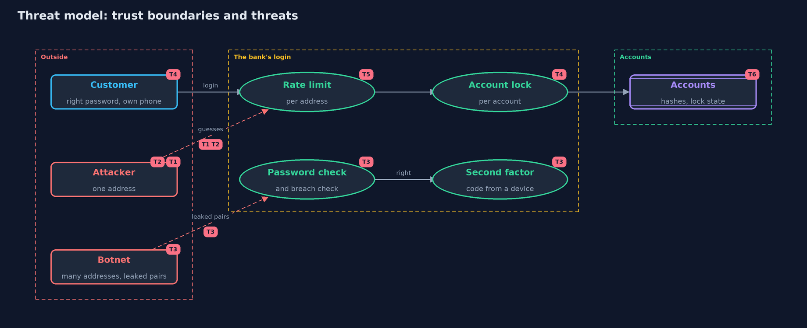

# Threat Model — Password Attacks and Defences

A threat model answers four questions: what are we protecting, who or what could harm it, how, and what do we do about it. This one covers this project's own demo system, not a production deployment. Domain: an online bank.

## Scope

The login of an online bank and the defences in front of it: the account lockout, the per-address rate limit, a second
factor, a check against known breached passwords, and the messages the login returns. It covers guessing at the login page,
not theft of the database and not how the password is stored.

## What we protect (assets)

- Customers' accounts and the money behind them.
- The availability of login for the real customer.
- The secrecy of which usernames exist.
- The login service itself, which spends work on every attempt.

## Who and what acts on the system

- Customers, with passwords of every strength, some reused from other sites.
- An attacker with one address, trying many passwords against one account.
- An attacker spraying a few common passwords across all accounts.
- A botnet using many addresses, with pairs leaked from another site.

## Trust boundaries

A trust boundary is a line that data or a request crosses between parts that trust each other differently. Threats cluster where those lines are.

- Internet to login: where the per-address limit sits.
- Login to account: where the lock and the password check sit.
- Password to second factor: where a right password stops being enough.

Each dashed box is a trust boundary. A rose tag such as T1 shows where the threat of that number, in the table below, applies.

## Threats, using STRIDE

STRIDE is a checklist of six kinds of threat: **Spoofing** (S), **Tampering** (T), **Repudiation** (R), **Information disclosure** (I), **Denial of service** (D), **Elevation of privilege** (E).

| Id | Kind | Threat | Where it shows up | Control in this project | What is left |
| --- | --- | --- | --- | --- | --- |
| T1 | Spoofing | A dictionary attack finds one account's password by trying many | `Attacks.dictionary` | An account lock after 5 failures slows it from tick 13 to tick 33 | It is slowed, not stopped; a stronger password and a second factor are needed |
| T2 | Spoofing | Spraying takes accounts with common passwords without tripping any lock | `Attacks.spray` | A rate limit per address slows the spray from 23 to 43 ticks | Four of ten accounts still fall; a breach check and a second factor help |
| T3 | Spoofing | Credential stuffing uses passwords reused from another site | `Attacks.stuff` | A second factor, and a check of right passwords against known breaches | Customers must change their password or enrol a device, which costs them effort |
| T4 | Denial of service | An outsider locks a real customer out by failing on purpose | `Bank.login` with `LockScope.ACCOUNT` | Lock each account-and-address pair instead | An attacker with many addresses gets more guesses: 10 addresses give 50 |
| T5 | Denial of service | A per-address limit blocks many honest customers behind one shared address | `Bank.login` rate limit | None here | Real systems tune limits per context and add other signals |
| T6 | Information disclosure | Different messages reveal which usernames exist | `Bank.login` messages | One message, "wrong username or password", for both cases, and the same hash computed for an unknown name, which also counts toward the lock | Other differences, such as a sign-up form that says a name is taken, can still reveal which names exist |
| T7 | Repudiation | Attacks go unnoticed because nobody looks at the failures | the whole login | None in this project | Logging failures per address and per account would show spraying as many accounts failing once |

## Assumptions

- Passwords are stored as slow, salted hashes (see password-hashing).
- The attacker has no stolen database and no access to the customer's device.
- Addresses can be told apart. Many customers behind one shared address are a hazard for any per-address limit.

## Out of scope

- Real networks, CAPTCHAs, device recognition and location signals.
- How one-time codes are made: the totp project covers that.
- Phishing, which defeats most of these defences by tricking the customer.

## How the tests check this

- `BankTest` checks each defence on its own: locks and when they end, limits per window, second factor, breach check and messages.
- `AttacksTest` pins the numbers: tick 13, 33 and 23 for the dictionary attack, and 23 and 43 ticks for the spray.
- `DemoRunsTest` compares the whole demo with the golden output.

## Where this model goes next

The next project, totp-multi-factor, builds the second factor that act four relies on: a one-time code made from a shared secret and the time.
