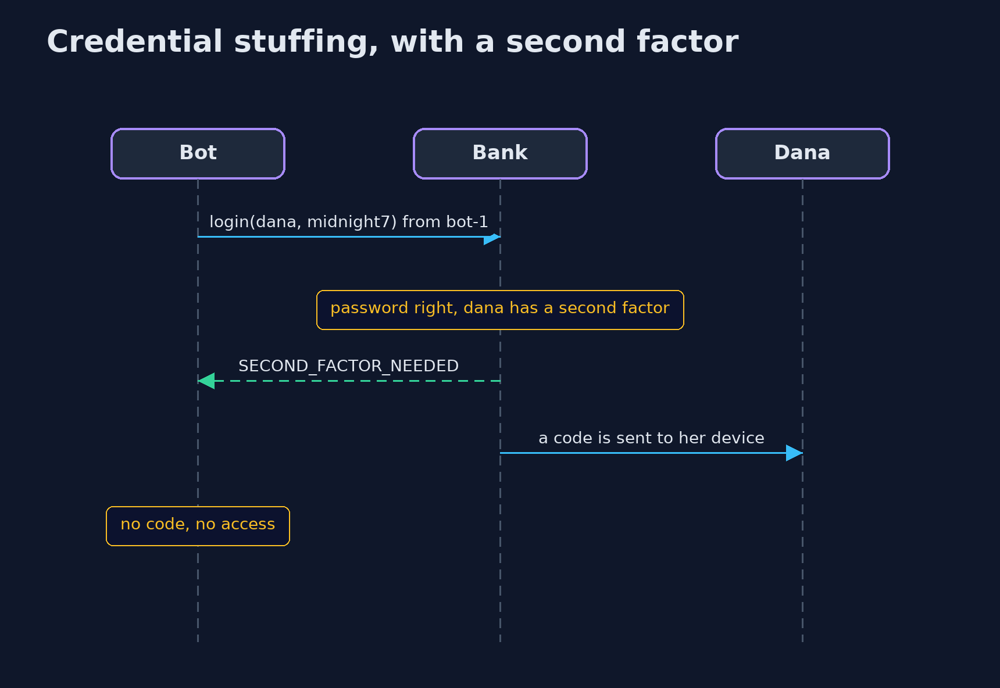
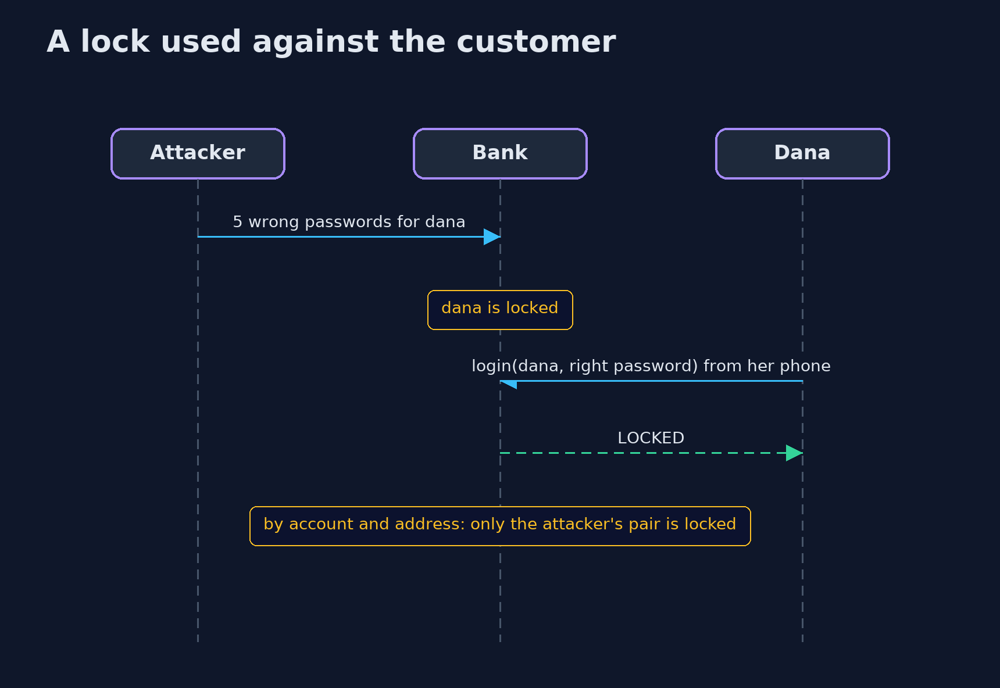

# Password Attacks and Defences — UML Sequence Diagrams

## 1. Credential stuffing, with a second factor

The leaked password is right, but a code is still needed, so the account is not taken.

## 2. A lock used against the customer

Locking by account lets an outsider lock the owner out; locking by account and address does not.

