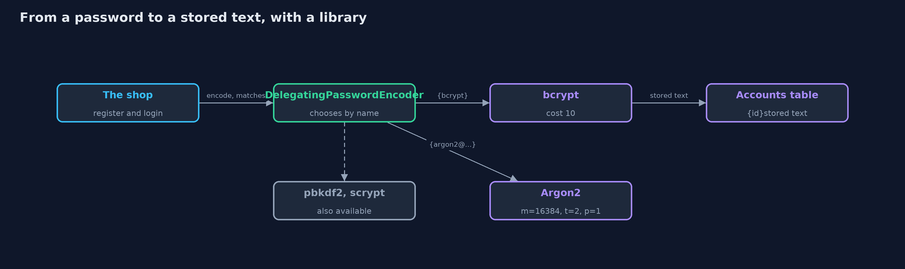
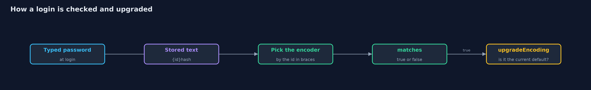
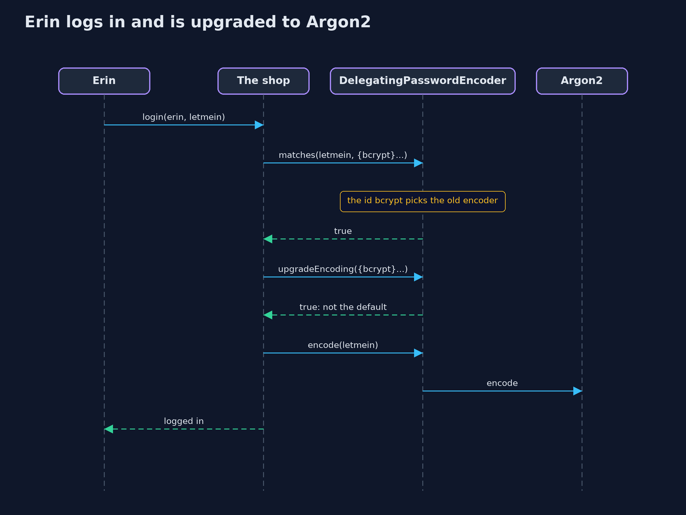

# Password Hashing with Spring Security Crypto

```
src/main/java/com/jk/explore/security/hashingspring/
├── Attacker.java           Someone with a stolen table of stored passwords, trying a list of common passwords against each account
├── Customers.java          The five customers of the online store, with the passwords they chose, and the attacker's list of common passwords
└── SpringHashingDemo.java  Runs the online store story in six numbered acts, with Spring Security's password encoders, and prints repeatable results
```

**Spring Security's password encoders store a slow, salted hash in one call, tag it with the algorithm's name, and let a shop move to a stronger algorithm without asking customers, as long as the list of algorithms it accepts is chosen on purpose.**

The plain version of this lesson built a slow, salted hash by hand, so the ideas were visible. This
project does what real applications do: it asks a library. Spring Security's `spring-security-crypto`
module gives every algorithm the same small interface, `PasswordEncoder`, with `encode` to make the
stored text and `matches` to check a login. Salts are added for you. The `DelegatingPasswordEncoder` writes
the algorithm's name in front of the stored text, in curly braces, such as `{bcrypt}`, so it can
check old hashes and make new ones with something stronger, and `upgradeEncoding` tells the shop when a
stored text is due to be replaced.

The same five customers, the same wordlist and the same attack as in the plain project make the two easy to
compare. Six acts show the encoders, the algorithms, the cost, a migration, and what it all costs.

## The idea in everyday terms

Think of a hotel that wants better locks. It cannot close the hotel and change every lock at once.
Instead, each lock carries a small label saying which kind it is. When a guest comes back, the
front desk checks the old lock as usual, then quietly fits a new one for the next visit.
The label is the `{bcrypt}` in front of the stored text. And a hotel that accepts any label a stranger
writes is asking for trouble, which is the lesson of the last act.

## The scenario

The online store from the plain project, with its five customers: Ana and Ben (both welcome1),
Carol, Erin and Dave. The shop now uses Spring Security's encoders. It starts with the two the library
warns against, moves to the delegating encoder, compares four algorithms, attacks bcrypt at two
costs, switches its default from bcrypt to Argon2 without asking anyone, and then looks at what that
cost.

## Run

```bash
./gradlew run
```

The demo tells the story in 6 acts, each printing exact numbers that the tests check:

| Act | What it shows |
| --- | --- |
| 1. Two the library marks as deprecated | NoOpPasswordEncoder stores the password itself; the SHA-256 encoder adds a salt but costs one cheap step per guess, so 24 guesses crack 4 of 5. |
| 2. One call: the delegating encoder | The default encoder writes {bcrypt} in front of a 68-character stored text, adds a salt for you, and checks logins with matches. |
| 3. Four algorithms, one interface | BCrypt, PBKDF2, scrypt and Argon2 each encode and match; the stored text of bcrypt shows its cost, and Argon2's shows its memory, passes and parallelism. |
| 4. The same attack, at two costs | Bcrypt at cost 4 and at cost 10 both lose 4 of 5 accounts in 24 guesses, but each guess at cost 10 is 64 times the work. |
| 5. Moving to a stronger algorithm without asking anyone | With Argon2 as the new default, Erin's old {bcrypt} text still checks, upgradeEncoding says it is due, and after her login it is stored as {argon2}. |
| 6. The bill: an open list, and memory | The default encoder accepts a planted {noop} value, an allow-list refuses it, and one Argon2 hash uses 16 MiB, so 100 logins at once need 1,600 MiB. |

## Test

```bash
./gradlew test
```

12 tests in `AttackerTest`, `DemoRunsTest`, `EncodersTest`. Every line the demo prints is checked against `docs/expected-output.txt`. Nothing printed depends on a random salt or on timing, so every run gives the same result.

## What the simulation got right, and what it left out

The costs shown are the library's current defaults for each algorithm, taken from the stored text where the
algorithm writes them down (bcrypt's cost, Argon2's memory, passes and parallelism). Guidance changes over time, so
check the current recommendation before copying any setting. The attack is the same eight-word loop as in the plain project,
counted in guesses. Bcrypt cost 10 is used because it is the library default, and cost 4 is the lowest bcrypt allows,
used only to show the difference.

## Technologies and versions

| Technology | Version | Used for |
| --- | --- | --- |
| Java | 25 | the code (toolchain set in `build.gradle`; Gradle finds or downloads the JDK) |
| Gradle | 9.2.1 (wrapper) | build and run, nothing to install |
| JUnit | 5.10.2 | the tests |
| videokit | repository tool (`tools/videokit`) | the narrated video and animation: Piper `en_US-amy-medium`, speed 0.8, longer pauses (the amy-slow voice) |

## Learning Material

| Document | What it is for |
| --- | --- |
| [Dependencies](docs/dependencies.md) | what the framework and infrastructure are, and why they are here |
| [Problem statement](docs/problem-statement.md) | the situation and what the project must show |
| [Prerequisites](docs/prerequisites.md) | what you need to know first |
| [Password Hashing with Spring Security Crypto, explained](docs/password-hashing-with-spring-security-crypto-explained.md) | the acts in prose |
| [Session guide](docs/session.md) | a one-hour lesson with exercises |
| [Animated walkthrough](docs/animation.html) | the acts step by step, narrated |
| [Threat model](docs/threat-model.md) | what is protected, who could harm it, and how, using STRIDE |
| [Spec](docs/spec.md) | what this project must be true of |
| [Expected output](docs/expected-output.txt) | the golden demo output every test and every port checks against |

### The idea in one picture

The shop calls one encoder; the delegating encoder chooses the algorithm, tags the text with its name, and checks old texts with the algorithm they name.



### Where each piece sits

The demo uses the library's encoders through the PasswordEncoder interface; Attacker works with any of them.


### How the data moves

The name in front of the stored text selects the algorithm; if it is not the current default, the text is flagged for upgrade.



### Who calls whom, in order




### Video

`video/password-hashing-with-spring-security-crypto-explained.mp4` (with `.m4a` audio and `.srt` subtitles) is built by `video/build_video.sh`. Rendered media is not committed.

## What it costs

- **Argon2 costs memory.** It is hard to speed up with special hardware because each hash needs a block of memory. The shop pays that memory on every login, so many logins at once need a lot.
- **An open list of algorithms is a risk.** The default delegating encoder accepts old and plain forms, including `{noop}`, which means no hashing at all. Anyone who can write to the table can plant one.
- **Another dependency.** Argon2 and scrypt need Bouncy Castle, and the crypto module expects the application to bring Spring's core and logging.
- **The same limits as before.** A strong algorithm cannot rescue a weak password, and every login still pays for the slow hash.

## When this is too much

For a real application, this is the minimum. The only time to write the hashing yourself is to teach it, which is why the plain
project exists. If a framework other than Spring is in use, its own password library does the same job, and
the advice is the same: use a vetted library, not your own code.

## Where you have already met this

- `PasswordEncoder` beans in Spring applications, and `{bcrypt}` in their user tables.
- The `$2a$10$` start of bcrypt hashes in many databases.
- `$argon2id$v=19$m=16384,t=2,p=1$...`, the format that shows Argon2's settings.
- Migration notes that say "hashes are upgraded the next time a user logs in".

## Where this sits

This project is the second one in [passwords-and-mfa](..), the library version of [password-hashing](../password-hashing).
