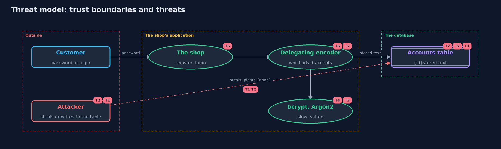

# Threat Model — Password Hashing with Spring Security Crypto

A threat model answers four questions: what are we protecting, who or what could harm it, how, and what do we do about it. This one covers this project's own demo system, not a production deployment. Domain: an online store.

## Scope

The part of an online store that stores and checks customer passwords using Spring Security's password encoders: the
default delegating encoder, four algorithms, a migration to a new default, and an allow-list. It covers a stolen
table, a planted value, and the cost of the algorithms. It does not cover how passwords reach the server or how
logins are rate limited.

## What we protect (assets)

- Customers' passwords, often reused elsewhere.
- The accounts table of stored texts.
- The login check, which spends time and memory on every attempt.
- The list of algorithms the shop agrees to accept.

## Who and what acts on the system

- Customers, with passwords of every strength.
- An attacker who steals a copy of the table and guesses offline.
- An attacker who can write to the table and plant a value.
- A developer who builds the encoder, and may choose the default list.

## Trust boundaries

A trust boundary is a line that data or a request crosses between parts that trust each other differently. Threats cluster where those lines are.

- Application to database: where the stored text is written and read.
- Stored text to encoder: the name in braces decides which code runs, so it is an input from the table.
- Database to the outside: the line a thief crosses when the table is copied.

Each dashed box is a trust boundary. A rose tag such as T1 shows where the threat of that number, in the table below, applies.

## Threats, using STRIDE

STRIDE is a checklist of six kinds of threat: **Spoofing** (S), **Tampering** (T), **Repudiation** (R), **Information disclosure** (I), **Denial of service** (D), **Elevation of privilege** (E).

| Id | Kind | Threat | Where it shows up | Control in this project | What is left |
| --- | --- | --- | --- | --- | --- |
| T1 | Information disclosure | The accounts table is stolen and the passwords are readable or cheap to guess | `NoOpPasswordEncoder`, `MessageDigestPasswordEncoder` | Use a slow, salted algorithm: bcrypt, PBKDF2, scrypt or Argon2 | Weak passwords on the attacker's list still fall |
| T2 | Elevation of privilege | A value such as {noop}letmein is planted in the table and accepted | the default `DelegatingPasswordEncoder` | Build the delegating encoder from an explicit allow-list of ids | Anyone with write access can still swap one valid hash for another; protect the table |
| T3 | Information disclosure | Offline guessing against a stolen bcrypt or Argon2 hash | `BCryptPasswordEncoder`, `Argon2PasswordEncoder` | Cost: bcrypt cost 10 is 1,024 rounds; Argon2 uses 16 MiB, two passes | Weak passwords fall; settings must be raised as hardware improves |
| T4 | Denial of service | Many simultaneous logins exhaust memory, because Argon2 needs 16 MiB each | `Argon2PasswordEncoder` | None here; the memory per login is shown | Rate limits and a cap on concurrent hashing are needed |
| T5 | Denial of service | Wrong logins load the server, because every check is slow | `matches` | None here | Rate limits and lockouts; the next project covers them |
| T6 | Tampering | An old algorithm is left in use after the default changes | `upgradeEncoding` | The stored text is replaced after the next correct login | Customers who never log in keep their old hash |
| T7 | Information disclosure | The format of the stored text reveals the algorithm and settings | the accounts table | None needed: security does not depend on hiding the algorithm | It tells an attacker how costly guessing is, which is why the cost must be high enough |

## Assumptions

- The typed password reaches the server over a protected channel.
- Only the application and administrators can write to the accounts table, except in the planted-value act, which supposes otherwise.
- Library versions are kept up to date, because the algorithms' recommended settings change.

## Out of scope

- Rate limiting and lockout: the next project covers online guessing.
- Password policy, breached-password checks and password managers.
- Spring Security's login filters.
- Hardware security modules and peppers.

## How the tests check this

- `EncodersTest` checks every algorithm, the visible settings, the migration and the planted value.
- `AttackerTest` shows the weak passwords fall in 24 guesses and the strong one survives.
- `DemoRunsTest` compares the whole demo with the golden output.

## Where this model goes next

The next project, password-attacks-and-defences, moves from offline guessing to online guessing: rate limits, lockouts and the cost of each.
