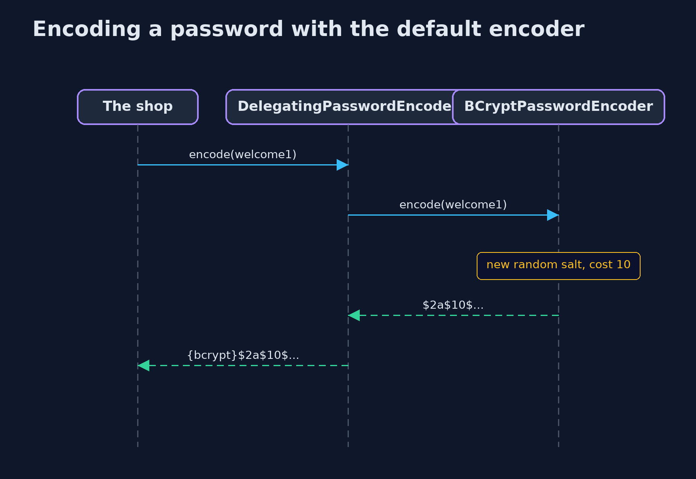
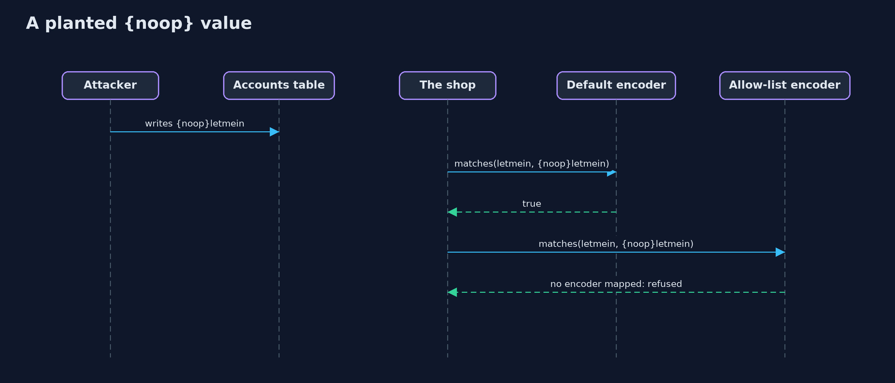

# Password Hashing with Spring Security Crypto — UML Sequence Diagrams

## 1. Encoding a password with the default encoder

The salt is created inside the encoder, so the shop never handles one.

## 2. A planted {noop} value

The default encoder knows the noop id, so a value written into the table is accepted; the allow-list does not.

