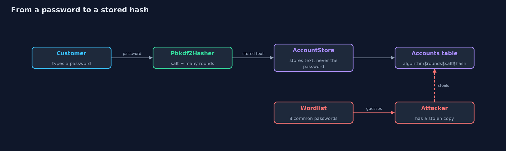
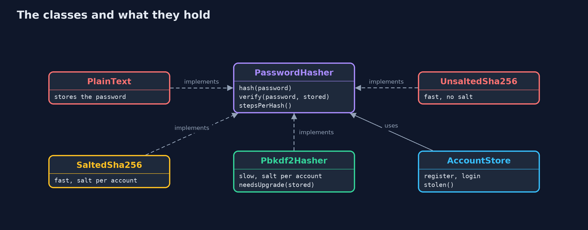
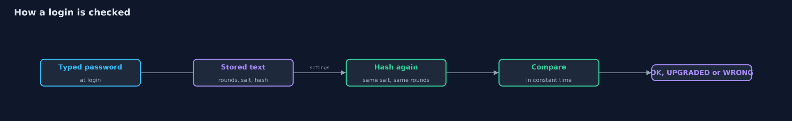
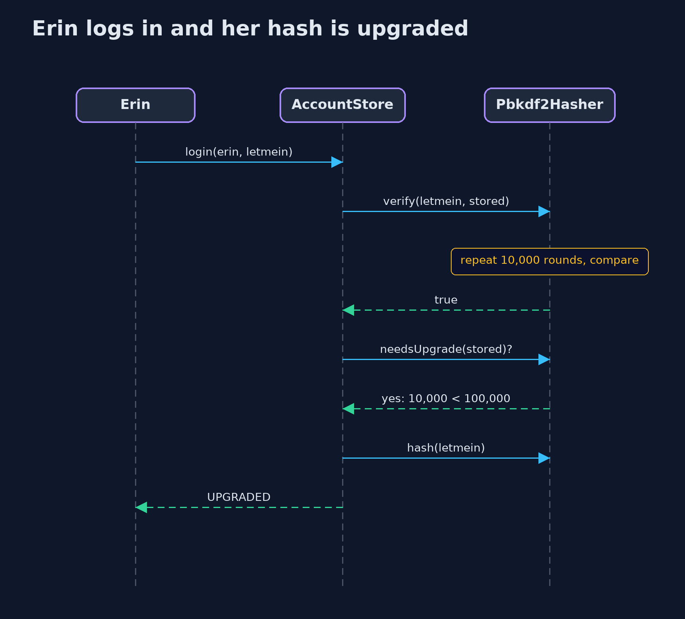

# Password Hashing

```
src/main/java/com/jk/explore/security/hashing/
├── AccountStore.java    The shop's table of accounts: a username and the stored text of its password, never the password
├── Attacker.java        Someone who has stolen the table of stored passwords and tries a list of common passwords against it
├── CountingSalts.java   Salts that are different for every call but the same on every run: 1, 2, 3 and so on, spread over 16 bytes
├── Cracked.java         What an attacker got from a stolen table: which passwords were found, and how many guesses it took
├── HashingDemo.java     Runs the online store story in five numbered acts and prints exact, repeatable results
├── Hex.java             Small helpers shared by the hashers
├── Login.java           The result of a login attempt
├── PasswordHasher.java  Turns a password into the text that is stored, and checks a login attempt against it
├── Pbkdf2Hasher.java    A slow, salted hash: PBKDF2 with HMAC-SHA-256, repeated {@code iterations} times
├── PlainText.java       The worst way to store a password: as it is
├── SaltSource.java      Where salts come from: a salt is a few extra bytes, different for every account, mixed into the hash
├── SaltedSha256.java    A fast hash with a different salt for every account
├── SecureSalts.java     Real salts: random bytes from the system's secure random generator
├── UnsaltedSha256.java  A fast hash with nothing added
└── WorkMeter.java       Counts hashing work in steps instead of seconds, so the demo prints the same numbers on every machine
```

**A shop should store only a slow, salted hash of each password, so a stolen database does not hand over the passwords, and every guess costs the attacker real work.**

When a customer signs up, the shop must be able to check their password later, but it should
never be able to read it. The answer is a **hash**: a one-way scramble. The shop stores the
scramble, and at login it scrambles what the customer typed and compares. Nobody can run the
scramble backwards. But a plain hash is not enough. Two customers with the same password get the
same scramble, and an attacker can prepare a table of scrambles of common passwords in
advance. So a good scheme adds two things. A **salt** is a few random bytes, different for each
account, mixed in so that identical passwords look different. And a **slow** hash repeats the
scramble many thousands of times, so each guess costs real work.

This project stores the same five passwords four ways and attacks each one with the same list
of common passwords. Work is counted in steps, not seconds, so every run prints the same
numbers.

## The idea in everyday terms

Think of a safe. Storing the password as it is, is leaving the cash on the table. A plain hash is
a lock that anyone with a catalogue of keys can open in a minute. A salt gives each customer a
lock of their own, so one catalogue no longer fits. And a slow hash makes each lock so stiff that
trying keys takes years. The thief can still carry the whole safe home. The safe only makes the
opening slow.

## The scenario

An online store has five customers. Ana and Ben both chose welcome1. Carol chose sunshine, Erin chose
letmein, and Dave chose a long random password. One night the whole accounts table is stolen. How
much the thief learns depends entirely on how the shop stored the passwords. The attacker has
a list of eight common passwords and nothing else.

## Run

```bash
./gradlew run
```

The demo tells the story in 5 acts, each printing exact numbers that the tests check:

| Act | What it shows |
| --- | --- |
| 1. Passwords stored as they are | The database is stolen and all 5 passwords are readable; there is nothing to crack. |
| 2. A fast hash, with no salt | Ana and Ben have the same stored value; a table of 8 common passwords, hashed once, cracks 4 of 5 accounts with no guessing per account. |
| 3. A fast hash, with a salt for each account | Ana and Ben's stored values now differ and the table trick fails, but cracking still takes only 24 guesses and 24 steps. |
| 4. A slow hash, with a salt for each account | PBKDF2 with 100,000 rounds makes each guess cost 100,000 times more: the same 24 guesses take 2,400,000 steps, yet the 4 weak passwords still fall. |
| 5. The bill: every login pays, and old hashes must be upgraded | One login costs 100,000 steps, 1,000 wrong logins cost 100,000,000; an account with 10,000 rounds is upgraded to 100,000 at its next login. |

## Test

```bash
./gradlew test
```

20 tests in `AccountStoreTest`, `AttackerTest`, `DemoRunsTest`, `HashersTest`. Every line the demo prints is checked against `docs/expected-output.txt`. Salts are a counter and work is counted in steps, so every run gives the same result.

## What the simulation got right, and what it left out

Work is counted in steps (one step for a fast hash, one per round for a slow one) because seconds depend on the
machine. The demo uses 100,000 rounds so it runs quickly, while current guidance for PBKDF2 with SHA-256 is several hundred
thousand. Salts in the demo are a counter, so the output is repeatable; real salts come from a secure random generator,
which this project also provides as `SecureSalts`. The attacker is a plain loop over eight passwords. Real attackers
use lists of billions, rules that mutate each word, and graphics cards that make fast hashes even faster.

## Technologies and versions

| Technology | Version | Used for |
| --- | --- | --- |
| Java | 25 | the code (toolchain set in `build.gradle`; Gradle finds or downloads the JDK) |
| Gradle | 9.2.1 (wrapper) | build and run, nothing to install |
| JUnit | 5.10.2 | the tests |
| videokit | repository tool (`tools/videokit`) | the narrated video and animation: Piper `en_US-amy-medium`, speed 0.8, longer pauses (the amy-slow voice) |

## Learning Material

| Document | What it is for |
| --- | --- |
| [Problem statement](docs/problem-statement.md) | the situation and what the project must show |
| [Prerequisites](docs/prerequisites.md) | what you need to know first |
| [Password Hashing, explained](docs/password-hashing-explained.md) | the acts in prose |
| [Session guide](docs/session.md) | a one-hour lesson with exercises |
| [Animated walkthrough](docs/animation.html) | the acts step by step, narrated |
| [Threat model](docs/threat-model.md) | what is protected, who could harm it, and how, using STRIDE |
| [Spec](docs/spec.md) | what this project must be true of |
| [Expected output](docs/expected-output.txt) | the golden demo output every test and every port checks against |

### The idea in one picture

At registration the hasher adds a salt and a slow hash; at login it repeats the work with the stored salt and rounds and compares.



### Where each piece sits

Four hashers implement one interface; the account store and the attacker use it without knowing which one it is.



### How the data moves

The stored text carries the rounds and the salt, so the check repeats exactly the work that made the hash.



### Who calls whom, in order




### Video

`video/password-hashing-explained.mp4` (with `.m4a` audio and `.srt` subtitles) is built by `video/build_video.sh`. Rendered media is not committed.

## What it costs

- **Every login pays.** The slow hash runs on every login attempt, right or wrong, so the server spends real work each time. A flood of wrong logins can become an attack on the server itself.
- **Settings age.** Computers get faster, so the number of rounds that was slow enough five years ago is too low now. Hashes must be upgraded, ideally at the next login.
- **A slow hash cannot save a weak password.** A password that is on the attacker's list falls, however slow the hash. Slow only makes guessing expensive.
- **The salt is not a secret.** It is stored beside the hash. Its job is to make every account's hash different, not to hide anything.

## When this is too much

Never. Every system that stores a password for a person must hash it. What can vary is the
choice of algorithm and settings. This project uses PBKDF2 because it ships with Java. Current
guidance often prefers newer designs such as Argon2 or bcrypt where a library provides them, and
the with-spring-security-crypto project shows them.

## Where you have already met this

- The long `$2a$...` text stored in a user table of many applications: a bcrypt hash with its cost and salt included.
- The notice "we store passwords as salted hashes" in a company's security page.
- A data-breach story where passwords were "hashed with MD5", and cracked within days.
- A framework's `PasswordEncoder`, whose stored values begin with a name between curly braces.

## Where this sits

This project is the first one in [passwords-and-mfa](..), the third module of the beginner track.
