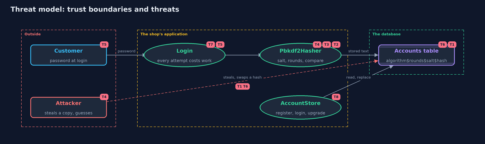

# Threat Model — Password Hashing

A threat model answers four questions: what are we protecting, who or what could harm it, how, and what do we do about it. This one covers this project's own demo system, not a production deployment. Domain: an online store.

## Scope

The part of an online store that stores and checks customer passwords: the four storage schemes from plain text to
PBKDF2, the account table, the login check and the upgrade of old hashes. It covers what a thief learns from a
stolen table, and what guessing costs. It does not cover how passwords are chosen, how they travel to the server, or
what happens after login.

## What we protect (assets)

- Customers' passwords, which are often reused on other sites.
- The accounts table, which holds the stored text.
- The login check, which spends real work on every attempt.
- The accounts themselves, which a stolen or swapped hash could open.

## Who and what acts on the system

- Customers, who choose passwords, some of them weak.
- An attacker who has stolen a copy of the accounts table and guesses offline.
- An attacker who can write to the table and replace a stored hash.
- An attacker who sends many wrong logins to load the server.

## Trust boundaries

A trust boundary is a line that data or a request crosses between parts that trust each other differently. Threats cluster where those lines are.

- Customer to server: the typed password arrives (HTTPS protects it; see the transport-security module).
- Application to database: the stored text is written and read.
- Database to the outside: the line a thief crosses when the table is copied.

Each dashed box is a trust boundary. A rose tag such as T1 shows where the threat of that number, in the table below, applies.

## Threats, using STRIDE

STRIDE is a checklist of six kinds of threat: **Spoofing** (S), **Tampering** (T), **Repudiation** (R), **Information disclosure** (I), **Denial of service** (D), **Elevation of privilege** (E).

| Id | Kind | Threat | Where it shows up | Control in this project | What is left |
| --- | --- | --- | --- | --- | --- |
| T1 | Information disclosure | The accounts table is stolen and the passwords are readable | `PlainText`, and the table in every scheme | Store only a salted, slow hash, never the password | A weak password on the attacker's list still falls to guessing |
| T2 | Information disclosure | Two accounts with the same password can be seen to match | `UnsaltedSha256` | A different salt for every account, stored with the hash | The salt is public by design; it hides matches, not passwords |
| T3 | Information disclosure | A table of common passwords, hashed in advance, cracks every account at once | `Attacker.crackWithTable` | Salts, so no table made in advance fits any account | The attacker can still guess per account |
| T4 | Elevation of privilege | Offline guessing against a stolen hash | `Attacker.crackEachAccount`, `Pbkdf2Hasher` | A slow hash: 100,000 rounds multiply the cost of every guess by 100,000 | Weak passwords still fall; real guidance uses more rounds or a memory-hard function such as Argon2 |
| T5 | Denial of service | Many wrong logins load the server, because each one costs a slow hash | `AccountStore.login` | None here; the cost is shown as 100,000,000 steps for 1,000 attempts | Rate limits and lockouts are needed; the password-attacks-and-defences project covers them |
| T6 | Tampering | An attacker with write access swaps a stored hash for one they know | the accounts table | None in this project, by design | Protect the table with database permissions and audit changes |
| T7 | Information disclosure | The comparison leaks, through its timing, how much of a hash matched | `Hex.sameText` | A comparison that takes the same time wherever the texts differ | Other side channels, such as response timing for unknown usernames, are not covered |
| T8 | Elevation of privilege | Old, weaker hashes stay in the table for accounts that never log in | `AccountStore.login`, `Pbkdf2Hasher.needsUpgrade` | The hash is replaced by a stronger one after the next correct login | A hash can only be upgraded when the password is known, so dormant accounts stay weak |

## Assumptions

- The password reaches the server over a protected channel.
- Salts come from a secure random generator in real use. The demo uses a counter so output is repeatable, and must never be used for real accounts.
- The attacker's list is small. Real lists have billions of entries and rules that vary each word.

## Out of scope

- Password policy, breached-password checks and password managers.
- Multi-factor login: the totp project covers one-time codes.
- Choosing between PBKDF2, bcrypt, scrypt and Argon2 in a real system: the with-spring-security-crypto project shows bcrypt and Argon2.
- Resetting a forgotten password.

## How the tests check this

- `HashersTest` checks each scheme against a known value, shows salts change the stored text, and checks the stored format.
- `AttackerTest` shows a table cracks unsalted accounts, fails against salts, and that a slow hash multiplies the work by the number of rounds.
- `AccountStoreTest` shows a wrong password never changes the stored hash and a correct one upgrades an old hash once.
- `DemoRunsTest` compares the whole demo with the golden output.

## Where this model goes next

The next project, the with-spring-security-crypto version, repeats this with bcrypt and Argon2 from a library. After that, password-attacks-and-defences
shows how attackers guess online, and how limits and lockouts answer them.
