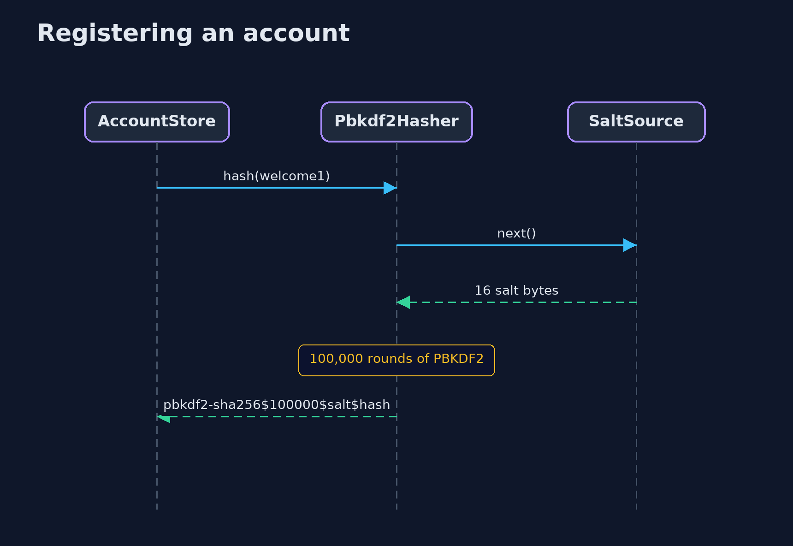
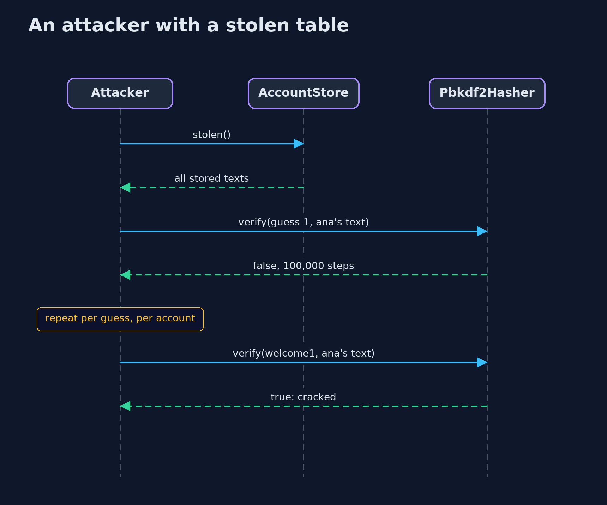

# Password Hashing — UML Sequence Diagrams

## 1. Registering an account

A new salt is drawn for every account, so identical passwords give different stored text.

## 2. An attacker with a stolen table

With a salt for every account, the attacker must hash each guess for each account separately.

