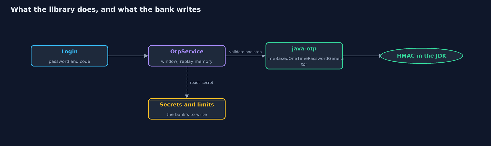
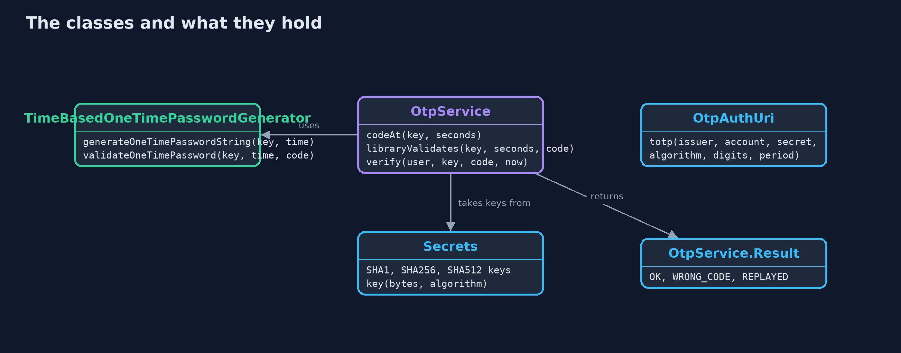
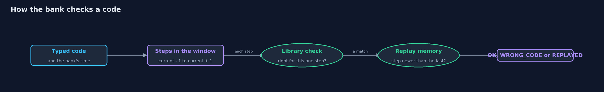
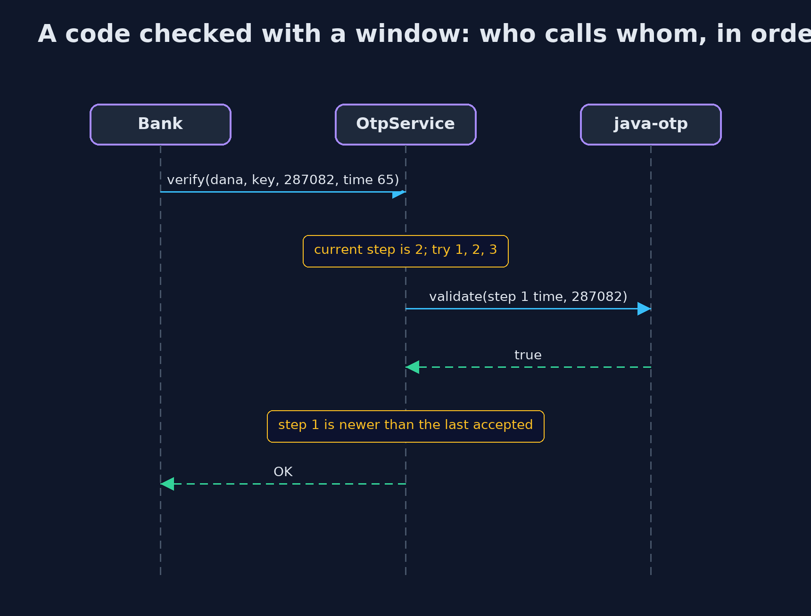

# One-Time Codes with the java-otp Library

```
src/main/java/com/jk/explore/security/totpotp/
├── OtpAuthUri.java      The text that a QR code carries when you turn on two-step sign-in: an {@code otpauth://} link holding the issuer, the account, the secret as Base32 and the settings
├── OtpLibraryDemo.java  Runs the online bank story in five numbered acts, with the java-otp library, and prints exact, repeatable results
├── OtpService.java      The bank's check of a one-time code, built on the java-otp library
└── Secrets.java         The keys of the published test vectors of RFC 4226 and RFC 6238, one for each hash
```

**A library makes the same one-time codes as the hand-written version and checks one time step, but the window, the replay memory, the secrets and the attempt limits are still the bank's to write.**

The plain version of this lesson built the one-time code by hand from HMAC, so the recipe was visible. Most applications
use a library instead. This project uses **java-otp**, a small open-source library with one class for the time-based code,
`TimeBasedOneTimePasswordGenerator`. Given a secret key and a time, it makes the code. Given a code, it can say whether it
is right for one time step. And that is all. The rest of what a bank needs is still written by the bank: a window of steps for clocks that are
a little out, a memory so a code cannot be used twice, secure storage for secrets, and limits on wrong guesses.

The demo checks the library against the published test values, shows exactly where its check stops and the bank's code starts,
tries the other hashes and digit counts, builds the `otpauth://` link that a QR code carries to the phone, and ends with the list of things it does
not do.

## The idea in everyday terms

Think of a clerk who buys a ready-made stamp that prints a new number every thirty seconds. The stamp does its one job well. The clerk still has to decide
how many seconds either side of the number to accept, to remember which numbers were already used, to lock the stamp away, and to turn away
someone who keeps guessing. Buying the stamp does not change who has to do those.

## The scenario

The online bank and its customer Dana from the plain version. The bank now lets java-otp make the codes and does the rest
itself. The demo follows the library through five questions: does it match the standard, what does it check, what else can it make, how does the secret get to
the phone, and what is left for the bank to write.

## Run

```bash
./gradlew run
```

The demo tells the story in 5 acts, each printing exact numbers that the tests check:

| Act | What it shows |
| --- | --- |
| 1. The library makes the same codes as the hand-written version | The library gives 755224, 287082, 359152 and 969429 for steps 0 to 3, and 287082 at time 59: the values in the RFCs. |
| 2. What the library checks, and what it leaves to the bank | The library validates a code for one step only; the bank's own window of 1 accepts it one step later and refuses it two steps on. |
| 3. Other hashes and longer codes | SHA-1, SHA-256 and SHA-512 with 8 digits give 94287082, 46119246 and 90693936 at time 59, the RFC 6238 values. |
| 4. Giving the secret to the phone | The QR code carries an otpauth link with the issuer, the account, the Base32 secret and the settings; the app reads it once and keeps the secret. |
| 5. The bill: what the library does not do | The library alone accepts the same code twice; the bank's own memory of the last step refuses the second use; secrets, wrong-code counts and limits are all the bank's. |

## Test

```bash
./gradlew test
```

15 tests in `DemoRunsTest`, `LibraryCodesTest`, `OtpAuthUriTest`, `OtpServiceTest`. The library's codes are tested against the published values of RFC 4226 (SHA-1, 10 values) and RFC 6238 (SHA-1, SHA-256 and SHA-512). Every line the demo prints is checked against `docs/expected-output.txt`.

## What the simulation got right, and what it left out

The secrets are the public keys of the RFC test vectors, so the codes can be checked against the standards: they must
never protect a real account. Time is a number of seconds passed to the code, so every run prints the same digits. The
bank's window and replay memory are small classes kept in memory, which a real bank would keep in a shared store. Authenticator apps differ in what they
support, and the demo does not test any app.

## Technologies and versions

Every version below is pinned in the project's build files and was the latest stable release when the project was built.

| Technology | Version | Used for |
| --- | --- | --- |
| Java | 25 | the language and runtime; a Gradle toolchain finds or downloads the JDK |
| Gradle | 9.8.1 (wrapper) | build and run; nothing to install, the wrapper downloads it |
| com.eatthepath:java-otp | 1.0.0 | java-otp: HOTP and TOTP one-time codes |
| commons-codec:commons-codec | 1.23.0 | Apache Commons Codec: Base32 and other encoders |
| org.junit.jupiter:junit-jupiter | 6.1.3, set by junit-bom | JUnit 5: the tests (tests only) |
| org.junit.platform:junit-platform-launcher | 6.1.3, set by junit-bom | JUnit platform launcher, which Gradle needs to run the tests (tests only) |
| videokit | repository tool (`tools/videokit`) | the narrated video and animation: Piper `en_US-amy-medium`, speed 0.8, longer pauses (the amy-slow voice) |

## Learning Material

| Document | What it is for |
| --- | --- |
| [Dependencies](docs/dependencies.md) | what the framework and infrastructure are, and why they are here |
| [Problem statement](docs/problem-statement.md) | the situation and what the project must show |
| [Prerequisites](docs/prerequisites.md) | what you need to know first |
| [One-Time Codes with the java-otp Library, explained](docs/totp-multi-factor-with-java-otp-explained.md) | the acts in prose |
| [Session guide](docs/session.md) | a one-hour lesson with exercises |
| [Animated walkthrough](docs/animation.html) | the acts step by step, narrated |
| [Threat model](docs/threat-model.md) | what is protected, who could harm it, and how, using STRIDE |
| [Spec](docs/spec.md) | what this project must be true of |
| [Expected output](docs/expected-output.txt) | the golden demo output every test and every port checks against |

### The idea in one picture

The library sits at the bottom, making codes and checking one step; the window, replay memory and the rest sit above it, written by the bank.



### Where each piece sits

OtpService wraps the library's generator; OtpAuthUri builds the link; Secrets holds the RFC keys.



### How the data moves

The bank tries each step in the window with the library's check, then applies its replay memory.



### Who calls whom, in order




### Video

`video/totp-multi-factor-with-java-otp-explained.mp4` (with `.m4a` audio and `.srt` subtitles) is built by `video/build_video.sh`. Rendered media is not committed.

## What it costs

- **The library checks one step only.** Its validation answers for the single time step that the given time falls in, so a window for slow or fast clocks is code you write.
- **No replay memory.** The same code is right twice within its step unless the bank remembers the last step it accepted.
- **No secret storage and no attempt limits.** The library takes a key from you and never sees a customer.
- **Settings that apps may ignore.** Other hashes and eight digits are valid TOTP, but some authenticator apps support only SHA-1, six digits and thirty seconds, so a bank that changes them must control the app.
- **A dependency to maintain.** It is small, and it still has to be kept up to date.

## When this is too much

A bank should not write its own HMAC and truncation: a library has been used and reviewed by many people. Writing the plain version once, to understand it, is
useful, and then production code should use a library. What matters is knowing the line between the two.

## Where you have already met this

- `TimeBasedOneTimePasswordGenerator` and its equivalents in most languages: `pyotp` in Python, `otplib` in JavaScript, `rotp` in Ruby.
- The `otpauth://totp/...` text behind the QR code on a two-step sign-in setup page.
- Library documentation that says "you are responsible for storing the secret and preventing replays".
- Frameworks, such as Spring Security or Keycloak, that wrap a library like this and add the policy around it.

## Where this sits

This project is the sixth in [passwords-and-mfa](..), the library version of [totp-multi-factor](../totp-multi-factor).
