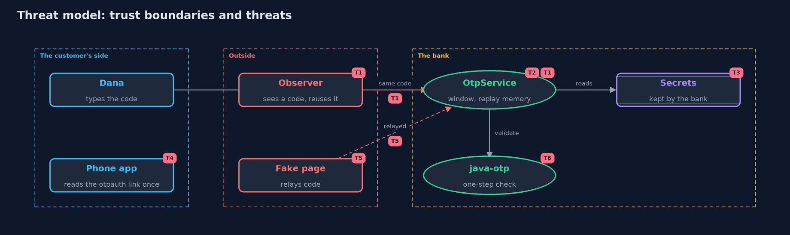

# Threat Model — One-Time Codes with the java-otp Library

A threat model answers four questions: what are we protecting, who or what could harm it, how, and what do we do about it. This one covers this project's own demo system, not a production deployment. Domain: an online bank.

## Scope

The bank's use of the java-otp library for one-time codes: the code generator, the bank's window and replay memory around it, the
secret, and the otpauth link that carries the secret to the phone. It covers what the library does and does not protect against. It does not
cover the password check, TLS, or hardware keys.

## What we protect (assets)

- Customers' accounts.
- The shared secret, on the phone, on the bank's server and in the otpauth link.
- The bank's record of the last accepted step.
- The correctness of the library's codes.

## Who and what acts on the system

- Dana, the customer.
- An observer who sees a code or the enrolment screen.
- A fake bank page that relays codes.
- A developer who relies on the library for more than it does.

## Trust boundaries

A trust boundary is a line that data or a request crosses between parts that trust each other differently. Threats cluster where those lines are.

- Bank to phone: the secret crosses once, in the otpauth link or QR code.
- Customer to bank: the code is typed and sent.
- Bank code to library: the library checks one step, and everything else is above it.

Each dashed box is a trust boundary. A rose tag such as T1 shows where the threat of that number, in the table below, applies.

## Threats, using STRIDE

STRIDE is a checklist of six kinds of threat: **Spoofing** (S), **Tampering** (T), **Repudiation** (R), **Information disclosure** (I), **Denial of service** (D), **Elevation of privilege** (E).

| Id | Kind | Threat | Where it shows up | Control in this project | What is left |
| --- | --- | --- | --- | --- | --- |
| T1 | Spoofing | A code seen by an observer is used again | `OtpService.verify` | The bank remembers the last accepted step and refuses it again | The library alone does not do this; the observer can still be first |
| T2 | Denial of service | A phone's clock is out, so the right code is refused; a wide window gives an attacker more chances | the window in `OtpService` | A window of one step either side, written by the bank | The library validates one step only, so the window is the bank's to choose and test |
| T3 | Information disclosure | The secrets are stolen from the bank | wherever the bank stores them | None in the library or the demo | The bank must store them encrypted, and limit who can read them |
| T4 | Information disclosure | The otpauth link or QR code is seen during enrolment | `OtpAuthUri` | Show it once, on a private screen | Anyone who sees it can make the customer's codes |
| T5 | Spoofing | A fake page relays the code at once | the customer's browser | None in TOTP | Hardware security keys stop this; a library cannot |
| T6 | Tampering | The library's codes differ from the standard, so real apps are refused | `TimeBasedOneTimePasswordGenerator` | Tests against the published values of RFC 4226 and RFC 6238 | The version must be re-tested whenever it is upgraded |

## Assumptions

- TLS protects the codes and the enrolment page in transit.
- The phone is not compromised.
- The library is the version pinned in the build, and is kept up to date.
- The demo's secrets are public test keys.

## Out of scope

- Storing secrets encrypted, and limiting attempts: later modules and the attacks project.
- Hardware security keys, which stop relaying.
- Testing real authenticator apps.

## How the tests check this

- `LibraryCodesTest` checks the library against RFC 4226 and RFC 6238 for three hashes.
- `OtpServiceTest` checks the library's one-step check, the bank's window, the replay protection and its per-customer memory.
- `OtpAuthUriTest` checks the link's parts and the padding.
- `DemoRunsTest` compares the whole demo with the golden output.

## Where this model goes next

The cryptography module comes next, beginning with hashing and integrity, which explains the keyed hash, HMAC, that this library uses inside.
