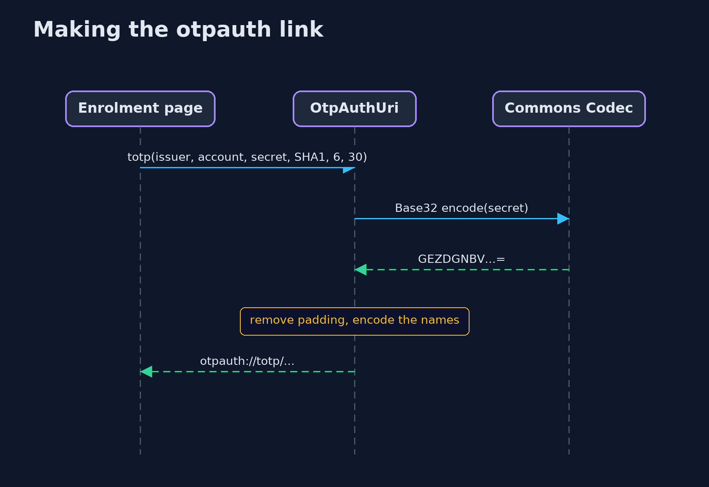
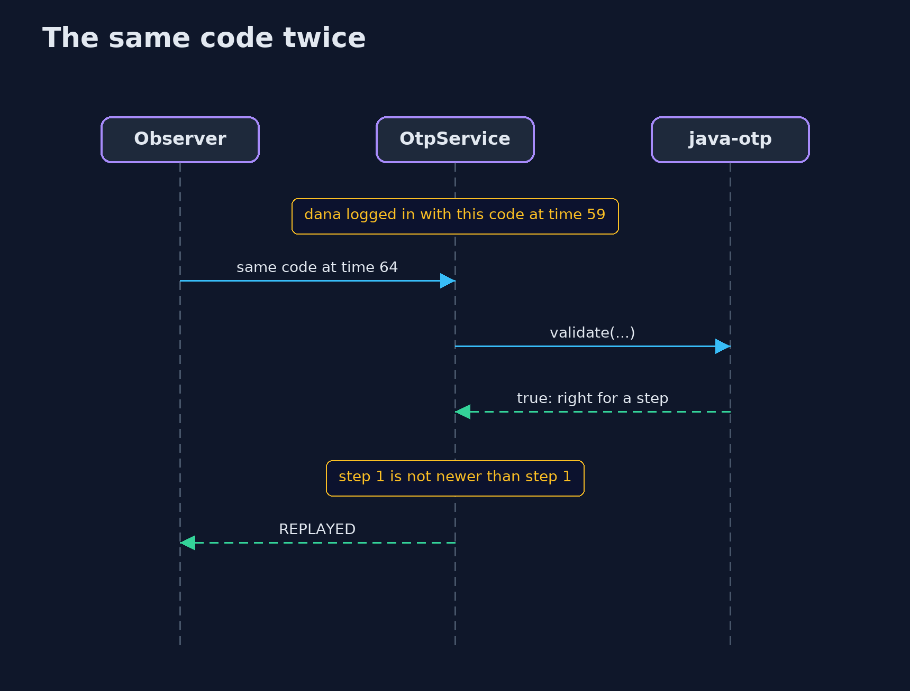

# One-Time Codes with the java-otp Library — UML Sequence Diagrams

## 1. Making the otpauth link

The secret becomes Base32 text with its padding removed, and goes into a link with the settings.

## 2. The same code twice

The library accepts the code both times; the bank's memory refuses the second.

