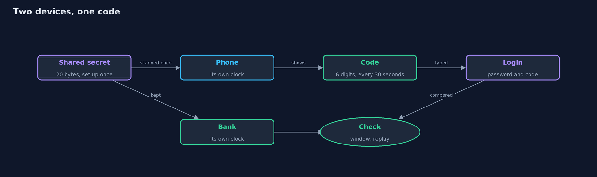
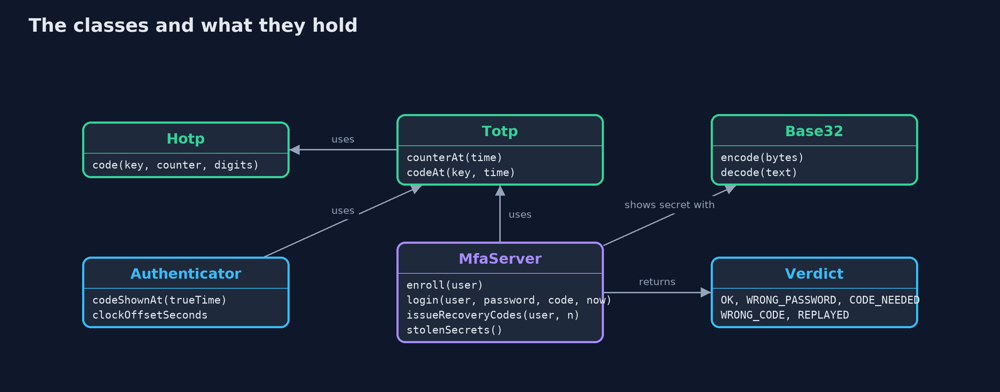
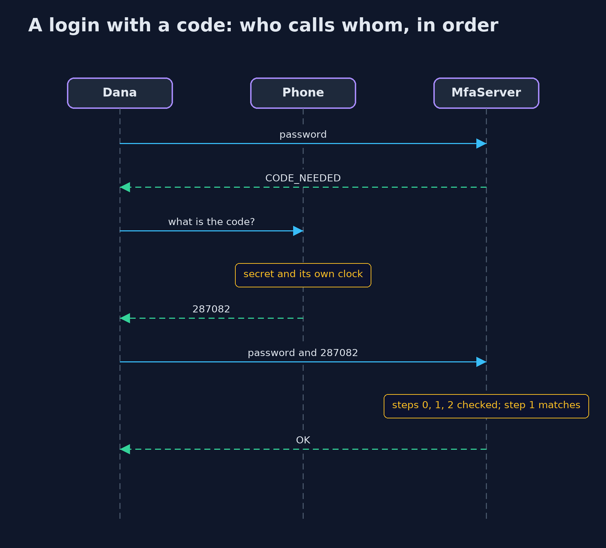

# One-Time Codes (TOTP)

```
src/main/java/com/jk/explore/security/totp/
├── Authenticator.java  The authenticator app on the customer's phone: it holds the secret and works out the code from its own clock
├── Base32.java         Base32 (RFC 4648), the text form authenticator apps use for a shared secret: upper-case letters and the digits 2 to 7, so it can be typed or put in a QR code without any look-alike characters
├── DemoSecrets.java    Fixed secrets, so the demo prints the same codes on every run
├── Hotp.java           HOTP (RFC 4226): a code made from a secret key and a counter
├── MfaServer.java      The bank's login with an optional second factor
├── SecretSource.java   Where shared secrets and recovery codes come from
├── SecureSecrets.java  Real secrets and recovery codes, from the system's secure random generator
├── Totp.java           TOTP (RFC 6238): HOTP where the counter is the number of whole steps of time since the start of 1970
├── TotpDemo.java       Runs the online bank story in five numbered acts and prints exact, repeatable results
└── Verdict.java        The bank's answer to a login attempt
```

**A time-based one-time code is made from a secret the phone and the bank share and the current 30-second step, so a stolen password is not enough, but a code typed into a fake page still works.**

A password is something you know, and it can leak. A **second factor** adds something you have, such as a phone,
so a stolen password alone is not enough. The most common second factor is the six-digit code in an authenticator
app. It is a **time-based one-time password**, **TOTP**, defined in RFC 6238 on top of **HOTP** in RFC 4226. The bank
and the phone share a **secret key**, set up once. Every 30 seconds, each works out the same code from that secret and the
current time, and never needs to talk to the other. To make a code, the counter, the number of whole 30-second steps since 1970, is
put through **HMAC** with the secret, and a few bytes of the result become six digits.

This project builds that from the standard library, checks it against the published test values of the RFCs, and then
looks at what a bank must decide around it: how far apart two clocks may be, whether a code may be used twice, and where the
secret lives. Its last act shows what a code cannot do.

## The idea in everyday terms

Think of a safe-deposit box that needs two keys turned together: yours, and the bank clerk's. Your key is the password
and never changes. The clerk's key is replaced every thirty seconds by a new one, and both the clerk and your phone know the pattern, so each can
tell which key is right now without ever meeting. A thief with a copy of your key cannot open the box. But a thief who stands
beside you, and uses the clerk's key the moment you show it, can.

## The scenario

An online bank's customer, Dana, has a password, midnight7, that leaked from another site. The bank adds a second factor: Dana
enrols an authenticator app on her phone, with a shared secret. From then on a login needs the password and the six-digit
code. The demo follows the code from its first calculation, with the secret from the published RFC test values so the numbers can be
checked, through clocks that disagree, a code used twice, and a fake bank page.

## Run

```bash
./gradlew run
```

The demo tells the story in 5 acts, each printing exact numbers that the tests check:

| Act | What it shows |
| --- | --- |
| 1. A password alone | With only the password, which leaked from another site, the attacker logs in: one factor, one leak. |
| 2. Enrolling a second factor | The bank makes a 20-byte secret shown as Base32; at time 59 the counter is 1 and the code is 287082; steps 0 to 3 give 755224, 287082, 359152, 969429. |
| 3. Logging in with a code, and clocks that disagree | The password alone now asks for a code; the right code is accepted; a phone 25 seconds fast is accepted, 70 seconds fast and a 2-step-old code are not. |
| 4. The same code twice | Without replay protection an observer can reuse Dana's code 5 seconds later; with it, the second use is REPLAYED. |
| 5. The bill: what a code cannot do | A fake bank page can pass on the password and code at once; the bank's table holds the secret; a recovery code is a second way in that works once. |

## Test

```bash
./gradlew test
```

29 tests in `AuthenticatorTest`, `Base32Test`, `DemoRunsTest`, `HotpTest`, `MfaServerTest`, `TotpTest`. The code generator is tested against the published values of RFC 4226 (HOTP, 10 values), RFC 6238 (TOTP with SHA-1, SHA-256 and SHA-512) and RFC 4648 (Base32). Every line the demo prints is checked against `docs/expected-output.txt`, and time is a number given to the code, so every run gives the same result.

## What the simulation got right, and what it left out

Time is a number of seconds passed to the code, so every run prints the same digits. The secret is the key used in the published
test values of RFC 4226 and RFC 6238, so the output can be checked against the standards, but it is public and must never protect a real
account; `SecureSecrets` gives real random secrets. The bank here checks only the code and the password, and keeps its table in
memory. A real bank also limits attempts, stores secrets encrypted, and offers other factors, which this project does not model.

## Technologies and versions

| Technology | Version | Used for |
| --- | --- | --- |
| Java | 25 | the code (toolchain set in `build.gradle`; Gradle finds or downloads the JDK) |
| Gradle | 9.2.1 (wrapper) | build and run, nothing to install |
| JUnit | 5.10.2 | the tests |
| videokit | repository tool (`tools/videokit`) | the narrated video and animation: Piper `en_US-amy-medium`, speed 0.8, longer pauses (the amy-slow voice) |

## Learning Material

| Document | What it is for |
| --- | --- |
| [Problem statement](docs/problem-statement.md) | the situation and what the project must show |
| [Prerequisites](docs/prerequisites.md) | what you need to know first |
| [One-Time Codes (TOTP), explained](docs/totp-multi-factor-explained.md) | the acts in prose |
| [Session guide](docs/session.md) | a one-hour lesson with exercises |
| [Animated walkthrough](docs/animation.html) | the acts step by step, narrated |
| [Threat model](docs/threat-model.md) | what is protected, who could harm it, and how, using STRIDE |
| [Spec](docs/spec.md) | what this project must be true of |
| [Expected output](docs/expected-output.txt) | the golden demo output every test and every port checks against |

### The idea in one picture

The phone and the bank share a secret and each turn it, with the current time step, into the same code, without any message between them.



### Where each piece sits

Hotp and Totp make codes; Authenticator is the phone; MfaServer is the bank.



### How the data moves

The time becomes a counter, the counter goes through HMAC with the secret, and a few bytes of the result become six digits.


### Who calls whom, in order




### Video

`video/totp-multi-factor-explained.mp4` (with `.m4a` audio and `.srt` subtitles) is built by `video/build_video.sh`. Rendered media is not committed.

## What it costs

- **A code typed into a fake page still works.** TOTP cannot tell the real bank from a copy, so an attacker who relays the password and code within seconds is in. Only phishing-resistant factors, such as hardware security keys, stop that.
- **The secret lives on the server too.** The bank must keep the shared secret to check codes, so a stolen table of secrets lets an attacker make every customer's codes.
- **Recovery codes are a second way in.** A customer who loses the phone needs one, and it must be guarded like a password.
- **Clocks must roughly agree.** A window forgives small differences, and a wider window accepts more codes and gives an attacker more chances.
- **A little friction on every login,** and a real cost for customers who lose their phone.

## When this is too much

For an account that cannot lose anything, a password may be enough. For money, health, or anything that can be used to reset other
accounts, a second factor is the standard advice, and an authenticator app is a reasonable first choice. Where the highest
stakes meet phishing, a hardware key is better than a code.

## Where you have already met this

- The six-digit code in Google Authenticator, Microsoft Authenticator or a similar app, which changes every 30 seconds.
- The QR code you scan when you turn on two-factor sign-in, which carries the secret.
- "Enter one of your recovery codes" when you have lost your phone.
- Banks and email providers saying that SMS codes are weaker than an app.

## Where this sits

This project is the fifth in [passwords-and-mfa](..), after the password-hashing and password-attacks projects and their tool versions.
