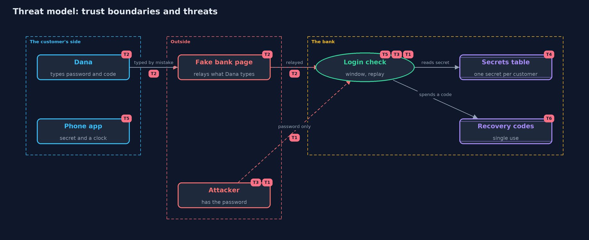

# Threat Model — One-Time Codes (TOTP)

A threat model answers four questions: what are we protecting, who or what could harm it, how, and what do we do about it. This one covers this project's own demo system, not a production deployment. Domain: an online bank.

## Scope

The second factor of an online bank's login: the shared secret, the code made from it, the bank's check with its window and
its replay memory, and recovery codes. It covers an attacker who has the password, one who watches a code, one who runs a fake bank
page, and one who steals the bank's table. It does not cover how the password is checked or stored, or hardware security keys.

## What we protect (assets)

- Customers' accounts, and the money behind them.
- The shared secret held by each phone and by the bank.
- The recovery codes issued to each customer.
- The bank's record of the last accepted step.

## Who and what acts on the system

- Dana, the customer, with her phone.
- An attacker who has Dana's password but not her phone.
- An observer who sees a code as it is typed.
- A fake bank page that relays what the customer types.
- An attacker who copies the bank's table of secrets.

## Trust boundaries

A trust boundary is a line that data or a request crosses between parts that trust each other differently. Threats cluster where those lines are.

- Customer to bank: the password and the code cross the internet.
- Phone to customer: the code is shown on a screen, and can be seen.
- Bank to its table of secrets: the secret must be readable by the bank to check codes.

Each dashed box is a trust boundary. A rose tag such as T1 shows where the threat of that number, in the table below, applies.

## Threats, using STRIDE

STRIDE is a checklist of six kinds of threat: **Spoofing** (S), **Tampering** (T), **Repudiation** (R), **Information disclosure** (I), **Denial of service** (D), **Elevation of privilege** (E).

| Id | Kind | Threat | Where it shows up | Control in this project | What is left |
| --- | --- | --- | --- | --- | --- |
| T1 | Spoofing | An attacker with a leaked password logs in | `MfaServer.login` | A second factor: the right password alone gets CODE_NEEDED | An attacker who also has the phone, or a relayed code, still gets in |
| T2 | Spoofing | A fake bank page collects the password and code and relays them at once | the customer's browser | None in TOTP: the code cannot tell the real bank from a copy | Hardware security keys, which check the site's identity, are the answer |
| T3 | Spoofing | Someone sees a code as it is typed and uses it again | `MfaServer.login` with replay protection | The server remembers the last accepted step and refuses it again | The observer can still use it first, if they are faster than Dana |
| T4 | Information disclosure | The table of secrets is stolen, so every customer's codes can be made | `MfaServer.stolenSecrets` | None in the demo | Store secrets encrypted with a key kept apart, and limit who can read the table |
| T5 | Denial of service | A phone's clock is wrong, so the right code is refused, or a wide window gives an attacker more chances | the window in `MfaServer` | A window of one step either side forgives 30 seconds of drift | A phone more than a step out is refused; a wider window accepts more codes |
| T6 | Elevation of privilege | A recovery code is stolen and used instead of the phone | `MfaServer.loginWithRecoveryCode` | Each recovery code works once, and the password is still required | An unused code is a standing second way in and must be guarded like a password |

## Assumptions

- The channel is protected with TLS, so codes are not read in transit.
- The phone is not itself compromised.
- The bank's clock is correct, and phones are within a few seconds of it.
- The demo's secret is public (the RFC's test key) and the table is in memory. Real secrets are random and stored encrypted.

## Out of scope

- Limits on wrong codes: the password-attacks project covers lockouts and rate limits.
- Phishing-resistant factors such as hardware security keys and WebAuthn.
- SIM swaps, because this is not an SMS code.

## How the tests check this

- `HotpTest`, `TotpTest` and `Base32Test` check the code, in the standard library, against the published values of RFC 4226, 6238 and 4648.
- `MfaServerTest` checks the window, replay protection, recovery codes, and the server's holding of the secret.
- `AuthenticatorTest` checks that a fast phone shows a later step's code.
- `DemoRunsTest` compares the whole demo with the golden output.

## Where this model goes next

The cryptography module comes next, starting with hashing and integrity: HMAC, the keyed hash used here, is a central part of it.
