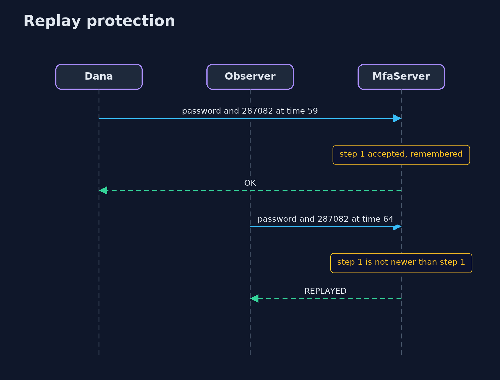
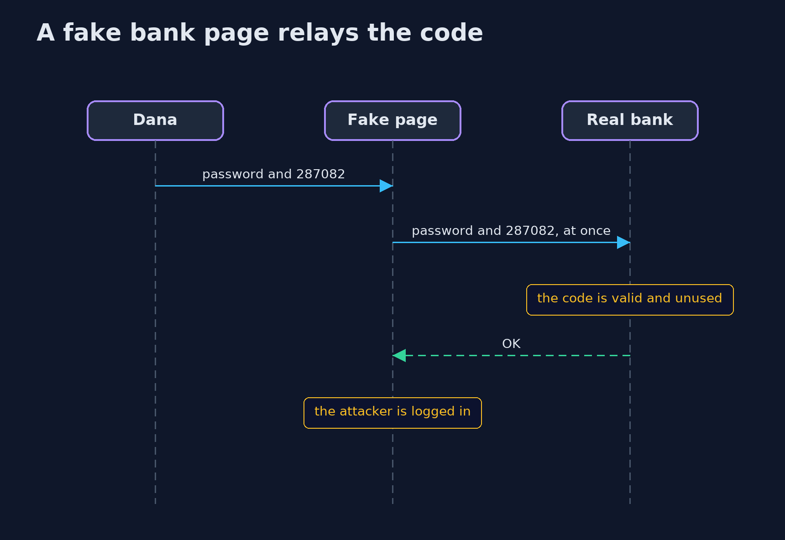

# One-Time Codes (TOTP) — UML Sequence Diagrams

## 1. Replay protection

The server remembers the last step it accepted, and refuses that step again.

## 2. A fake bank page relays the code

The fake page cannot make a code, but it can pass on one that Dana typed, within its 30 seconds.

