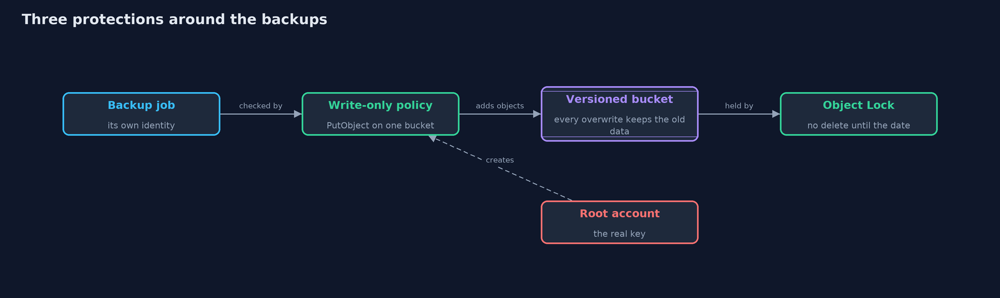
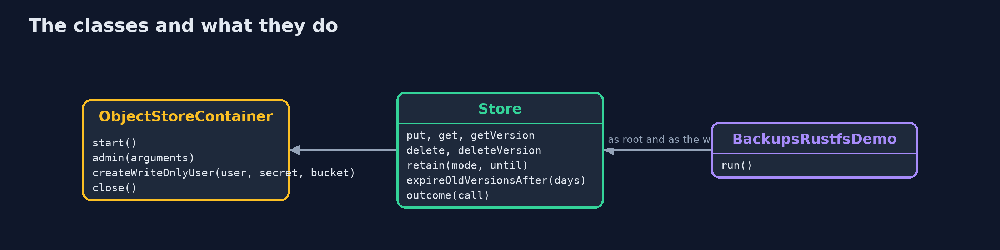
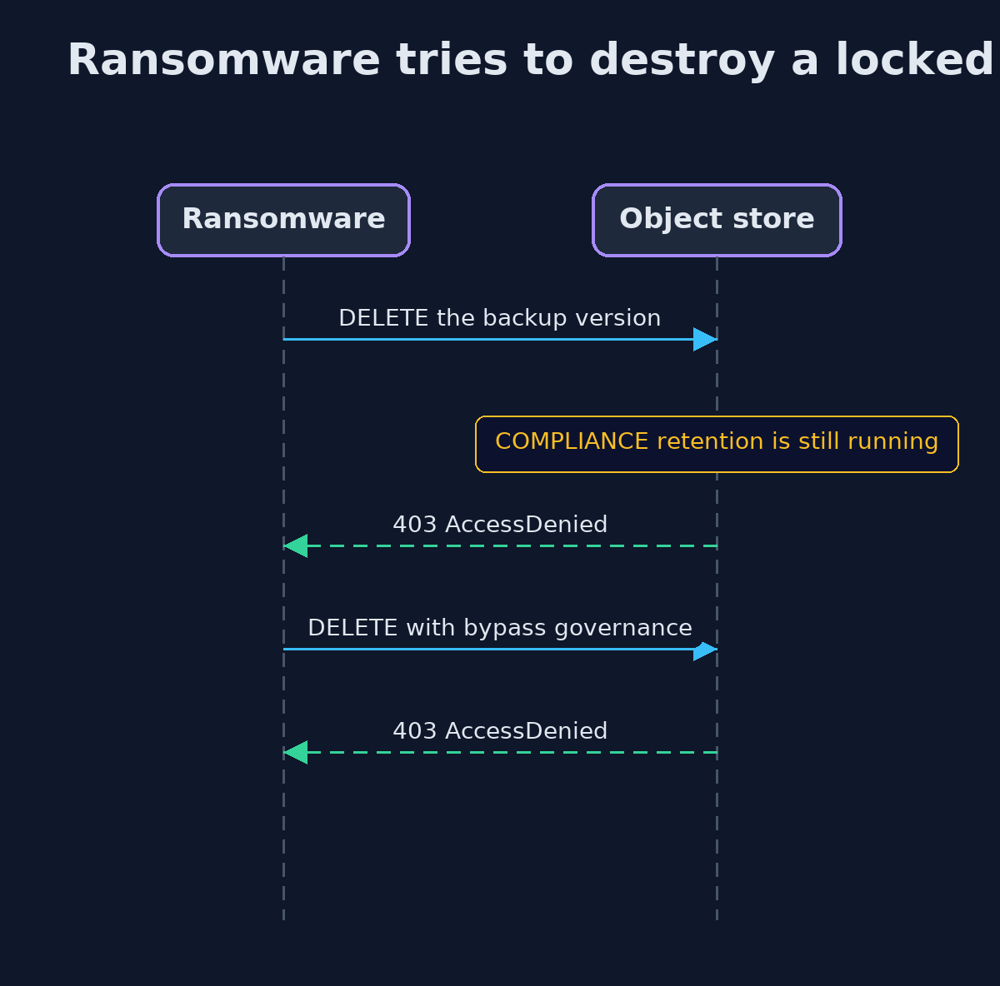

# Backups and Recovery with RustFS, an S3-Compatible Object Store

```
src/main/java/com/jk/explore/security/backupsrustfs/
├── BackupsRustfsDemo.java     Runs the online store story in five numbered acts against a real object store in Docker, and prints exact, repeatable results
├── ObjectStoreContainer.java  A local S3-compatible object store in Docker, and the admin tool that creates users and policies in it
└── Store.java                 A thin S3 client for one identity: every call in the demo is made as a particular user, so what each user may do is visible
```

**An S3-compatible object store gives backups three protections that a plain folder cannot: versions that survive an overwrite, locks that survive even the root account, and a write-only identity for the backup job, at the price of storage and a lock that cannot be undone.**

The plain version of this lesson kept backups in folders and simulated the ransomware. Real backups usually go to **object storage**: a service that stores objects (files with a name) in buckets and speaks the **S3** API, which Amazon S3,
RustFS and many others share. Three of its features matter for security. **Versioning** keeps the old data when an object is overwritten or deleted. **Object Lock** makes a version impossible to delete until a date, in COMPLIANCE mode even for the root account.
And the store has its own **identities and policies**, so the backup job can be allowed to add objects and nothing else.

The demo runs a real store in Docker and talks to it with the AWS SDK for Java, as the shop, as ransomware and as the backup job.

## The idea in everyday terms

Think of a safe deposit box with a postal slot. The courier can post envelopes through the slot but cannot open the box, read what is inside or take anything out. The box keeps every envelope ever posted, and the bank has promised, in a way that not even the manager can undo,
that nothing posted this month will be destroyed. A thief who steals the courier's key can post junk, and nothing more.

## The scenario

An online store backs up its orders to an object store. Ransomware overwrites the orders file, then looks for the backups to destroy them. The demo shows what versioning, a lock and a write-only identity each stop, how a checksum catches a damaged upload, and what all of it costs.

## Run

```bash
./gradlew run
```

The demo tells the story in 5 acts, each printing exact numbers that the tests check:

| Act | What it shows |
| --- | --- |
| 1. Versioning: an overwrite does not destroy the old data | Ransomware overwrites orders.csv, two versions are kept, the original is restored by writing it back, and a plain delete only adds a marker. |
| 2. Object Lock: nobody can delete a locked version | A COMPLIANCE-locked backup refuses deletion, even with bypass and from the root account, and the retention cannot be shortened; GOVERNANCE can be lifted with a special permission. |
| 3. The backup job gets an identity that can only add objects | The backup job's policy has one action, PutObject: it can write a backup but cannot read, list, delete, delete a version or write to another bucket. |
| 4. A checksum catches a damaged backup | An upload with the right SHA-256 is accepted; one whose bytes do not match the checksum is refused with BadDigest and leaves nothing behind. |
| 5. Keeping history without keeping it for ever, and the cost | A lifecycle rule removes old versions after 30 days; the bill is storage that grows, a lock that cannot be undone, a root account that is the real key, and disks that the lock does not protect. |

## Test

```bash
./gradlew test
```

14 tests in `DemoRunsTest`, `ObjectStoreTest`, `StoreUnitTest`. The ordinary tests need only a JDK (the checksum helper, the outcome wording and the write-only policy). The integration tests and the demo start the real store in Docker and check versioning, both lock modes, the write-only identity, the checksum, the lifecycle rule, and that no container or network is left behind.

## What the simulation got right, and what it left out

The store runs in Docker on your machine and is thrown away after each run, with fixed demo credentials that protect nothing. The demo prints only facts that do not depend on ports, version ids or time. The retention date is a day from the moment of the run, and the demo prints only that the lock refuses.

## Technologies and versions

Every version below is pinned in the project's build files and was the latest stable release when the project was built.

| Technology | Version | Used for |
| --- | --- | --- |
| Java | 25 | the language and runtime; a Gradle toolchain finds or downloads the JDK |
| Gradle | 9.8.1 (wrapper) | build and run; nothing to install, the wrapper downloads it |
| software.amazon.awssdk:s3 | set by the build | library the code uses |
| software.amazon.awssdk:url-connection-client | set by the build | library the code uses |
| org.junit.jupiter:junit-jupiter | 6.1.3, set by junit-bom | JUnit 5: the tests (tests only) |
| org.junit.platform:junit-platform-launcher | 6.1.3, set by junit-bom | JUnit platform launcher, which Gradle needs to run the tests (tests only) |
| RustFS (rustfs/rustfs) | 1.0.2 | the S3-compatible object store that runs in Docker; MinIO's community edition no longer publishes images, and RustFS speaks the same S3 and MinIO-style admin API |
| rc (rustfs/rc) | v0.1.36 | the admin command-line tool that creates the backup user and its policy; the same job `mc` does for MinIO |
| Docker | 24 or later | runs the store and the admin tool; only the integration tests and the demo need it |
| videokit | repository tool (`tools/videokit`) | the narrated video and animation: Piper `en_US-amy-medium`, speed 0.8, longer pauses (the amy-slow voice) |

## Learning Material

| Document | What it is for |
| --- | --- |
| [Dependencies](docs/dependencies.md) | what the framework and infrastructure are, and why they are here |
| [Problem statement](docs/problem-statement.md) | the situation and what the project must show |
| [Prerequisites](docs/prerequisites.md) | what you need to know first |
| [Backups and Recovery with RustFS, an S3-Compatible Object Store, explained](docs/backups-and-recovery-with-rustfs-explained.md) | the acts in prose |
| [Session guide](docs/session.md) | a one-hour lesson with exercises |
| [Animated walkthrough](docs/animation.html) | the acts step by step, narrated |
| [Threat model](docs/threat-model.md) | what is protected, who could harm it, and how, using STRIDE |
| [Spec](docs/spec.md) | what this project must be true of |
| [Expected output](docs/expected-output.txt) | the golden demo output every test and every port checks against |

### The idea in one picture

The job can only add, versions keep the history, and the lock holds the history until a date.



### Where each piece sits

ObjectStoreContainer starts the store and creates the user; Store makes every call as one identity.



### How the data moves

The old data stays as a version until a lifecycle rule or a retention date says otherwise.


### Who calls whom, in order




### Video

`video/backups-and-recovery-with-rustfs-explained.mp4` (with `.m4a` audio and `.srt` subtitles) is built by `video/build_video.sh`. Rendered media is not committed.

## What it costs

- **Storage grows with every version.** Each overwrite keeps the old object in full until a lifecycle rule removes it.
- **A COMPLIANCE lock cannot be undone.** A wrong retention date is paid for in storage until it ends, and nobody, including you, can shorten it.
- **The root account is the real key.** Whoever holds it can create users and change policies, so it stays out of daily use and under its own protection.
- **The lock stops the API, not the disks.** Someone who can delete the storage underneath, or the whole account, still wins, so keep a copy somewhere else too.
- **It needs Docker for the lab.** The demo starts a store in a container, so it runs only where Docker is available.

## When this is too much

For a small shop, a versioned bucket with a write-only backup identity and a lifecycle rule is a large gain for little work. Object Lock in COMPLIANCE mode is for backups whose loss would end the business, and a short retention is a sensible way to start.

## Where you have already met this

- Amazon S3 Versioning and Object Lock, Azure immutable blob storage, Google Cloud bucket lock.
- Backup tools such as restic and Veeam, which can write to S3 buckets with locks.
- The advice "keep an immutable copy" in every ransomware guide.
- RustFS, Ceph and other S3-compatible stores in on-premises and home-lab backups.

## Where this sits

This project follows [backups-and-recovery](../backups-and-recovery) and is the third project in [safe-habits](..), after [least-privilege](../least-privilege): the write-only backup identity is least privilege applied to a real service.
