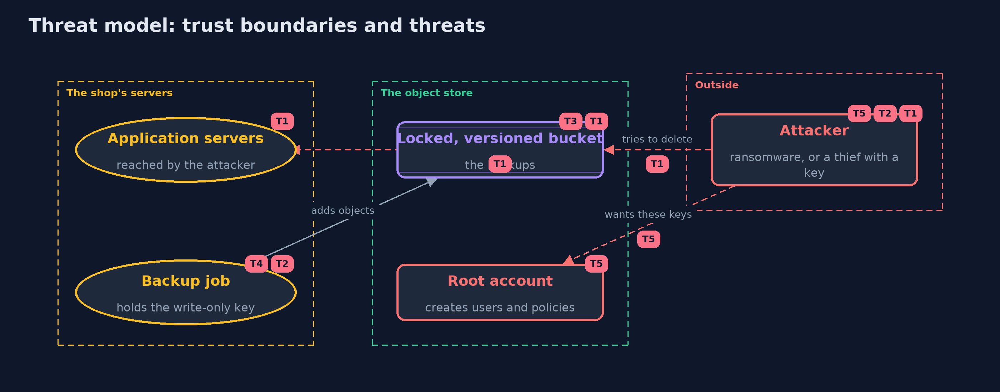

# Threat Model — Backups and Recovery with RustFS, an S3-Compatible Object Store

A threat model answers four questions: what are we protecting, who or what could harm it, how, and what do we do about it. This one covers this project's own demo system, not a production deployment. Domain: an online store.

## Scope

The backups of an online store held in an S3-compatible object store: the objects and their versions, the locks, the identity that writes backups, and the root account. It covers ransomware on the application servers and a thief who steals a key.
It does not cover the store's disks, the network between the servers and the store, or the contents of the backups.

## What we protect (assets)

- The backup objects and their older versions.
- The write-only key of the backup job.
- The root credentials of the store.
- The retention settings.

## Who and what acts on the system

- The shop's application and backup job.
- Ransomware running with the application's rights.
- A thief who has stolen the backup job's key.
- An administrator who holds the root account.

## Trust boundaries

A trust boundary is a line that data or a request crosses between parts that trust each other differently. Threats cluster where those lines are.

- Application servers to the object store: only the write-only identity crosses it.
- The backup identity to the root account: the root account can change any policy.

Each dashed box is a trust boundary. A rose tag such as T1 shows where the threat of that number, in the table below, applies.

## Threats, using STRIDE

STRIDE is a checklist of six kinds of threat: **Spoofing** (S), **Tampering** (T), **Repudiation** (R), **Information disclosure** (I), **Denial of service** (D), **Elevation of privilege** (E).

| Id | Kind | Threat | Where it shows up | Control in this project | What is left |
| --- | --- | --- | --- | --- | --- |
| T1 | Tampering | Ransomware overwrites or deletes the backups using the application's access | the bucket | Versioning keeps the old data, and Object Lock refuses deletes of locked versions | Versions cost storage, and a lock protects only until its date |
| T2 | Elevation of privilege | A thief with the backup job's key reads or destroys the backups | `ObjectStoreContainer.createWriteOnlyUser` | The policy has one action, PutObject, on one bucket | The thief can still add junk, so quotas and alerts on unusual uploads are needed |
| T3 | Tampering | A backup is damaged in transit or at upload | `Store.put` | A SHA-256 checksum is sent and verified by the store | Only a restore test shows that the backup is usable |
| T4 | Repudiation | Nobody can say who uploaded or removed a backup | the backup job | A separate identity for the job makes its actions attributable | Audit logging of the store has to be switched on and kept elsewhere |
| T5 | Elevation of privilege | The root account is stolen, and policies, users and governance locks are changed | the root account | COMPLIANCE locks cannot be lifted even by the root account | GOVERNANCE locks can, new users can be added, and the store's disks are outside the lock, so keep the root credentials out of daily use and keep a copy elsewhere |

## Assumptions

- The root credentials are kept out of the application servers.
- The store's disks and the account itself are not attacked.
- In the demo, the store is local and its credentials are fixed demo values.

## Out of scope

- Replication to another site or provider.
- Encryption keys and key management.
- The correctness of the backup's contents: the plain project's restore test.

## How the tests check this

- `ObjectStoreTest` (integration, Docker) checks versions, delete markers, both lock modes, the write-only identity, checksums, the lifecycle rule, and that nothing is left running.
- `StoreUnitTest` checks the SHA-256 helper against the published value, the wording of refusals, and that the policy has one action.
- `DemoRunsTest` (integration) compares the whole demo with the golden output.

## Where this model goes next

The safe-habits module is finished with this project. The track continues with the tool versions of the earlier projects and then the intermediate level.
