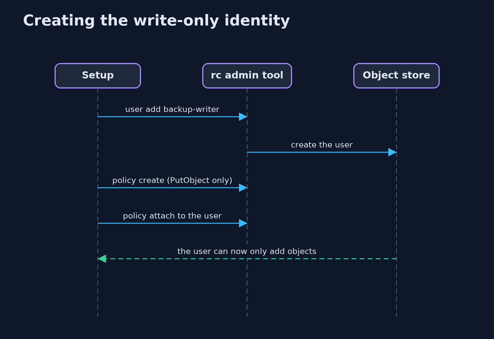
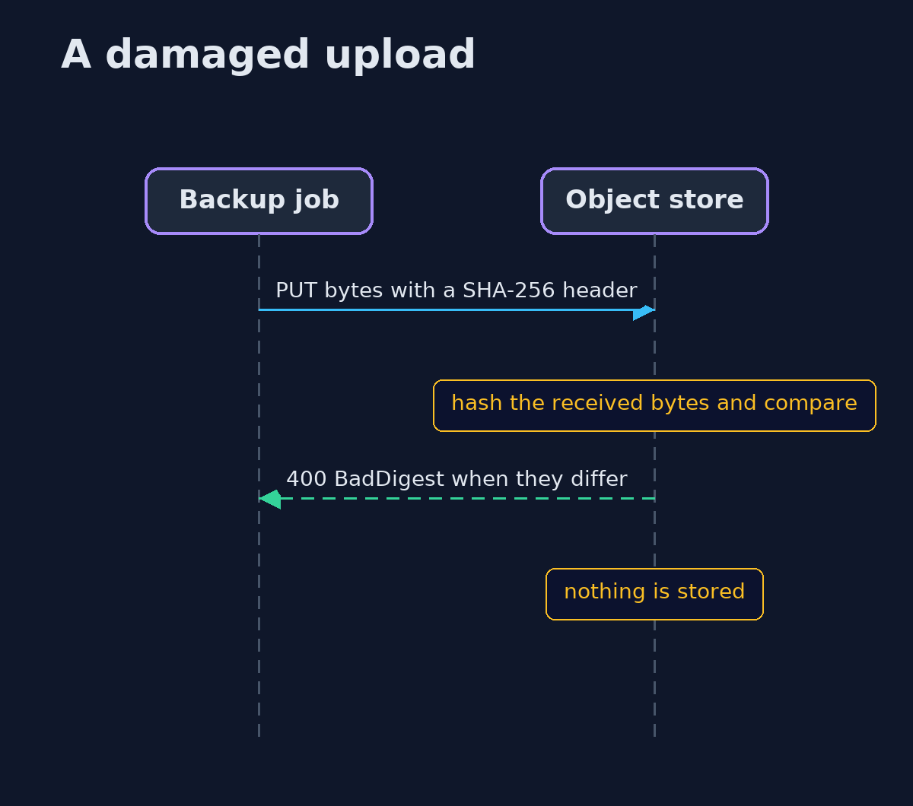

# Backups and Recovery with RustFS, an S3-Compatible Object Store — UML Sequence Diagrams

## 1. Creating the write-only identity

The admin tool creates the user, the policy and the attachment, as the root account.

## 2. A damaged upload

The store hashes what it receives and compares it with the checksum sent.

